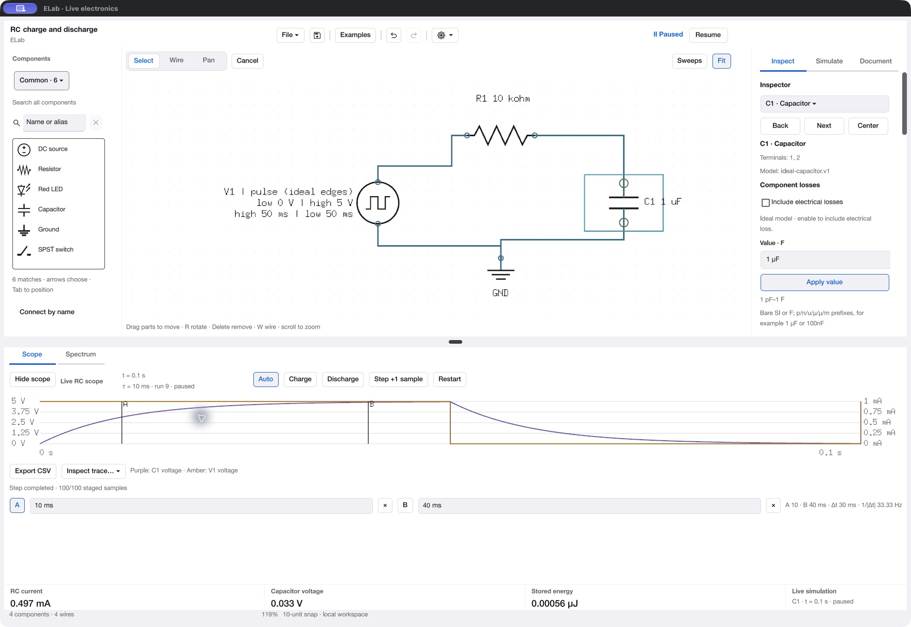
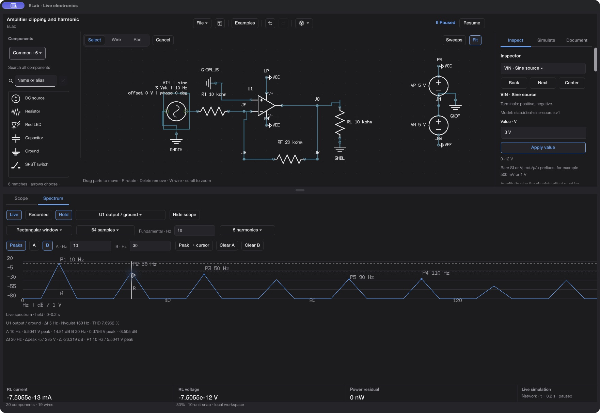
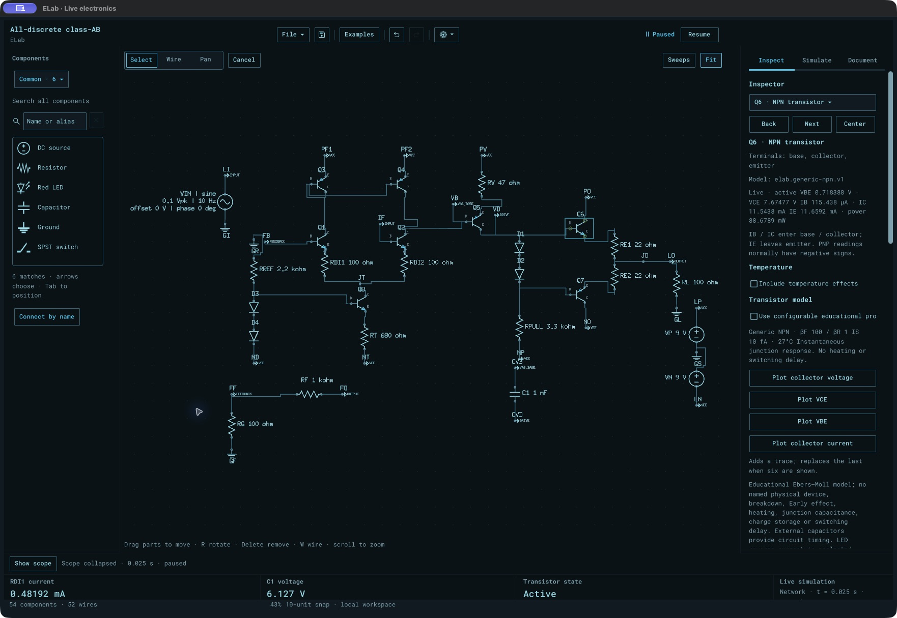

# ELab

**Draw a circuit. Watch it work. Measure what changes.**

ELab is a hobbyist electronics workbench built with [Vellum](https://github.com/dshills/vellum).
Build schematics from scratch, change component values, and explore live voltage,
current and timing. The desktop app and AI agents use the same validated commands
for drawing, simulation, analysis, saving and export.

**Current source: 87 working examples · 61 component kinds · 226 shared commands.**



*RC charge and discharge: edit the circuit above, inspect the waveforms below.*

## What you can do

- **Draw and edit schematics.** Search components by name or hobbyist alias,
  browse Common or topic categories, preview a snapped component before placing
  it, and connect named terminals. Move or rotate parts with their wires attached.
  Use junctions, net labels, keyboard shortcuts, Undo/Redo and reusable circuit blocks.
- **Simulate as you build.** Watch supported analog and digital circuits evolve;
  pause, restart or step to an exact simulated time. Inspect signed voltage/current,
  transistor operating states, stored energy, motor speed and other device readings.
- **Measure in time and frequency.** Switch between Scope and Spectrum using the
  same selected probes. Inspect timing cursors, live FFT, ranked peak markers and
  A/B frequency/amplitude cursors. Hold a spectrum while simulation continues.
- **Run experiments.** Capture an independent Verify run, compare recordings,
  measure intervals and threshold timing, and explore DC sweeps, AC/Bode response,
  harmonic distortion, small-signal noise, tolerances and feedback response.
- **Keep and share your work.** Save `.elab` projects with supported model settings
  and kept recordings. Export schematics as SVG, PNG or PDF, preview and print
  pages, and export measurements as CSV or JSON. Recovery and unsaved-work
  protection help preserve edits.
- **Work with agents.** Discover commands and schemas, inspect circuit state,
  preview atomic edits, apply guarded changes, and observe jobs/events through
  headless stdio or a private local connection to the running desktop app.
- **Choose your workspace.** Light, Dark, System and Apollo themes, native macOS
  menus, a searchable component browser, Inspect/Simulate/Document panels, and an
  adjustable schematic/instrument split.

See the [drawing workflow](docs/workbench-workflows.md),
[component browser](docs/component-browser.md), [workspace](docs/workspace-layout.md)
and [shared command guide](docs/agent-api.md).

## Scope and Spectrum

The **Scope** plots up to six selected voltage/current channels. Place A/B cursors
by clicking, dragging or entering times; inspect timing differences, interval
statistics and recorded experiments without changing the live circuit.

The **Spectrum** tab reuses those probes for live FFT or a separately captured
recording. It offers window/sample controls, a declared fundamental, harmonic
measurements and THD when the sample interval supports them. The newest additions
are **P1–P5 peak markers** and **A/B frequency/amplitude cursors**, with frequency,
peak-amplitude and dB differences. Cursor frequencies snap to actual FFT bins;
controls stay in place as frames arrive.



*Clipped-amplifier output: the held live FFT shows the fundamental and harmonics.
A/B cursors compare the 10 Hz and 30 Hz bins.*

[Scope/probes](docs/scope-probes.md) · [Spectrum and cursor commands](docs/spectrum-analysis.md) ·
[Recorded measurements](docs/interval-measurements.md) · [AC sweeps](docs/ac-frequency-sweeps.md)

## Electronics library

| Area | Components and capabilities |
| --- | --- |
| Sources and power | DC, sine and pulse sources; current sources, electronic loads, batteries with charge/sag, rectifiers and voltage regulators |
| Passive circuits | Resistors, potentiometers, capacitors and inductors; optional losses; transformers and coupled inductors |
| Semiconductors | LEDs, silicon/Schottky/Zener diodes, NPN/PNP BJTs, N/P MOSFETs, JFETs, SCRs, TRIACs, optocouplers and photodiodes |
| Analog and timing | Powered op-amps, comparators with hysteresis, 555 timers, configurable transistor profiles, temperature effects and self-heating |
| Digital | Basic gates, flip-flops, counters, BCD decoding and seven-segment displays |
| Interaction and sensors | Switches, momentary pushbuttons with bounce, thermistors, light-dependent resistors, temperature/light controls and debounce experiments |
| Motion and loads | DC motors, PWM and H-bridge forward/reverse/brake/coast control, relays with flyback experiments, loudspeaker electrical loads and explicit audio preview |
| Schematic helpers | Grounds, junctions, named nets, pinned live readings and reusable circuit blocks |

Models have explicit supported domains and work limits. The current envelope is
**64 simulated parts, 100 electrical nodes, 100 drawing objects and 300 wires**,
with device-specific bounds, including **16 combined NPN/PNP transistors**.
See [circuit capacity](docs/circuit-capacity.md), [electronics models](docs/hobbyist-devices.md)
and [numerical qualification](docs/numerical-qualification.md).

### From a first LED to a discrete amplifier

Open **Examples** to browse topic categories, search across all 87 circuits, and
see schematic previews, a question to explore, an experiment and model limits.
Opening an example retains Save/Discard/Cancel protection for your current work.

Good starting points:

| Example | Try this |
| --- | --- |
| LED current limiter | Change resistance and compare current and illustrative brightness. |
| RC charge and discharge | Change capacitance, watch the time constant and measure with cursors. |
| Capacitor-timed LED flasher | Compare the two transistor/LED branches and their switching times. |
| Amplifier clipping and harmonic distortion | Reduce input amplitude, then compare the waveform, harmonics and THD. |
| Reversible PWM motor driver | Compare forward/reverse drive, PWM, braking and coasting. |
| All-discrete class-AB amplifier | Inspect a differential pair, current mirror, gain stage and complementary output. |



*The class-AB example uses eight BJTs and 27 simulated parts, with no op-amp
component. Apollo gives the workspace its cyan instrument-console appearance.*

[Example browser](docs/example-browser.md) · [Discrete amplifier](docs/discrete-class-ab.md) ·
[Motor driver](docs/hbridge.md) · [Themes](docs/appearance.md)

## Build and run

The desktop target is **macOS on Apple Silicon**. Packaged candidates have been
tested on macOS 26.x. The portable Go simulation core and headless agent do not
require Vellum, a window system or a GPU.

For the desktop build, install **Go 1.25.6 or newer**, **Python 3.10 or newer** and
**Xcode Command Line Tools**, then run:

```sh
git clone https://github.com/dshills/ELab.git
cd ELab
./scripts/build.sh
./build/elab
```

The build verifies and extracts the repository's pinned Vellum SDK and its
compatibility patches. A sibling Vellum checkout is not required. If invoking
native Go tools directly, run `python3 scripts/prepare-vellum.py` first.
See [the SDK pin and preparation details](third_party/vellum/README.md).

Start with **Examples → LED current limiter** or **RC charge and discharge**.
To build from blank, select a component from the left browser, place it on the
sheet, then choose **Wire** and click terminal dots. Select a part to edit values
such as `2.2k Ω` or `1 µF` in Inspect.

With the canvas focused: **W** Wire, **V** Select, **H** Pan, **R** Rotate,
**Delete** remove, and **Escape / Cancel** end an unfinished gesture.
**Cmd+Z / Cmd+Shift+Z** undo/redo when a text editor does not consume the shortcut.
**Fit** follows the actual schematic workspace as it resizes.

For a local double-clickable development bundle after building:

```sh
python3 -B scripts/package_app.py --binary build/elab \
  --output build/ELab-local/ELab.app --version 0.0.0 --build-version 1
```

Use a new output path for each bundle. This produces an unsigned/ad-hoc local
build, not a Developer ID signed or notarized installer. Historical local package
paths in validation records are not GitHub downloads. Build this source to get
the newest peak/cursor functionality.

The [current local unsigned release](docs/current-release.md) documents the
matching app/agent archive, checksum and qualification limits.

## Use an AI agent

Run a headless session:

```sh
go run ./cmd/elab-agent
```

Send one JSON request per line; receive one JSON response per line. For example:

```json
{"version":1,"id":"catalog","command":"capabilities.list","params":{}}
{"version":1,"id":"inspect","command":"project.inspect","params":{}}
```

Agents can discover detailed input schemas, component/model limits, command
preconditions and asynchronous job outcomes. Mutations carry an observed
revision and a retry key; document guards protect against stale work. Drawing,
measurement and analysis use the same service as the desktop controls.

To let an external agent work with a desktop session:

```sh
./build/elab --agent-endpoint "$PWD/build/session.endpoint.json"
```

In another terminal:

```sh
./build/elab-agent --connect build/session.endpoint.json
```

Use a new descriptor path. The descriptor is a private local credential; keep it
out of shared files and logs. Normal shutdown removes it. Persistent headless
socket sessions are also supported through `elab-agent --listen`.

[Agent protocol](docs/agent-api.md) · [Command discovery](docs/capability-details.md) ·
[Events](docs/events.md) · [User/agent conformance](docs/agent-conformance.md)

## Development and checks

```sh
# Portable core, protocol and tooling checks
ELAB_QUALITY_PROFILE=portable ./scripts/check.sh

# Complete macOS checks, including native and rendered UI suites
./scripts/check.sh

# Build and run the native drawing/simulation smoke harness
./scripts/build.sh
./build/elab --smoke --smoke-timeout 2m
```

The quality runner checks formatting/imports, Staticcheck, Python tooling,
Go vet and race tests. Electrical tests cover reference values, conservation,
transients and guarded failures; integration tests cover shared commands,
persistence, retries, background work and UI/agent parity.

The [latest spectrum measurement review and test evidence](docs/validation/spectrum-markers-20261028/README.md)
records the peak/cursor implementation. Native OS-input, clean-account install,
participant usability and signing/notarization gates remain separately recorded;
passing software tests do not close them.

| Code | Responsibility |
| --- | --- |
| `workbench/` | Circuit graphs, electrical models/solvers, shared command service and analysis jobs |
| `desktop/` | Vellum macOS workspace, schematic/scope/spectrum rendering and command bindings |
| `transport/` and `cmd/elab-agent/` | Headless JSON protocol and private local desktop connections |
| `cmd/elab-conformance/` | Cross-adapter workflow/electrical checks |
| `scripts/` | Builds, quality gates, examples, packaging and qualification tools |
| `docs/` and `research/` | User/API guides, engineering evidence and product research |

[Architecture](docs/architecture.md) · [Release checklist](docs/v1-release-checklist.md) ·
[Product requirements](research/07-product-requirements.md)

ELab is an actively developed educational simulator. Component models are
illustrative rather than manufacturer-qualified hardware models. Each device
and analysis guide describes its assumptions and limits. Audio playback is
explicit; opening or simulating a circuit stays silent.
