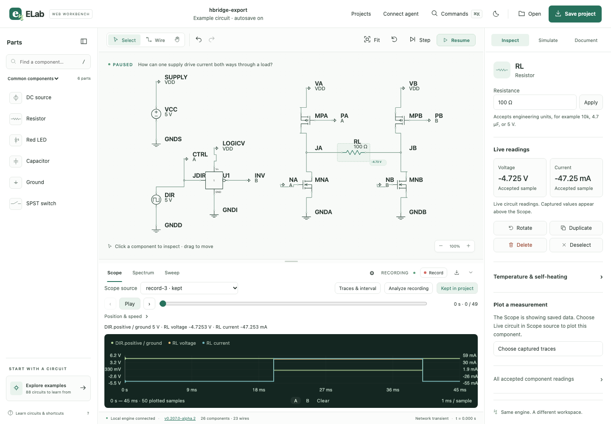

# ELab

**Draw a circuit. Watch it work. Measure what changes.**

ELab is a local web electronics workbench. The browser interface is the primary
application; its Go host runs the shared solver, models, guarded commands,
recordings and project storage. No account, cloud service, frontend build or Node
installation is needed to run the app.

**89 examples · 61 component kinds · 242 shared commands.**

[Download the macOS web alpha](https://github.com/dshills/ELab/releases/tag/v0.207.0-alpha.2)
— Apple Silicon, ad-hoc signed. See the release's first-use guide and qualification scope.



## Run

Use the Go version declared in `go.mod`, then run from the repository root:

```sh
go run .
```

Open <http://localhost:8788> to load the styled workbench and connect to the
simulation engine. Stop with Control-C. For a standalone executable with the
frontend embedded, or the accompanying agent/conformance tools:

```sh
go build -o build/elab .
./build/elab
# Or build all three maintained executables:
./scripts/build.sh
```

`--dev` serves `static/` directly; reload the browser after editing assets.
`--addr 127.0.0.1:8789` selects another loopback port. `--data-dir /path/to/library`
selects a separate library; only one host may write each library at a time.

The library location remains unchanged: the platform's user configuration
folder plus `ELab/web` (macOS: `~/Library/Application Support/ELab/web`). Edits
checkpoint locally; **Save project** creates a named project. **Projects** offers
recovery copies and reversible Trash. Version 1–5 `.elab` projects open on Main.
Projects with child sheets use version 6 of the `.elab` format. See the
[workbench guide](docs/web-workbench.md) and [project format](docs/project-format.md).

On macOS, the self-contained **ELab Web.app** starts the host and opens the default
browser. Build a local package with Xcode command-line tools and Go:

```sh
python3 -B scripts/package_web.py --output 'build/local/ELab Web.app' \
  --version 0.207.0-dev --build-version 315 \
  --archive build/local/ELab-Web-dev-macos-arm64.zip
```

The launcher is a small platform wrapper around this same web app. Packaging uses
macOS system tools and does not require Vellum. Distribution signing and OS
acceptance scope are recorded with each candidate's qualification.
The [Developer ID distribution guide](docs/macos-distribution.md) covers
notarization, stapled tickets, Gatekeeper and exact-archive installation checks.

## Workbench

New to electronics? Open **Learn circuits & shortcuts** for guided LED, capacitor
and H-bridge activities with units and expected results explained along the way.

- Draw, wire, move, rotate and duplicate parts; use net labels, junctions, circuit
  blocks, box selection, group move/copy/duplicate, undo/redo and keyboard placement.
- Organize a circuit into sheets connected by named ports, reuse linked designs,
  and find parts and signals across the project.
- Simulate up to 128 parts and 200 electrical nodes across all sheets. Try **Two
  MOSFET H-bridges on one supply** to see two loads reverse independently.
- Inspect live voltage/current and device settings; pause, restart or step the
  same Go simulation used by agents.
- Capture and retain experiments, seek exact samples, compare recordings, measure
  thresholds/settling, inspect FFT/THD and run DC/AC/noise/loop sweeps or tolerances.
- Save/import/export `.elab` projects and complete measurement data. Export SVG,
  CSV/JSON and WAV; macOS also provides PDF/PNG rendering. Browser Print supports
  schematic print previews.
- Back up the whole project/recovery library and restore copies, including Trash,
  unsaved work and kept results. See [library backups](docs/library-backups.md).
- Use Light, Dark, System or Apollo appearance, resizable panels, direct simulation
  settings and accessible keyboard controls.

[Workbench guide](docs/web-workbench.md) · [Feature coverage](docs/web-parity.md) ·
[Dual H-bridge walkthrough](docs/hbridge.md#two-mosfet-h-bridges-on-one-supply) · [Models and limits](docs/hobbyist-devices.md) ·
[Circuit capacity](docs/circuit-capacity.md)

The large-circuit features above are available when running the current source.
For the scope of the downloadable build 314 alpha, see the [release record](docs/current-release.md).

## Agents

The headless JSON/MCP adapters retain the shared Go workbench and numerical
behavior. Build `cmd/elab-agent`, then run `./build/elab-agent --mcp` or print a
client configuration with `./build/elab-agent --mcp-config`.

Choose **Connect agent** in the web workbench to enable MCP access to that exact
visible workspace and copy its client configuration. Edits share revision guards,
undo history and autosave; disconnect revokes the connection immediately.
Headless agents and private socket hosts remain independent alternatives. See
[agent setup](docs/agent-setup.md) and the [command API](docs/agent-api.md).

## Development and checks

```sh
./scripts/check.sh
# Explicit profiles:
python3 -B scripts/quality.py --profile portable --artifacts build/quality-portable
python3 -B scripts/quality.py --profile macos --artifacts build/quality-macos
```

Quality output directories must be new. Both profiles retain the complete Go
race suite and vet, frontend logic tests, Python tooling tests and lint. macOS
also builds a package, checks an OS-extracted archive, and tests its copied host
and restart recovery without launching a GUI. The default profile follows the OS.

[Browser qualification](browser/README.md) runs real Chromium, Firefox and WebKit
journeys in CI. Its locked npm dependencies are for testing only.

| Path | Responsibility |
| --- | --- |
| Root `*.go`, `static/` | Web host, persistence, embedded frontend and tests |
| `workbench/` | Shared circuit models, solver, commands, measurements and storage contracts |
| `cmd/`, `transport/`, `internal/` | Agent/conformance adapters and shared platform services |
| `browser/` | Browser test dependencies and end-to-end journeys |
| `launcher/macos/` | Small macOS web-host launcher |
| `scripts/`, `tools/` | Builds, packaging, quality tools and headless API examples |
| `docs/`, `research/` | Guides, qualification history and research |

The former Vellum UI, SDK and native-only test/build tools are preserved in the
Git tag **`archive/native-ui-2026-11-03`** and removed from the active tree.
[Restore the archived native source](docs/native-archive.md). Qualified release
artifacts remain preserved. Historical validation documents describe their
recorded revisions; they are not instructions for building the current UI.

ELab is an educational simulator. Device guides describe supported domains,
numerical limits and model assumptions; the models are not calibrated physical
parts. Audio playback is explicit.
