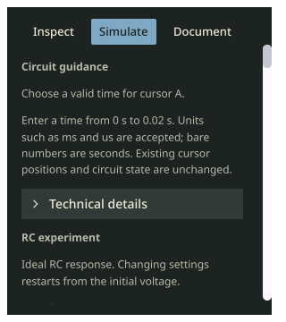

# Apollo blue button accents

The owner requested more blue in the Apollo controls after trying /224.
Apollo now uses muted blue (#7EA8C4) for selected buttons and accent styling.
The gray-green panels, cream ink, coral warnings, control geometry and
independently colored amber scope traces are unchanged. No command, persistence,
circuit or simulation behavior changes.

[Focused checks](quality.txt) pass: lint/staticcheck, native source inventory,
theme/user/agent/menu parity, saved preference restoration, text contrast and
mounted Apollo disclosure/window-background paint checks. The inventory update
changes only desktop/theme.go's source hash; every route and public command
remains identical. The original [full Apollo validation](../apollo-theme/README.md)
is preserved; no redundant full suite or new OS/native acceptance is claimed.

The local /225 development bundle is separate from /224 and the preserved /205
release. The running owner app and its circuit are left open.
