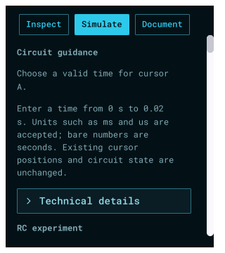

# Apollo instrument-console reference

The owner supplied an attached PlainCAD screenshot in the conversation, clarifying the
intended theme as near-black blue panels, cyan lettering and outlined controls,
compact monospace labels, and bright selected controls. Apollo now uses that
visual language within ELab's existing schematic and inspector layout. The
reference's CAD features and text are visual content, not requested ELab features.
The original screenshot was no longer present at its supplied Downloads path
when archiving, so the conversation attachment remains the visual reference.

Roboto Mono is already bundled with the UI runtime. Apollo controls have thin
cyan outlines and one-unit corners; selected controls have a bright cyan fill
and dark lettering. Browser symbols/rows, panel surfaces, schematic grid and
readings follow the session palette. Independent scope signal colors and coral
warnings remain available. Light, Dark and System retain their existing styling.

[Focused checks](focused.txt) pass lint/staticcheck, source-route audit, shared
theme/menu/agent preference checks, persistence, contrast, component symbols and
mounted disclosure/guidance/navigation/window/footer checks. Apollo was added to
the narrow task-page and long-footer fixtures. Text contrast is at least 4.5:1
and control-outline contrast at least 3:1 on both panel surfaces. Glyph checking
now measures coverage against the actual session ink rather than assuming white
text. [Full desktop race and normal/offscreen vet](desktop-quality.txt) pass.

The [inventory review](inventory-review.json) preserves all source routes and
public commands; only the two styling-source hashes and site line numbers change.
No electrical model, public command, file format or input handler is added.

These captures qualify rendered panel styling and the tested layout/interaction
paths. Packaged-app visual observation is recorded separately when available;
this does not close the four historical native acceptance items or promote the
preserved /205 release. Existing owner app sessions and projects stay open.
