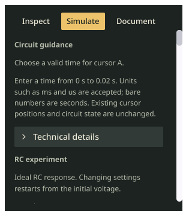

# Apollo theme

Apollo is a built-in appearance preset with gray-green panels, cream labels,
amber selections, coral warnings and 2-unit control corners. The existing
Light, Dark and System palettes retain their colors and 5-unit corners.
The [design and usage](../../appearance.md) describe the command-module inspiration.

Users select Apollo in the header theme menu or native Appearance menu. Agents
use `appearance.theme.set {"theme":"apollo"}`. Both share the same validator,
discovery schema and independent saved-preference store. Theme changes preserve
the circuit, simulation, dirty state and history; replacing a project keeps the
selected theme. Fresh sessions restore a configured Apollo preference.

The [full quality log](quality.txt) passes lint/staticcheck, 67 Python checks,
root/desktop race tests and vet, mounted-control race checks and offscreen vet.
Added checks cover public discovery, saved restoration, user/agent/menu parity,
existing-theme restoration and minimum 4.5:1 text contrast on both panel surfaces.
Mounted checks inspect actual disclosure surface/glyph pixels, exercise expansion
and verify root-edge color without moving content. The [receipt](report.json)
records the changed-file hashes and scope.

The [first gate](initial-inventory-quality.txt) caught the missing native audit
alias. The [inventory review](inventory-review.json) confirms the new alias targets
the existing public theme command. Only its menu-group and registration
declarations change; public commands and all unrelated source routes are preserved.

This is an offscreen inspector capture, not a new macOS window acceptance test.
No existing app is launched, replaced or closed. A separately built local
development candidate does not promote or replace the preserved release.
