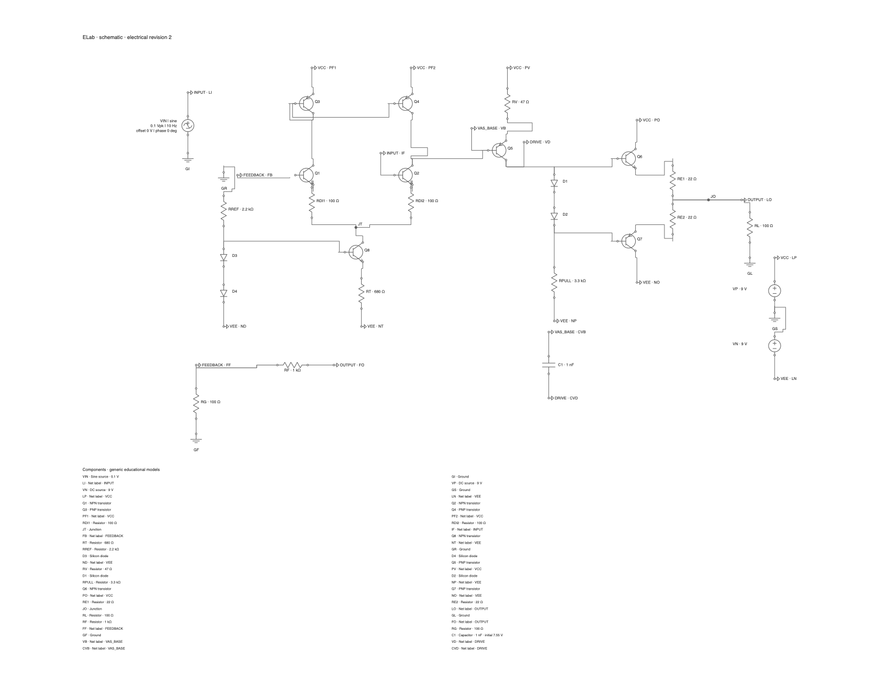

# All-discrete class-AB amplifier qualification

October 27, 2026. Runnable candidate **ELab 0.197.0 /275** is
[available here](../../../build/ELab-0.197.0-275-Discrete/ELab.app).
Clean binary source: `4e79a78c057ba76b6cc7bc74e5bb7e804334d428`. The matching agent and **63**
example projects accompany the app. This is the existing unsigned/ad-hoc channel;
no prior qualified download is replaced or promoted. No push or upload.

The combined NPN/PNP budget rises from **2 to 16**, including embedded
optocoupler phototransistors. The new **eight-BJT** example includes differential
input, PNP mirror, tail sink, voltage gain, biased complementary output and
feedback; it contains no op-amp. It has 27 simulated parts and 20 nodes.
Other capacities, electrical models, file format, tolerances and integration
work guards remain unchanged. [User/agent guide](../../discrete-class-ab.md),
[package identities](package.json), [summary](summary.json).

## Electrical and shared-command coverage

Independent scalar equations check the 0.985326 mA tail and all-NPN/all-PNP/mixed
16-device load lines. Tests check mirror base-current loading, DC gain/offset,
class-AB idle overlap, positive/negative handoff, KCL/power, a 17-device refusal
that remains editable/savable, and the optocoupler's combined-budget slot.
Cold ±100 mV solves give gain 10.9063 V/V and zero-input offset −21.93 mV.
A bounded private source-step fallback repairs the reproduced cold negative-input
failure only in newly admitted purely algebraic discrete networks. Final full
sources must pass ordinary strict guards. Reactive initial conditions are retained.
[Electrical tests](../../../workbench/class_ab_test.go), [focused results](focused2.txt).

Both exact packaged headless and copied native-service paths pass 401/801-row
transient captures, output handoff, half-step refinement, live stepping,
reconstruction from blank through existing commands, exports and recorded reopen.
Desktop browser/search/Open, edit/Undo, stepping, probes and mesh validation
match direct agent commands in ordinary and rendered suites. All **194 command
IDs** and **53 component definitions** are retained; the example catalog grows
from 62 to 63. These are semantic/routed software checks, not native hardware-rate
or precise OS queue acceptance. [Headless](headless-checks.json),
[native](native-checks.json), [catalogs](catalogs.json),
[reproduction recipe](../../../scripts/discrete-class-ab-demo.py).
A reused controller initially labeled its scope “New public commands”; this
descriptive label is corrected, with the original receipt retained in
[native-features-original.json](native-features-original.json). No new command
IDs were introduced. The native workflow report hashes its sandbox wrapper under `agent_sha256`;
the underlying exact packaged agent binary is independently pinned in the
runtime and package receipts.

The compensation capacitor starts at explicit **7.55 V**, not zero stored energy.
The first frame differs from the settled DC point. Generic models omit thermal,
breakdown, safe operating area, internal charge and physical bandwidth/stability.
This low-frequency 100 Ω educational fixture does not qualify a speaker power
amplifier. The guide distinguishes these limits from simulated measurements.

## Complete source and package checks

Final coverage passes **885 portable /
348 ordinary desktop /
485 rendered** top-level race tests, with
**1981 /
849 /
1520** including subtests. Lint/imports,
77 Python tests, all three vets, PRD audit and build pass. The SDK is unchanged;
its prior framework qualification is retained. [Final source report](application-report.json.gz).

The first complete portable run found a genuine historical-capacity-report
compatibility regression. The validator had derived old envelopes from the new
16-device limit. It now accepts exact historical two-device envelopes and current
limits, rejecting unpublished hybrids and every existing corruption case.
The historical report is unchanged. The only two changed inputs are the validator
and its tests; their full package and only command consumer were rerun. Every
other passing portable package retains exact-input coverage from the initial
complete run. The initial failing log is preserved and is not labeled passing.
All 1390 final frozen executable/test/module inputs remain exact.
[Initial run](application-portable-race.jsonl.gz),
[repaired package](application-portable-repaired-package-race.jsonl.gz),
[controller/coverage method](continue_checks.py.txt).

The exact copied app passes full native smoke and four public adapters under
development-file and IP-network denial, with fixture-only shared-geometry write
denial. All **102** external conformance processes exit 0 normally. The separate
owned amplifier fixture also closes normally and removes its endpoint.
[Runtime](runtime-report.json.gz), [public adapters](public-report.json.gz),
[process exits](external-process-exits.json), [normal feature close](native-final-process-state.json).

All **63** packaged projects reopen paused/clean with exact graphs. The original
**124 project/SVG files** remain byte-identical, with all 62 original catalog
entries exact; only copied README/catalog metadata is extended. All **23**
protected prior package/SDK/lock identities remain exact. Source and copied app
seals verify strictly. Owner sessions/projects/settings are untouched.
Original native input checks **3/6/9/11**, participant and separate-account gates
remain open. [Examples](examples.json), [preservation](preservation-before.json),
[seals](final-signatures.txt).

