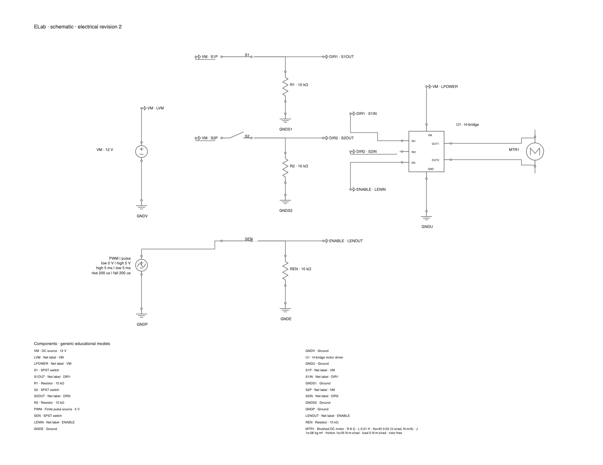
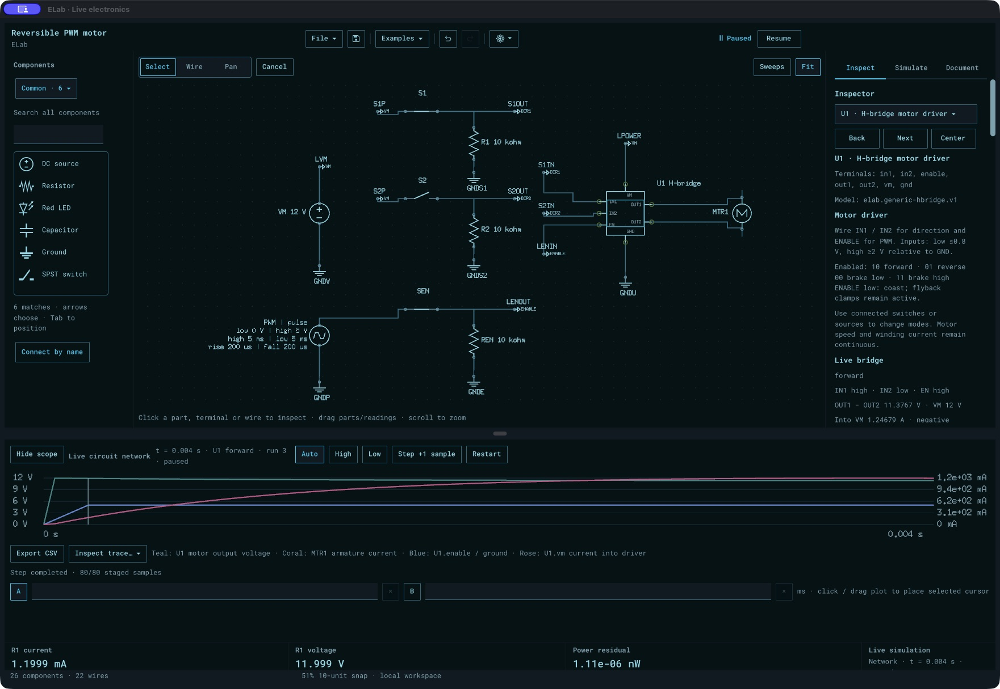

# H-bridge qualification

**ELab 0.191.0 /252** adds a generic H-bridge driver and the **Reversible PWM
motor driver** example (`hbridge-motor`). The final package is
`build/ELab-0.191.0-252-HBridge/ELab.app`, with its matching agent alongside it.
It was built from clean source `03f8d7a72276bee1e1d1af3d33fafe69d1dc307f` and
passes strict ad-hoc signature verification. The existing qualified alpha
download remains preserved; this candidate has not replaced that release.

The [model and command contract](../../hbridge.md) describes the seven pins,
truth table, signed currents, passive flyback clamps and limitations. IN1/IN2
choose forward, reverse or brake; ENABLE supplies drive/coast PWM. Both output
legs support bidirectional current, allowing braking and energy return to VM.
The model has no thermal protection, current limit or fitted physical IC identity.

Users and agents share ordinary placement, wiring, source, switch, scope and
project commands. The browser now has **49 parts**; there are still **175 public
commands**. The native example alias delegates to `example.load`. Mode control
comes from actual wired voltages, with no separate override API.

## Electrical and repository checks

Independent checks cover loaded truth tables across supply voltages and local
ground offsets; analytic derivatives; KCL and passive power balance; forward and
reverse motor steady state; blocked-rotor current; PWM speed response and flyback;
brake/coast decay; stored-current/speed continuity at a switch boundary; strict
capture validation; model provenance; current-probe signs; project reopening;
required input connections and shorted supplies. The final default template also
has an assertion rejecting unresolved source sampling.

| Check | Result |
| --- | --- |
| Complete root race command | 844 top-level tests /1,877 including subtests passed; no failed/skipped tests |
| Focused desktop race checks | 13 top-level /18 including subtests passed, 23.893 s |
| Focused rendered desktop race checks | 18 top-level /59 including subtests passed, 64.880 s |
| Root, desktop and rendered desktop vet | Passed |
| goimports/staticcheck | Passed |
| Python tooling | 67 tests passed |
| PRD coverage-record audit | 27 requirements passed; a coverage audit, not full product acceptance |

The full root command reused cached results for unaffected packages; workbench
reran in 213.477 s. Two CLI packages have no test files. Compressed raw race logs
and [quality-complete.json](quality-complete.json) retain exact commands and
results. Desktop checks were focused suites for this addition, rather than
complete desktop-suite reruns. Test processes used `GOMAXPROCS=2`; the application
uses its normal runtime settings. Numerical tolerances, the 512-attempt guard,
100 ms per-output budget and existing circuit limits are unchanged.

The complete/focused baseline above corresponds to `020a4eb3`. Subsequent edits
only rearranged the example's control nets and captions, spaced its input labels,
and changed its configured pulse edges from 100 to 200 µs to resolve them on the
existing 50 µs output grid. A sampling assertion was added. The H-bridge/motor
equations and solver limits did not change. Electrical/routing/export checks
passed in 27.634 s; final H-bridge/source-sampling checks passed in 6.998 s;
final native parity and mounted-theme checks passed in 13.074 s; lint passed.
The [post-suite patch](post-suite-changes.patch) and corresponding logs preserve
this distinction.

## Final packaged replay

[packaged-replay.json](packaged-replay.json) exercises all five output modes,
PWM, conservation, pending switch behavior, captures, saving and fresh-process
reopening through the matching packaged agent. It exports SVG, PNG and PDF;
the [manifest](export-manifest.json) records their hashes. Run it again with
`scripts/hbridge-demo.py` and fresh output/artifact paths.

After the same 60 ms spin-up and 40 ms continuation, the replay measures:

| Commanded mode | RPM |
| --- | ---: |
| Forward | 4,713.58 |
| Reverse | −3,831.50 |
| Brake low | 441.04 |
| Brake high | 441.04 |
| Coast | 3,081.52 |

These are observations at a specified time, not claimed final steady states.
The final default PWM example reaches 2,639.35 RPM after 40 ms. The exported
schematic was inspected for separated control blocks, ground labels, complete
driver/motor symbols and readable parts descriptions.

## Actual desktop verification

The packaged /251 executable was launched with private recovery/appearance files
and a private agent endpoint through a fixed argument-only launcher. CUA mouse
input selected S1 on the canvas and opened its native switch control. The UI
reported the pending switch state; after one sample, the bridge changed from
forward to brake low without a new run. The pending/accepted AX observations and
filtered electrical snapshots are retained under [native](native/).

That check exposed crowded fitted input labels and an unnecessary default source
sampling advisory. After those presentation/default repairs, the final **/252**
packaged executable was checked again in Apollo. Its fitted input labels are
separated, the sampling advisory is absent, the source advice is resolved, and
the actual driver/scope show forward operation. See the
[final native state](native252/native-final.json) and screenshot below. Mounted
tests separately cover Light, Dark and Apollo; this is not a claim of exhaustive
physical testing across every UI gesture/theme.

Both synthetic projects were saved and both owned apps closed normally. Their
private endpoints disappeared, and CUA reported no running ELab session after
cleanup. No owner projects or window dimensions were changed. The model/core
controls were unchanged between /251 mouse verification and /252 presentation
verification. The initial launcher-path lookup failed to attach; the already
running canonical app was identified and reused, without a duplicate launch or
another permission question.

[report.json](report.json) and [package.json](package.json) record source,
scope, hashes and cleanup. The preserved alpha ZIP still has SHA-256
`d13973f02f9c2895d353d24338ed060492a3a2200ff8a91e3606bfa867f4946b`.
