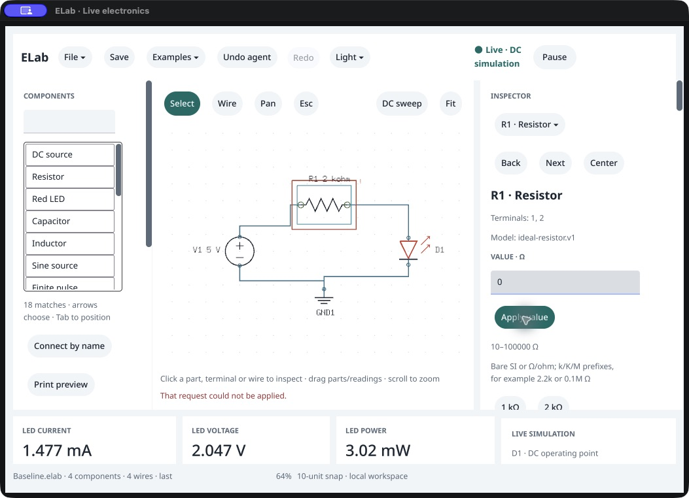

# Inspector accessibility recovery · source repair

October 18, 2026. **The grouped development candidate preserves externally discoverable value controls after an invalid Apply.** Actual CUA entry and AX-identified targets complete `0` → refused → `2.2k` → one Apply without coordinate fallback. The result is fresh **1.344737452917332 mA**, matching the exact packaged /159 agent. This is source/development evidence; a clean replacement package is still pending. Preserved /159 remains affected by the [original external traversal failure](../../../research/ui-audit/first-version/native-edit-159/README.md).

The inspector now places existing sections in stable named groups: object editing, circuit information, measurements, display, output, guidance and the remaining existing sections. Controls retain their IDs, order, callbacks, shared commands and revision/document guards. Groups use zero padding and the existing 12-pixel spacing. Vellum, models and the saved format are unchanged. [Source patch](source-repair.patch.gz), [binding review](native-ledger-review.json).

The investigation distinguishes publication from external traversal. The flat development diagnostic still finds enabled, measured, hit-testable Cocoa value/Apply elements after refusal and corrects through their selectors. It does not reproduce loss inside the native publication itself. The earlier external CUA tree does omit those visible controls. Grouping resolves that observed external path; this evidence does not prove a general client limit or a framework root cause. [Flat diagnostic log](native-smoke-before.txt), [protocol and scope corrections](validation-protocol.json).

| Actual native stage | Evidence |
|---|---|
| Publicly seeded saved LED file and R1 selection | Baseline 2 kΩ /1.477 mA. The graph is seeded; this is not a new blank construction check. |
| Type `0`, before Apply | Accepted graph, results, scope, run/electrical revision, document and history remain unchanged. |
| Apply once | Invalid value refused with unchanged accepted state. Value field, Apply, selection and value heading remain in the external tree, including a repeated full observation. |
| AX-identified field, type `2.2k` | Private draft is visible; accepted state remains unchanged and the prior error stays visible until Apply. |
| AX-identified Apply once | Canonical 2.2 kΩ, error cleared, fresh 1.345 mA. Full graph/drawing/history/result/scope matches the independent agent. |
| Public save and fresh-agent reopen | Every saved field except `view` matches the agent reference. A fresh packaged agent starts blank and reopens a clean/fresh graph with matching complete results/scope. |

[Observer](observer-source.py), [input transcription](ui-observation.txt), [external availability](external-ax-availability.json), [state journal](native-session.json.gz), [stage summary](stage-summary.json), [native saved file](<Native corrected LED.elab>), [fresh reopen](fresh-agent-reopen.json.gz). The cross-process comparator excludes independent run/electrical identities and legitimate actor/view differences; within-session refusal/private-draft assertions compare protected state exactly. The independent agent uses the same solver, not an independent physics implementation.

The native smoke now checks invalid-value refusal, continued native control publication and correction through actual Cocoa selectors. The grouped candidate's complete smoke passes in **39.112 s**. Its reused producer's raw scope label incorrectly says added assertions only; the [protocol](validation-protocol.json) records the effective scope and retains the raw result. The first flat diagnostic reaches and passes the relevant inspector check, then fails the later recovery fixture because the producer disabled recovery. That fixture error is preserved rather than counted as a complete smoke pass. The complete consumer gate passes in **189.732 s**: formatting/imports, Staticcheck, PRD audit, all 51 Python tests, root/native race and vet, mounted controls and tagged vet. [Final output](full-check-final.txt), [result](full-check-final.json). Its initial ledger check correctly refused a semantically equal Python re-encoding; the exact Go-generated bytes were restored before the passing final run. Runtime sources remained unchanged throughout that final run.

Native SHA `98590015ec818c145cd1968350b7f2b22c2bd7edba105513045b729582d78234` is identical for the smoke, actual native replay and final rebuild. [Development identity](development-identity.json), [trimmed build metadata](native-build-info.txt), [unaltered raw metadata](native-build-info.raw.txt.gz), [rebuild verification](final-build.json). The custom bundle's plist label is 0.142.0 /159, but this is a modified working-tree development executable based on `40cfd37`, not a clean /159 or replacement release. The reference agent SHA is `ac6185607ad04c76ba205e8e6e71d79d7b724d4c534d66a73d5a04f5be9b5c0b`. [Helper/source identities](producer-identity.json).

The source ledger retains 68 production files, 393 sites, 162 public IDs and 132 routed IDs. Only `view.go`'s production hash and line locations change; semantic site expressions, route/alias sets and commands are unchanged. Original PID 60128 closes normally with exit 0 and is [absent](process-verification.json); the stopped disposable bundle's previous bytes are [restored](harness-restoration.json). All 20 qualified reviews, original /147 candidate and canonical /120 [verify unchanged](preservation.json). No owner window, settings, printer or canonical promotion occurs.

This covers one ASCII invalid-value correction path in a development build. It is not full VoiceOver, keyboard-only, IME/concurrent-input, latency, environment/distribution or owner acceptance. Owner remains “Not tried yet”; P0 remains 17 implemented /10 partial. Next: package and qualify the committed repair, then resume the frozen first-version acceptance plan.
