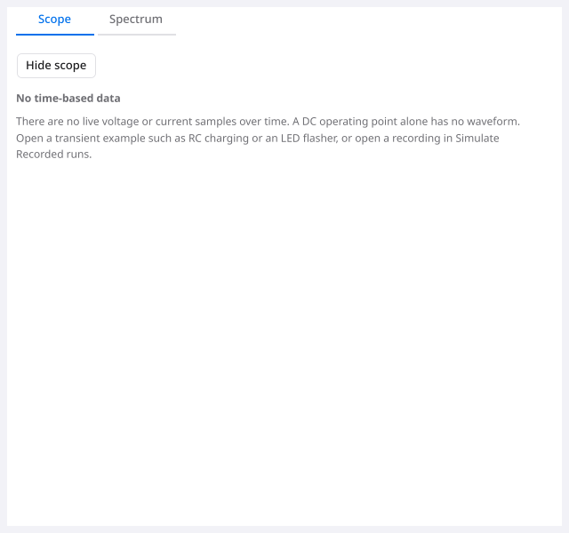
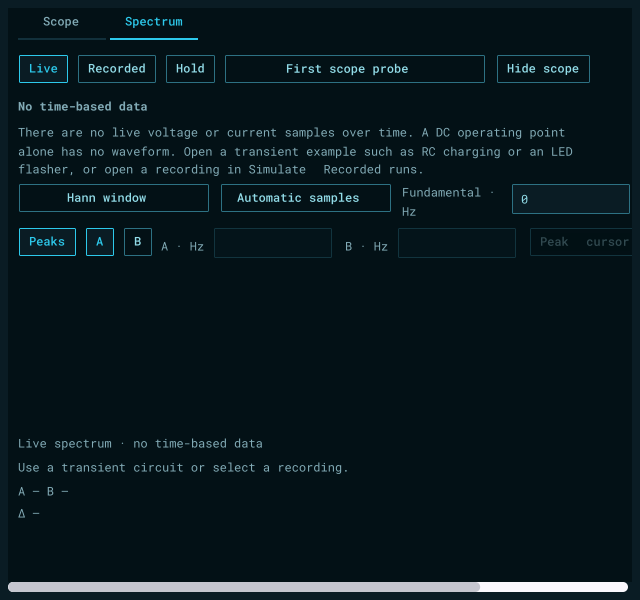

# Persistent Scope / Spectrum access — October 30, 2026

The owner reported that the instruments disappeared on the DC Transistor LED
switch example. The workspace mounted the entire instrument dock only when a
transient/recording existed or Spectrum was already selected; there was no
visible tab from which to select Spectrum in that state.

## Change

- Mount the instrument dock for every circuit in the normal schematic workspace.
  Print preview and sweep source-pane behavior remains unchanged.
- Retain Scope and Spectrum tabs while collapsed. Tabs select the existing shared
  `scope.view.set`; Show/Hide continues to use `scope.visibility.set`. Selecting a
  collapsed tab does not silently expand it or alter its visibility preference.
- An empty Scope explains the absence of time samples, rather than displaying an
  empty RC plot and irrelevant timing controls. Distinguish blank circuits and
  waiting transient runs; explain that DC values alone are not waveforms.
- An empty Spectrum with no live transient points to transient examples or
  Simulate → Recorded runs. Preserve Live/Recorded choices, all existing settings
  and independent captured analysis. Valid recorded results are never relabelled
  empty because the live schematic is blank or DC.
- Bound explanatory text to the actual workspace width before text shaping.
  Text-only Scope must not shrink to the longest word; wide Spectrum settings
  must not stretch the explanatory text beyond the visible viewport.

No public command, solver/model/limit, dependency, saved-project format or
acquisition behavior changes. No release package is replaced. The already-open
owner app remains untouched; these are source and offscreen validation results.

## Internal review

Reviewed locally without Prism or an external review provider. Checked root
mounting, collapsed restoration, shared action guards, recorded-versus-live
ownership, result precedence, nil transient handling, unique descriptor IDs and
no-data layout across Light, Dark, System and Apollo.

Initial regression tests reproduced missing tabs on LED/NPN DC examples and a
missing collapse control. An initial blank fixture incorrectly used the
nonexistent project.new command; corrected to the existing project.clear before
counting that fixture. The first mounted fixture needed to omit GPU extensions
using the same existing control-fixture approach; it makes no GPU/native-window
claim. A screenshot review then found an overly narrow Scope paragraph and
clipped Spectrum paragraph that visibility-only assertions had missed. Reused
the existing bounded-label layout and added viewport allocation assertions.
An intermediate assertion measured font-dependent shaped text instead of its
wrapping frame; the final assertion checks the actual frame and visible label.
The first full ordinary suite also caught two real regressions: paused flasher
and NPN-pulse drawings could not reach Restart before their first transient
state existed. Restored the original shared Restart action for that waiting
transient state, without mounting a fictitious plot. Both complete drawing and
agent-parity cases pass after the repair. The no-data live Spectrum readout also
explicitly says no data instead of claiming it is collecting samples.

The regression suite also imports a real captured RC run into an empty live
schematic, plots its recorded scope and computes its spectrum, preserving the
live document and simulation. Existing waveform, spectrum cursor/peak,
stationary-control, recording and divider tests cover the data-bearing paths.

No unresolved findings in the changed source. These checks do not close the
separate historical hardware-rate/native queue, OS Save-panel, signing or
participant-acceptance gates.

## Validation

All checks below passed. Raw local logs/captures are retained under
`build/instrument-access-20261030/`; `inputs.json` identifies the reviewed inputs.

| Check | Result |
| --- | --- |
| Complete ordinary desktop race suite, final production and ordinary test inputs | 455.845 s |
| Related rendered race suites: Instrument, Scope, Spectrum, divider, native recording and both repaired drawing cases | 114.957 s |
| Mounted DC/NPN fixture: tab clicks, collapse/restore and wrapping at 640/1040 in all four themes | 7.829 s |
| Focused flasher/NPN initialization repair and instrument cases | 14.949 s |
| Maintained lint (including trusted SDK verification) | Pass |
| Ordinary and offscreen vet | Pass |
| Desktop application build | Exit 0 |
| Diff whitespace and reviewed input hashes | Pass |

The rendered related suite used the blank-circuit mounted fixture; its production
inputs are final. The mounted fixture was then strengthened to load the actual
DC Transistor LED switch example and passed separately in every theme/width.
Ordinary regression tests cover empty, LED and NPN DC circuits, preservation of
circuit/history/run state, agent-driven visibility and recorded analysis on an
empty live schematic. The initial failed full run and focused repair receipt are
retained alongside the final full pass. The build succeeded despite a nonfatal
sandbox denial while attempting to write Go module stat-cache metadata; the
existing duplicate `-lobjc` linker warning also remains.

Representative captures use the retained offscreen driver, with GPU extensions
omitted from the controls fixture; they are not native-window captures.

