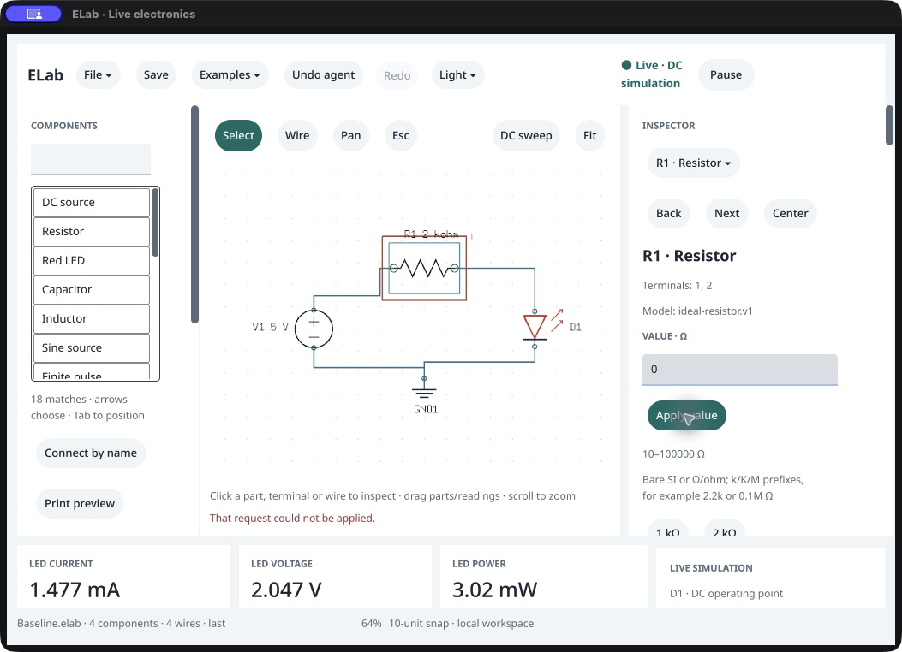

# Exact /160 native inspector recovery

October 18, 2026. **The previously failing external accessibility correction passes on the clean /160 executable.** After an invalid `0` Ω Apply, the field, Apply button, selection and value heading stay in the external tree. Actual CUA AX-identified correction to `2.2k` and one Apply produce fresh **1.344737452917332 mA**, displayed as **1.345 mA**. No coordinate fallback is used.

The controller publicly seeds a saved 2 kΩ LED fixture and selects R1. This is a correction check, not new blank construction. A separate exact /160 packaged agent provides the reference. Private invalid/corrected drafts and refused Apply preserve accepted graph, complete physics/scope, run/electrical identity, document and history. Graph/drawing/history/full-result/scope parity passes after refusal and correction. The comparator excludes independent run/electrical IDs across processes and legitimate actor/view differences; within-session protection is exact. Both processes use the same solver, not an independent physical model.

[Observer](observer-source.py), [input transcription](ui-observation.txt), [external AX availability](external-ax-availability.json), [state journal](native-session.json.gz), [stage summary](stage-summary.json). The [repeated refused tree](refused-repeated.ax.txt) and [private corrected tree](corrected-private.ax.txt) retain edit targets. The refusal remains visible until successful Apply; [corrected screenshot](corrected.png) shows fresh readings and cleared error.

Explicit final public commands save [the native result](<Native corrected LED.elab>) and [the reference](<Agent corrected LED.elab>); every field except view matches. A fresh packaged agent starts blank, reopens the native file clean/fresh, and matches components/wires/nets plus complete result/scope. [Fresh reopening](fresh-agent-reopen.json.gz), [producer](fresh-reopen-source.py). These are public Save/Open checks, not native file panels.

Source is clean `4403097eb81cdc558d8e00e49c387149022a1c75`, SDK `b22478c`. Native SHA `4158b9b1332e36a458c03c40c1075c72127a6aadd728dafc5b8db5aebb512eef`; agent SHA `bf177e5f3d136196745f09bb4f090bc87ce7b45c82218fd5991fc890acd86cc4`. [Identity](identity.json) pins the packaged app tree and build provenance. The native executable and resource manifest are copied to an isolated bundle with a custom identifier/executable name and modified plist labelled0.143.0/160. This is exact-executable qualification, not an intact whole-bundle reader claim. Shared observer helpers [match the clean source](producer-identity.json).

Original PID65563 closes normally with exit0 and is [absent](process-verification.json). The stopped disposable bundle is [restored](harness-restoration.json); the source packaged app tree stays unchanged. No product/SDK source change, post-close relaunch, owner work, settings or print job occurs. Copied-runtime isolation and four-adapter acceptance are separately recorded by the replacement receipt.

This proves one seeded LED ASCII invalid-value recovery path. General reader/IME, keyboard-only/concurrent input, visible-p95, other inspectors, environment/distribution and owner/study acceptance remain open. Owner remains Not tried yet; P0 stays17 implemented/10 partial. [Checkpoint](checkpoint.json).
