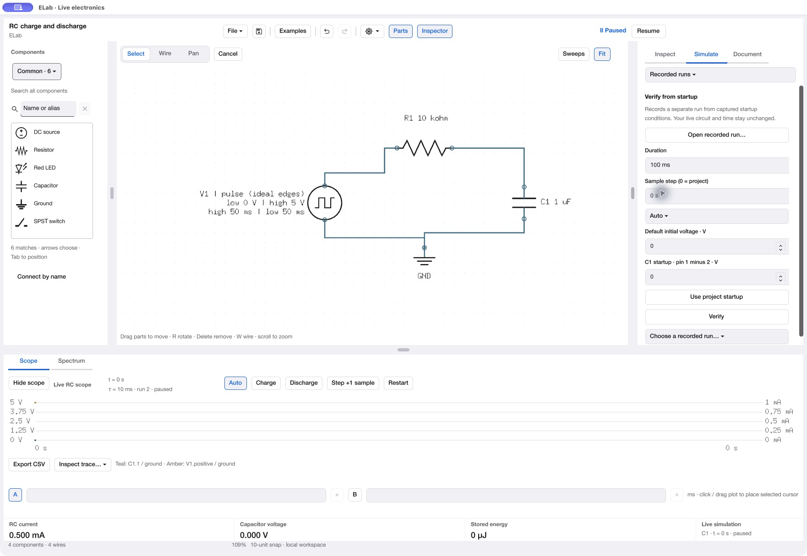

# Side panels and Simulate tools — October 29, 2026

Implementation and internal review of collapsible/resizable Parts and Inspector
panels and a one-tool-at-a-time Simulate chooser. Existing electrical, file,
instrument and analysis commands remain; two shared presentation commands bring
the catalog to 228. No components, models, solver limits or SDK bytes changed.

## Final source checks

[Coverage](coverage.json) binds the following completed checks to frozen inputs:

- Full ordinary portable, desktop and rendered/offscreen application suites pass.
- New shared presentation/electrical tests and mounted panel/chooser tests pass
  under the race detector. The mounted checks cover four themes at 1040 and 1440
  logical window widths, a queued pre-agent divider callback, constrained maximum
  preferences, drawing-action reachability and persistent chooser navigation.
- All 104 Python tests, PRD and maintained command inventory pass.
- Lint/imports and portable, desktop and rendered vets pass.
- The catalog is 65,069 bytes, below its unchanged 65,536-byte budget. All local
  schema references resolve, command quantity/time grammar remains available,
  and output waveform types stay numeric.

The reviewed run passed all nine test/audit steps before lint found one import
group in `capacity_test.go`. The [isolated correction](import-only-change.json)
changes only import grouping. Its test rerun and all remaining lint/vet checks
pass with exact final inputs. Full test results are carried across that explicit
non-behavioral difference; they are not represented as a second full-suite run.
The initial failed budget/rendered receipts remain, alongside final passing
results. No failing test was removed and no budget was increased.

## Native observations

Owned CUA sessions verified collapse/reopen and both divider edges. The final RC
session exercised the chooser, wheel scrolling and scrollbar dragging, followed
by a wider inspector. The chooser stayed fixed and redundant outer horizontal
bars disappeared. The measured [final state](native/results.json) remained paused
and clean with unchanged electrical revision and run ID. All owned sessions
closed normally; owner documents, settings and sessions were preserved.

Additional exact screenshots show [Live controls](native/01-live-controls.png),
[wheel-scrolled recording controls](native/03-recordings-scrolled.png) and
[the scrollbar drag](native/04-scrollbar-drag.png). Screenshots are observations,
not timing or hardware-queue measurements. The retained whole-workspace fixture
replaces only unsupported canvas-extension paint; its managed panels/dividers
remain real. Read the [internal review](internal-review.md) for corrections and
scope distinctions.

## Package and preserved release boundaries

A matching clean-source development candidate is assembled after the feature
commit; its build and integration receipts are recorded separately here. These
source/UI checks do not assert a new complete release qualification. The current
qualified release remains /285; [all 47 prior package/SDK pins](preservation.json)
remain exact. Historical native checks 3/6/9/11, participant acceptance,
clean-account installation and public signing retain their separate status.

No push, upload, external code review, owner project write or security change was
performed. [Workspace guide](../../workspace-layout.md) describes parameters,
keyboard behavior, session-only choices and all six Simulate tasks.
