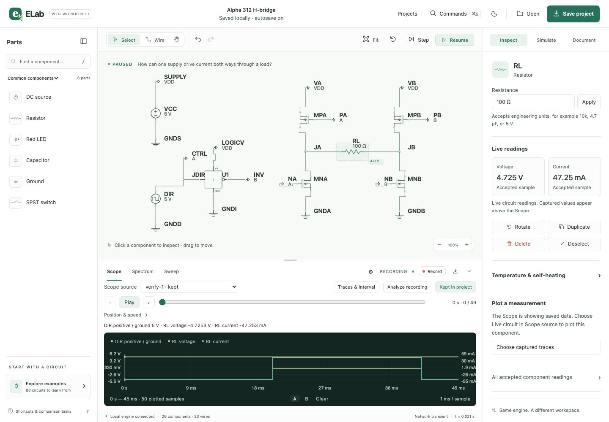

# ELab 0.206.0 alpha 1 — Web workbench, build 312

The owner requested qualification and publication from `main`. The clean package
source is `b90d7e95018be93afea94d45e246e4296d9978b4`. The shipping bundle is
`com.dshills.elab.web`, version `0.206.0-alpha.1`, build `312`, arm64, ad-hoc signed.
It contains no test-library override and requires no Go, Node or Vellum runtime.
Earlier alpha packages, release assets and native archive tags remain preserved.

Published [v0.206.0-alpha.1](https://github.com/dshills/ELab/releases/tag/v0.206.0-alpha.1)
on November 3, 2026 at 20:34:40 UTC. All five fresh `main` CI jobs pass. The
[complete qualification report](qualification.json), [release receipt](published-release.json),
[first-use guide](START-HERE.md) and [checksums](SHA256SUMS.txt) are retained here.
The tag points to the package's exact clean source; this later documentation
commit records publication without changing application or test sources.

## Shipping artifact

- ZIP: `ELab-Web-0.206.0-alpha.1-macos-arm64.zip`
- Bytes: 10,383,772
- SHA-256: `8a4f469238f3b753a81d3174e1d83acf12f3948269896b04826412f312edcfe9`
- [Sealed package receipt](package.json): exact source, toolchains, linked notices,
  final executables and file hashes/modes.
- [Archive qualification](archive-qualification.json): OS `ditto` extraction,
  strict signature/system dependency checks, and all 12 files' exact bytes/modes.
- [Copied runtime](runtime-qualification.json): embedded frontend outside source
  without Go/Node in PATH, normal control Quit and restored 22 kΩ edit.

## Packaged web and desktop checks

The [six packaged Chromium journeys](packaged-browser.json) pass without retries
or skipped cases. They exercise the actual OS-extracted shipping backend in a
disposable library with Go/Node excluded from its PATH. Five are the unchanged
[standard journeys](../../../browser/tests/workbench.spec.mjs); the sixth checks
the four-MOSFET bridge through visible UI controls and read-only observations.

The [H-bridge journey](hbridge-qualification.json) confirms −4.7253319 V at restart
and +4.7253319 V after a 21 ms advance. A 45 ms capture is retained, named and
saved. Browser reload preserves it. Browser download, file-input import and
re-export preserve the exact graph, settings, device models and all 50 recorded
rows. The project has 26 components including four discrete MOSFETs.

The [launcher check](launcher-qualification.json) uses an isolated copy of the
shipping bundle with its explicit test-library override and test identifier.
The backend bytes are unchanged; the fixture's outer signature is regenerated.
Computer-use observations confirm browser handoff, an accepted 3.3 µF edit,
normal Quit, restoration after reopening and final normal Quit. Both owned
browser tabs and the launcher were closed. Existing owner libraries were not
modified.

The [artifact export check](exports-qualification.json) validates SVG/PDF/PNG
signatures, recording JSON preserving all 50 rows, recording CSV and a 524-byte
WAV with nonzero PCM. No audio playback or printer submission occurs. This is
an export smoke check, not a claim of PDF/PNG visual fidelity across platforms.

## Reproduction and internal review

Archived release-only producers: [browser host](browser-host.mjs.txt),
[configuration](playwright.config.mjs.txt), [H-bridge journey](hbridge.spec.mjs.txt)
and [export check](qualify-exports.py.txt). They ran under
`build/web-release-312-checks/`; the pinned Playwright 1.64.1 headless Chromium
runtime was installed under `build/release-browser-runtime/`. The configuration
uses a private copy of the repository's locked browser dependencies and refuses
to reuse an existing server. No application or test source was changed for this
release. Initial release-harness selector/schema mistakes were corrected before
the final passing runs; they were not application defects.

Internal review checked shipping version/identity and absence of fixture
settings, source/asset identity, license inventory, exact archive extraction,
isolated host ownership and shutdown, guarded project operations, package versus
source-CI evidence, and exclusion of private launch credentials from public
receipts. No external review provider was used.

## Qualification scope

The shipping ZIP is exercised on Apple Silicon macOS 27.2. Hosted macOS 15 CI
builds and checks its own package from the same source; it does not install this
exact shipping ZIP. macOS 13 is a configured deployment target, not a tested
minimum. Intel, clean-account/Finder installation, notarization, VoiceOver and a
human usability pilot are not claimed. Automated accessibility covers the tested
workbench and Projects dialog views, not whole-app conformance.

Fresh `main` qualification is
[run 41708736986](https://github.com/dshills/ELab/actions/runs/41708736986).
All five jobs pass: [Linux](linux-quality.json), [macOS](macos-quality.json),
Chromium, Firefox and WebKit. Both profiles pass lint, 62 Python tests, 28 frontend
tests, the complete Go race suite and vet. macOS also passes its separate
[same-source package/runtime check](macos-ci-package.json). The
[CI receipt](ci.json) preserves job identities and outcomes.

The [GitHub-downloaded archive](github-download.json) matches the qualified local
ZIP, all sealed bytes/modes and strict signatures. Its copied backend runs and
recovers the acknowledged 22 kΩ edit after restart. The final five assets were
downloaded again after report/checksum upload; all four payload checksums passed
before the draft was published. `PACKAGE.json`, `QUALIFICATION.json`,
`SHA256SUMS.txt`, `START-HERE.md` and the ZIP are the five release assets.
