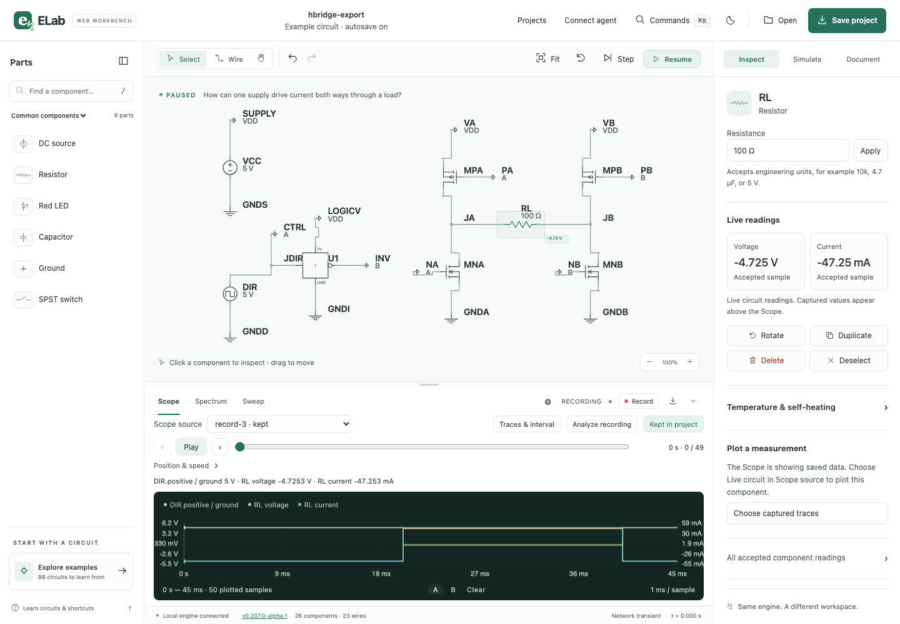

# ELab Web 0.207.0 alpha 1 — build 313

Qualified and published from clean `main` on November 4, 2026. The immutable
release tag identifies `2ca9bc8d6643a672336af21ca08a392084cab3b2`; this later documentation commit records
publication without changing application or test sources. Earlier alphas and
the native-source archive remain preserved.

[Release](https://github.com/dshills/ELab/releases/tag/v0.207.0-alpha.1) ·
[Start guide](START-HERE.md) · [Checksums](SHA256SUMS) ·
[Qualification](QUALIFICATION.json) · [Package inventory](PACKAGE.json) ·
[Published receipt](published-release.json).

## Shipping artifact and checks

The Apple Silicon ZIP contains the Swift web-host launcher and self-contained
Go backend with embedded frontend. It requires no Go, Node or Vellum runtime.
The app is ad-hoc signed and not notarized; signing remains deferred to the owner.

- Source: `2ca9bc8d6643a672336af21ca08a392084cab3b2`
- ZIP: `ELab-Web-0.207.0-alpha.1-macos-arm64.zip`
- Bytes: 11,856,229
- SHA-256: `04090425038f8ef53299bb30fbc25d5ce3d9dc082fb8daea250f538e73197342`
- Complete local macOS plan: lint, 75 Python tests, 32 frontend checks, all Go
  race tests, vet and package checks passed.
- Full browser qualification: 46 passed, two planned non-Chromium load skips,
  no unexpected or flaky results.
- Archive extracted with system ditto: sealed bytes/modes, strict signatures,
  system dependencies, clean source/version/build, restart/recovery and library
  backup/restore passed.
- GitHub draft archive downloaded and compared byte-for-byte, then its actual
  shipping backend passed the same runtime checks and the browser journey below.
- All six final GitHub assets were downloaded and compared, and all five payload
  checksums passed before public promotion.

The [shipping browser journey](shipping-browser.json) uses disposable data and
excludes development tools from the backend PATH. LED learning accepts an edit
and reduces current. Group duplication undoes in one step. The four-MOSFET load
reverses from −4.7253319 V to +4.7253319 V across 20 ms. All 50 accepted rows of
its 45 ms recording survive named save/reopen and browser export/import exactly.
About identifies the source, the diagnostic preview omits the project name and
the library backup creates a ZIP. There are no uncaught browser errors and the
owned backend saves and exits normally. The reproducible
[shipping test producer](shipping-smoke.mjs.txt) is retained without credentials.

## Release-blocking fix and internal review

The first downloaded candidate exposed a real fast-edit conflict: Enter on an
already selected resistor issued a redundant native selection, advanced command
revision and invalidated the immediately focused inspector edit. Commit
`2ca9bc8d` suppresses redundant browser selections only at queue execution time.
Earlier queued target changes are honored; explicit edit guards and native
command semantics are unchanged. The learning regression introduces selection
latency and immediately edits the acknowledged resistor. Twelve focused journeys
passed across all three engines before the complete release gates ran again.

Two earlier harness failures were corrected separately. Marquee bounds are now
read atomically from acknowledged, connected SVG nodes (30 repeated trials
passed). Restore tests await actual cancellation and enabled controls (30 fresh
library trials passed). No assertions or product limits were relaxed.

Internal review covered queued selections, stale edits, keyboard/pointer paths,
source and asset identity, fixture exclusion, exact downloaded bytes and normal
owned shutdown. No external review provider was used. Initial failed candidate
receipts remain under ignored build outputs and were never published.

## Hosted CI and qualification limits

At public qualification (2026-11-04T17:41:36.197424+00:00), [exact-source hosted CI](https://github.com/dshills/ELab/actions/runs/41878077636) was queued: Web browser (chromium): queued, Web browser (webkit): queued, macos: queued, Web browser (firefox): queued, portable: queued. These jobs had not produced results. Publication uses the complete passing local macOS target checks and explicitly retains this hosted limitation. The documentation-only follow-up commit skips a new CI run to preserve the queued source run.

The exact ZIP is exercised on Apple Silicon macOS 27.2. macOS 13 is the configured
build target, not a tested minimum. Intel, clean-account/Finder installation,
native file-picker interaction, native VoiceOver, whole-app accessibility
conformance and human usability acceptance are not claimed by these checks.
The earlier launcher check remains evidence for its original revision only.
Existing owner projects, running sessions and browser profiles were preserved.
