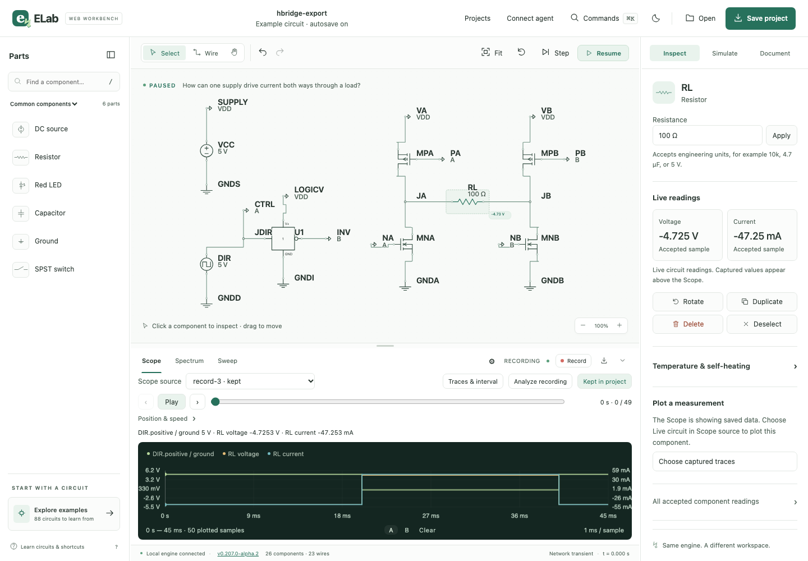

# ELab Web 0.207.0 alpha 2 — build 314

Qualified and published from clean `main` source `6c0d66e3cafcedb0228e5db978fb6c4f6089d5b8` on
November 8, 2026. The immutable public tag identifies that exact source; this
later documentation commit records publication. Earlier alphas and the
native-source archive remain preserved.

[Release](https://github.com/dshills/ELab/releases/tag/v0.207.0-alpha.2) · [Start guide](START-HERE.md) ·
[Qualification](QUALIFICATION.json) · [Package inventory](PACKAGE.json) ·
[Checksums](SHA256SUMS) · [Published receipt](published-release.json).

## Artifact and qualification

- ZIP: `ELab-Web-0.207.0-alpha.2-macos-arm64.zip`
- Bytes: 11,856,976
- SHA-256: `7b02492bd646390deee41e40cf08560786b63185ed686c452be42227d3c3aa6d`
- Apple Silicon, ad-hoc signed, not notarized. The package has no test-library
  override and needs no Go, Node or Vellum runtime.
- Fresh local macOS plan passed on the release commit: lint, 75 Python tests,
  36 frontend checks, the complete Go race suite, vet and package checks.
- Browser suite passed 46 journeys with two planned non-Chromium load skips,
  no unexpected failures and no flaky results.
- System ditto extraction, strict signatures, sealed bytes/modes, version/build/
  source identity, library backup/restore, saved recovery and restart/normal
  control Quit checks passed.
- GitHub draft assets were downloaded and compared, then the extracted exact
  shipping backend passed runtime checks and the two browser journeys below.
- All six final assets were downloaded and compared before public promotion;
  all five payload checksums passed. The public tag and draft target matched
  the qualified source. An [anonymous public manifest download](public-download.json)
  also matches the staged bytes.

## Downloaded shipping app and WebKit regression

Both [Chromium](shipping-chromium.json) and [WebKit](shipping-webkit.json) passed
three consecutive reloads with a real state read held across navigation. Each
reload explicitly aborted the old read, resumed conditional polling in the new
page and emitted no uncaught page errors. Six explicit abort/reload checks passed
against the actual GitHub-downloaded build 314, which reported the expected
version, build and clean release source.

Both engines also passed LED learning/editing, connected group duplication and
one-step undo, four-MOSFET reversal from −4.7253319 V to +4.7253319 V, and exact
preservation of all 50 captured rows through named save/reopen and browser
export/import. The support preview identifies the correct build and excludes
the project name. Library backup produces a ZIP. There were no command refusals
or uncaught errors; both owned backends saved and exited normally.

The [release-only producer](shipping-smoke.mjs.txt) is retained for reproducibility.
Its startup/control files, private library, raw backend logs and exported fixture
files remain in ignored build outputs and were not published.

## Hosted CI and internal review

[Hosted CI](https://github.com/dshills/ELab/actions/runs/41888150836) passed all five jobs on
`e5136106d1d49cb13e979f0ad9337bccd012f21a`: Linux, Apple Silicon macOS 26.6.2,
Chromium, Firefox and WebKit. Every application, test and workflow input hash
exactly matches the release commit. The intervening commit contains documentation
only. The qualification report explicitly records both commits and this input
comparison; fresh local release gates and downloaded-binary tests use the release
commit itself.

Internal review covered version/build/source and tag boundaries, the explicit
reload abort/resumed-polling assertions, unchanged mutation and solver guards,
sealed archive identity, report privacy and owned host cleanup. Application inputs
stayed fixed throughout qualification. Review was internal.

## Scope

The exact ZIP is exercised on Apple Silicon macOS 27.2. Hosted macOS checks built
and tested the same application inputs on their own runner; they did not install
this exact shipping ZIP. macOS 13 is the configured build target, not a verified
minimum. Intel, clean-account/Finder installation, native file-picker interaction,
VoiceOver, whole-app accessibility conformance and human usability acceptance are
not claimed. Existing owner projects and application sessions were preserved.
