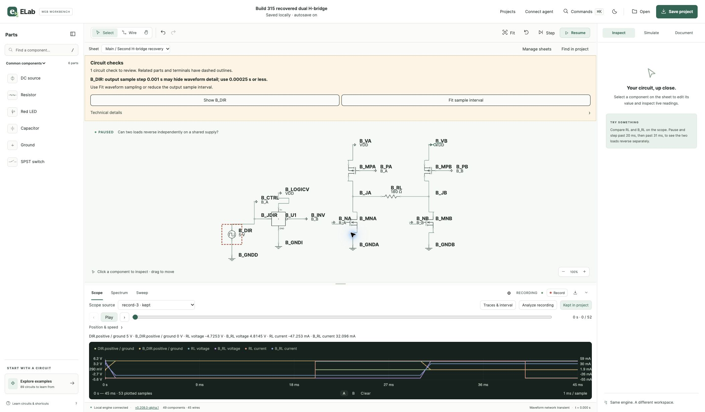

# ELab Web build 315 desktop validation

November 12, 2026. Apple Silicon Mac, macOS 27.2 (26B123), Finder and installed Chrome.

| Check | Result |
| --- | --- |
| Published bundle | Both release archives and their accompanying files passed the published SHA-256 checks. Finder copied the exact build 315 bundle to a test installation folder. The installed bundle matched the package file inventory, bytes, and modes, and passed strict code-signature verification. |
| Gatekeeper | With assessments enabled, `spctl --assess --type execute -vv` rejected the exact published ad-hoc-signed app with exit 3. First launch of that bundle under Gatekeeper remains unverified. |
| Upgrade from build 314 | Saved a 4.7 µF capacitor project in build 314, then changed the capacitor to 6.8 µF and left the change in autosave. Quit build 314, replaced the app at the same path, and opened build 315 from Finder. About showed the published build 315 revision. Build 315 opened the 6.8 µF autosave, and Projects reopened the named 4.7 µF save. |
| Multi-sheet save and reopen | Moved the 23 objects for the second H-bridge to a child sheet. Followed the shared `VDD` supply port in both directions. Saved a version 6 project with the child selected and a recording of 53 samples across six traces. The recording captured all four settled direction combinations. Reopening from Projects restored the child sheet, its 150 Ω load, the VDD port, and the recording. |
| Recovery | Renamed the child sheet and changed its load to 180 Ω. **Keep editing** preserved both changes. **Replace circuit** reopened the 150 Ω original and put the unsaved revision in Recovery History. **Recover a copy** restored the renamed child sheet, 180 Ω load, VDD port, and recording. Saved the recovered copy under a separate name. The original file remained byte-for-byte intact. The two files contained identical wire lists and all 53 recording rows matched exactly. |
| Native Open panel | The Chrome file picker opened, and Cancel preserved the recovered project. The successful reopen check used ELab’s Projects dialog. |

The upgrade used re-signed launcher copies with a test bundle identity and a
disposable project library. Both engine binaries matched their published copies
byte for byte, and the launcher machine code matched before and after
re-signing. The test used the existing macOS account. Clean-account installation
and VoiceOver remain unverified. The dual H-bridge example displayed its sampling
advisory at 1 ms. The recording check covered settled direction combinations and
exact sample preservation through the project workflows.

| Artifact | SHA-256 |
| --- | --- |
| Published build 314 ZIP | `7b02492bd646390deee41e40cf08560786b63185ed686c452be42227d3c3aa6d` |
| Published build 315 ZIP | `6a0ae6911cca5cbdbd783580f4826270cf11c8a9b85073daa884aa8194a73821` |
| Original multi-sheet project | `471cdcc7430f779eb838598df38ed92edd390182772832850492de9ce01c33f1` |
| Recovered multi-sheet project | `8020aad430f4e6035f5903b7bc97a49706487a5eef64427ae9376d736c6b399d` |

[Published release](https://github.com/dshills/ELab/releases/tag/v0.208.0-alpha.1) · [Hosted macOS job](https://github.com/dshills/ELab/actions/runs/43235023151/job/131240183448)
