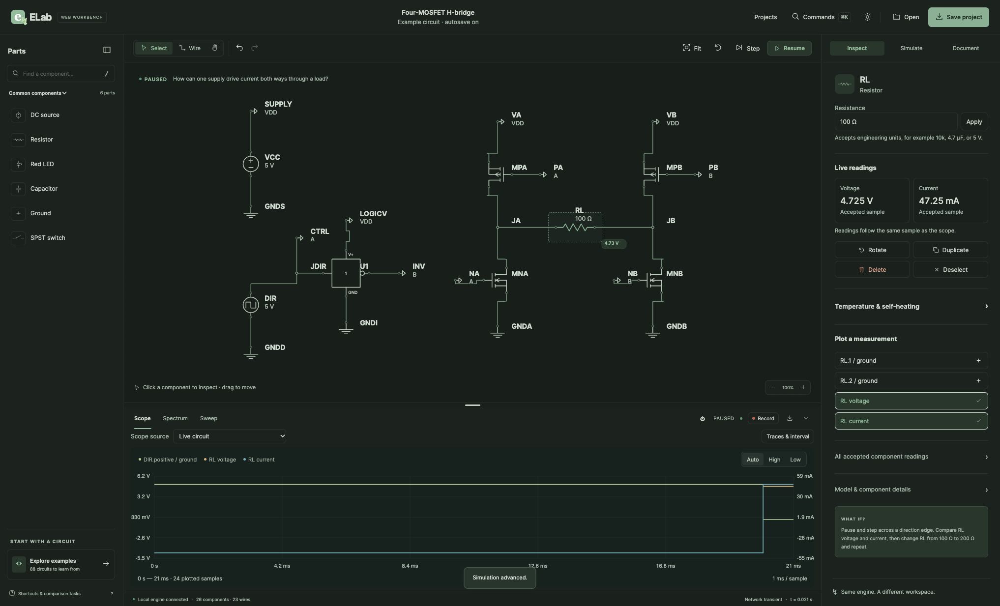

# Overnight web qualification, 2026-11-02

The owner lifted the video/desktop pause and authorized overnight testing and
continued engineering. Internal review remains the default; no external review
provider was used. Work stays on `exp-web`; existing alpha archives and the
original library/server on port 8788 remain preserved.

## Findings and fixes

- Hosted macOS run 41355615048 passed the complete shared race suite and vet,
  then failed staticcheck ST1013: the redirect-boundary test used `302` rather
  than `http.StatusFound`. The test now uses the named constant. Native desktop
  and rendered gates did not execute in that run, so they remain required.
- Space on a focused schematic button incorrectly reached the global playback
  shortcut. Space now activates component/terminal buttons, while the sheet's
  Space shortcut remains available outside a button.
- Replacing SVG contents after selection/movement lost focused objects and
  terminals. Focus is now restored by native object/terminal identity. Removing
  a focused object, or leaving wire mode, returns focus to the sheet.
- Safari accessibility activation invokes a semantic click without pointerdown.
  SVG buttons now handle that activation without duplicating pointer gestures.

Internal review checked event propagation/default prevention, pointer-versus-
semantic click separation, focused-object removal, terminal mode changes,
escaped native identifiers and preserving normal text/browser shortcuts.
Frontend tests cover focus recovery and the browser journey includes Space,
arrow movement and semantic activation.

Before committing these fixes, all 28 frontend tests and module syntax checks,
the full root/native lint script, web race tests (14.200 s) and diff whitespace
checks passed. The longer native plan is restarted from the committed revision.

## Exercised desktop checks

Disposable host: port 8789, library `build/night-ui-data-20261101`; a development
host so source changes require an explicit browser reload. User projects were
not imported or changed.

- Installed Chrome: reproduced Space/playback and focus-loss defects; verified
  corrected Space selection, stable paused state and arrow-movement focus.
- Chrome: engineering-unit edit to 2.2 µF; Command-S Save dialog, Command-A text
  selection and native text undo; named save/retrieval confirmed as **Night
  keyboard check**, with 2.2 µF and no storage alert.
- Installed Safari: reproduced inaccessible schematic activation; verified
  corrected accessibility-button activation, Space, arrow-movement focus and
  22 kΩ engineering-unit editing with Command-A/Return.

The initial Safari `getApp` launch call stalled for about 10.6 hours. It returned
on November 2; no desktop testing occurred while that tool call was blocked.
The already-running Safari session was then reused without another launch.
The cause of the tool stall is not established. No claim is made that the entire
planned overnight pass completed during that interval.

## Full qualification and further findings

The original local run was normally interrupted after the Safari finding. The
subsequent [full native receipt](local-native-quality.json), from committed
`ce595eed`, passes all twelve gates with unchanged source inputs: Python, PRD,
inventory, frontend, shared race/vet, lint, native desktop race/vet and rendered
race/vet. The three race gates took 494.621, 453.087 and 825.316 seconds.

[Hosted run 41419426333](https://github.com/dshills/ELab/actions/runs/41419426333)
passes Linux and all three browser jobs, but macOS exposed a separate test setup
race in `TestWeb555LiveClockSurvivesCPUContention`. Pausing immediately after an
example load can correctly cancel its initial asynchronous solve before a sample
exists. The test dereferenced that absent transient. Setup now explicitly
restarts while paused, waits, and validates its accepted initial sample before
starting the eight CPU burners. Missing/error samples fail with diagnostics.
The one-CPU load, 20-second progress deadline, required simulated progress and
KCL/power limits are unchanged; there are no numerical relaxations or retries.
Internal review compared this setup to the native capture fixtures and checked
burner cleanup on all outcomes. The corrected test passes 20 consecutive race
runs (49.842 s); the entire web race suite (12.624 s) and root/native lint pass.

Further desktop checks:

- Chrome pointer drags resize all three dividers, repeated drags work, keyboard
  resizing works, and the body cursor/resizing state clears after each gesture.
- The H-bridge has 26 components/23 wires, including four individual MOSFETs.
  With the native step controls, RL reads -4.725 V/-47.25 mA at 19 ms and
  +4.725 V/+47.25 mA at 21 ms, across the 20 ms direction change.
- A retained 40 ms capture contains 45 exact stored samples, including event
  frames. Keyboard End reaches index 44 at 40 ms; Home/Right reaches index 1 at
  1 ms and displays -4.7253 V/-47.253 mA from the captured rows.
- The native `.elab` download exists and parses as format `elab.schematic`,
  version 4, with all four MOSFETs and one retained recording. Its SHA-256 is
  `1696c9b1d0bd6572b477324f3a16662e069d6e8c331c0197d46fcc949a8eb185`.
- Safari selected that exported file through its native picker and reached the
  replacement/recovery confirmation. Completion of that reimport is not claimed.

The browser download-event hook stalled for about 2.6 hours despite a ten-second
timeout. The actual export was verified independently from the app-created file;
the stalled hook is not used as evidence of success. No cause for these tool
stalls is established. After the owner returned, work continued offscreen.

Updated hosted macOS confirmation and packaged candidate checks remain pending.
VoiceOver speech/navigation and human usability evaluation are not established
by native accessibility-tree inspection alone.
