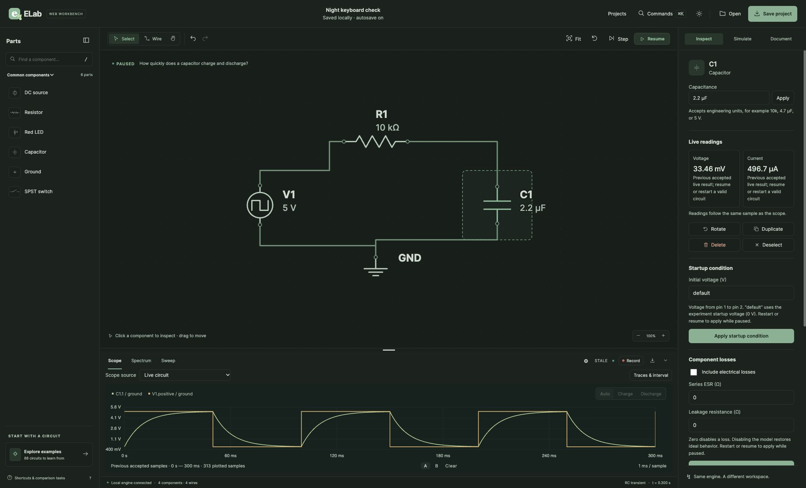

# Overnight web qualification, 2026-11-02

The owner lifted the video/desktop pause and authorized overnight testing and
continued engineering. Internal review remains the default; no external review
provider was used. Work stays on `exp-web`; existing alpha archives and the
original library/server on port 8788 remain preserved.

## Findings and fixes

- Hosted macOS run 41355615048 passed the complete shared race suite and vet,
  then failed staticcheck ST1013: the redirect-boundary test used `302` rather
  than `http.StatusFound`. The test now uses the named constant. Native desktop
  and rendered gates did not execute in that run, so they remain required.
- Space on a focused schematic button incorrectly reached the global playback
  shortcut. Space now activates component/terminal buttons, while the sheet's
  Space shortcut remains available outside a button.
- Replacing SVG contents after selection/movement lost focused objects and
  terminals. Focus is now restored by native object/terminal identity. Removing
  a focused object, or leaving wire mode, returns focus to the sheet.
- Safari accessibility activation invokes a semantic click without pointerdown.
  SVG buttons now handle that activation without duplicating pointer gestures.

Internal review checked event propagation/default prevention, pointer-versus-
semantic click separation, focused-object removal, terminal mode changes,
escaped native identifiers and preserving normal text/browser shortcuts.
Frontend tests cover focus recovery and the browser journey includes Space,
arrow movement and semantic activation.

Before committing these fixes, all 28 frontend tests and module syntax checks,
the full root/native lint script, web race tests (14.200 s) and diff whitespace
checks passed. The longer native plan is restarted from the committed revision.

## Exercised desktop checks

Disposable host: port 8789, library `build/night-ui-data-20261101`; a development
host so source changes require an explicit browser reload. User projects were
not imported or changed.

- Installed Chrome: reproduced Space/playback and focus-loss defects; verified
  corrected Space selection, stable paused state and arrow-movement focus.
- Chrome: engineering-unit edit to 2.2 µF; Command-S Save dialog, Command-A text
  selection and native text undo; named save/retrieval confirmed as **Night
  keyboard check**, with 2.2 µF and no storage alert.
- Installed Safari: reproduced inaccessible schematic activation; verified
  corrected accessibility-button activation, Space, arrow-movement focus and
  22 kΩ engineering-unit editing with Command-A/Return.

The initial Safari `getApp` launch call stalled for about 10.6 hours. It returned
on November 2; no desktop testing occurred while that tool call was blocked.
The already-running Safari session was then reused without another launch.
The cause of the tool stall is not established. No claim is made that the entire
planned overnight pass completed during that interval.

## Remaining qualification

The original full local quality run was normally interrupted after the Safari
finding so all final checks can run against stable source. It is not a passed
receipt. Full native quality, updated hosted browser journeys, packaged runtime,
restart/recovery, pointer resizing and further Safari workflows remain to be
completed. VoiceOver speech/navigation and human usability evaluation are not
established by native accessibility-tree inspection alone.
