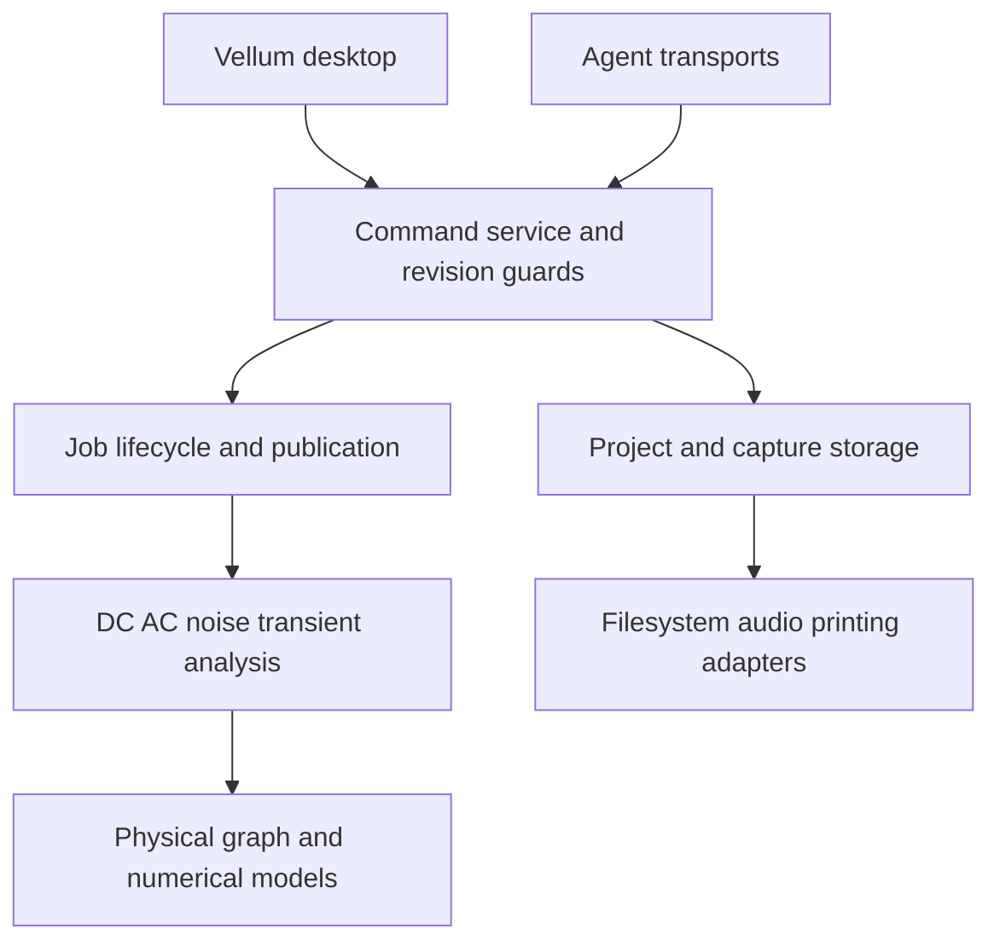

# Project code and architecture review — October 28, 2026

Reviewed source baseline: 4952e76d; reproduced boundary failures with the preserved
0.200.0 /278 package built from 096eb7bb. This is a risk-focused source review of
commands, snapshot ownership, graph/model integration, persistence, transport,
UI polling, testing and dependency/release structure. It is not an independent
revalidation of every electrical model or a physical desktop acceptance audit.

## Findings and implementation

| Priority | Finding | Status |
| --- | --- | --- |
| P1 | ELab rejects a saved, valid capacity noise capture | Fixed in source; round-trip and corruption controls added |
| P1 | Supported noise result exceeds socket response envelope | Fixed in source; full socket/direct parity regression added |
| P2 | Idle desktop recompiles and clones snapshots every 33 ms | Fixed in source with revision-aware polling |
| P2 | Service combines orchestration with large presentation/ownership routines | First separation implemented: snapshot DTO, builder and clone functions extracted |
| P2 | End-to-end capacity boundaries are less covered than individual features | Concrete 64-part/201-point/three-probe round-trip fixture now shared by numerical and transport tests |

### P1: captured noise cannot reopen

A circuit containing a source, a capacitor and 62 parallel 1 kΩ resistors is
within the 64-part simulation limit. Its 201-point noise sweep with three voltage
probes completes and saves successfully. Both socket and fresh headless reloads
reject that saved file: `invalid-document: sweep 0: noise total differs from contributions`.
The validator compared reconstructed derived values using exact equality.
Sequential binary64 summation of the serialized contributions differs from stored
noise densities in 27 of 603 probe samples, by at most six ULPs in this fixture.
The precise compiler/arithmetic origin has not been independently established.

Derived totals, input referral and integrated RMS now permit at most 32 spacing
units of binary64 roundoff. There is no absolute voltage floor, and metadata,
source laws, shape, finite-value and nonnegative-PSD validation remain enforced.
The spacing calculation uses the finite predecessor, so MaxFloat64 cannot turn
the tolerance into infinity. Tests reopen the original failing file, validate
its actual captured settings, and refuse material total/contributor-RMS changes,
zero-versus-positive discrepancies and nonfinite/extreme values. No solver
accuracy or integration/work limit changes.

### P1: agent socket loses access to supported results

The same graph produces a snapshot approximately 1,111,792 bytes long under
compact Python JSON encoding. The actual /278 socket reports `response-too-large`
after the live sweep completes; direct stdio returns its results. Snapshot
queries and mutations returning full snapshots are affected. The server applies
commands before it checks response size, so this can also make an accepted action
look failed to a client. The protocol documented the old envelope, but it no
longer accommodated supported circuit/analysis combinations.

The bounded socket/forwarder envelope is now 8 MiB, with the request bound and
existing connection/deadline limits preserved. The regression loads the original
capture over a real private Unix socket, asserts its reply exceeds the former
1 MiB boundary and remains within the new bound, and compares the complete sweep
against direct service results. This repairs the demonstrated case while retaining
full existing snapshot/command behavior. Longer term, paged analysis queries are
preferable to repeated growth of whole-state responses; the new bound is not a
proof that every future combination fits.

### P2: idle snapshot work

The desktop ticker calls Snapshot at roughly 30 Hz even when the document is idle.
Snapshot takes the service mutex, clones the graph, recompiles connectivity and
copies selected analysis results. Throttling rendering does not avoid this work.

SnapshotIfChanged checks the revision under the same mutex, returning detached
state only on change. The desktop ticker reuses its last owned snapshot while
idle. Ownership, command mutation, unchanged zero-allocation polls and shutdown
publication have regression controls. Existing event/agent commands retain their
contract. Active simulation still publishes state and can incur full snapshot
cost; caching immutable compiled topology and paged analysis remain later work.

## Architecture assessment

The architecture's strongest decision is its single semantic command boundary:
Vellum, Go clients, stdio and Unix sockets use Service.Dispatch. Revision and
document guards, retry identities, cloned snapshots, bounded worker jobs and
explicit model provenance are valuable foundations to preserve. Flat physical
block expansion also avoids a second simulator with different semantics.
Portable numerical tests, independent analytical references, routed/rendered UI
tests and isolated matching-binary conformance provide useful complementary
coverage. Historical evidence correctly distinguishes software routing from
native OS/hardware input qualification.

Before this implementation, tracked Go production code included roughly 43,974
lines across 281 workbench files and 19,979 lines across 158 desktop files.
Workbench had 39,509 test lines and desktop 25,212. These are size observations,
not quality scores. Most core state, numerical models, analyses, file handling,
command schemas and background jobs remain one Go package. Service was 1,484
lines; editing 1,318; mixed-network code 1,192. File-per-feature organization
helps navigation but does not enforce dependency or ownership boundaries.

The implementation extracts snapshot representation, assembly and deep-copy
ownership into workbench/snapshot.go, while keeping the authoritative service
mutex and command API. Further separation should proceed behind that facade:

Recommended next structural steps are an immutable graph/compilation boundary,
separate analysis-job stores with explicit ownership, then explicit wire-format
DTOs. Keep one command/revision authority during these changes. A broad rewrite
or splitting the mutex among feature packages would create more risk than this
review justifies. Strict JSON validation and forgery tests must survive extraction.

## Remaining engineering recommendations

1. Add boundary workflows combining capacity, maximum analysis width, save/reopen,
   transport response size and subsequent edits, beyond the newly added noise case.
2. Introduce paged or summarized analysis reads before increasing result volume
   further; preserve existing consumers through an explicit compatibility plan.
3. Move repeatable package qualification controllers out of historical `.py.txt`
   receipts into maintained tools with parameters. Preserve receipts as evidence.
4. Add repository CI gates for portable tests/vet and a macOS path for native and
   rendered tests. No tracked `.github` workflows were present; external CI was
   not inspected, so this is not a claim that no external automation exists.
5. Protocol introductory documentation is updated to identify /278 and its added
   commands; discovery remains authoritative for the actual running binary.

Items 1–4 remain follow-on recommendations; item 5 is corrected in this repair.
Native acceptance 3/6/9/11 and participant/clean-account gates remain separate.

## Verification and reviews

[Reproduction and test receipts](../docs/validation/project-review-20261028/).
The complete portable suite, affected desktop tests and vets passed. Focused race
controls cover noise, snapshot publication, shutdown, events and the real socket.
Initial lint refused import grouping in the new socket test; corrected grouping
is verified in the final receipts. Final-source checks and benchmark results are
recorded alongside this review. Existing /278 and prior packages stay preserved.

Prism used the authorized Anthropic Claude Opus 5.5 provider. The initial review
covered five chunks; the binary fixture is explicitly excluded from text review
and is exercised by executable tests. The follow-up has zero medium/high findings.
The initial test-baseline and benchmark findings were fixed. Contributor metadata
is now compared exactly with only derived RMS permitted bounded roundoff.
The cached-shutdown concern is covered by a publication regression and existing
shutdown tests. The preview indexing observation concerns unchanged code whose
records are validated before publication; no reachable malformed-record defect
was established. Follow-up settings guidance is resolved by using saved capture
metadata rather than the separate current inspector settings. Close is already
idempotent (closeLocked returns immediately when closed); explicit plus deferred
Close preserves cleanup on both success and test failure.

The representative paused LED benchmark measured full snapshots at 40,161 ns/op,
88,387 B/op and 594 allocations/op. An unchanged revision poll measured 64.71 ns/op,
zero bytes and zero allocations. These are local microbenchmarks, not measured
end-to-end desktop latency or proof of active-simulation speedup.
