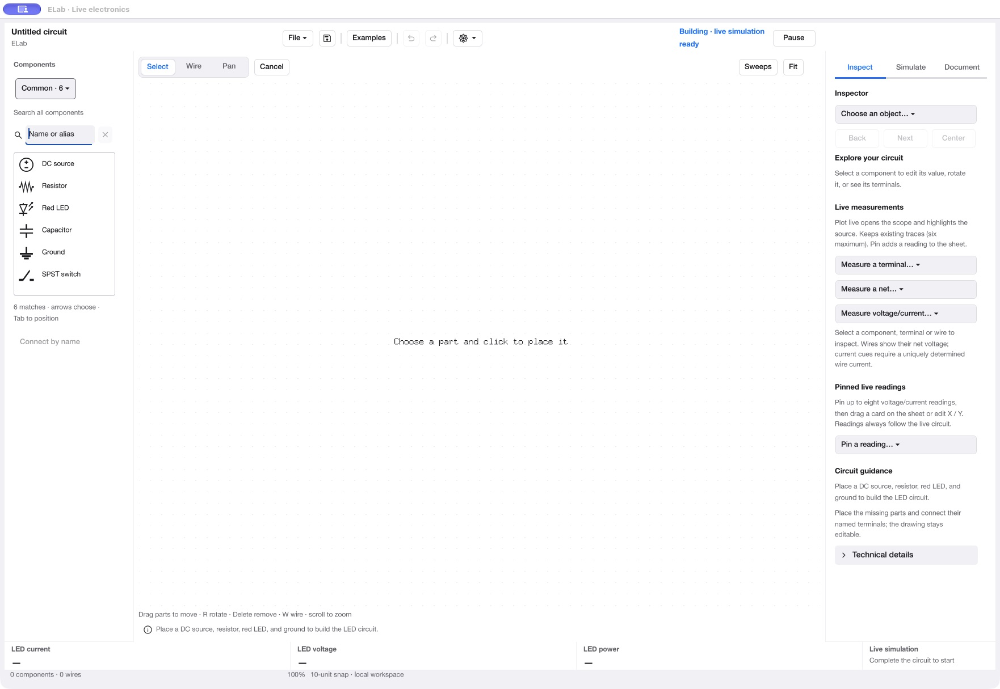
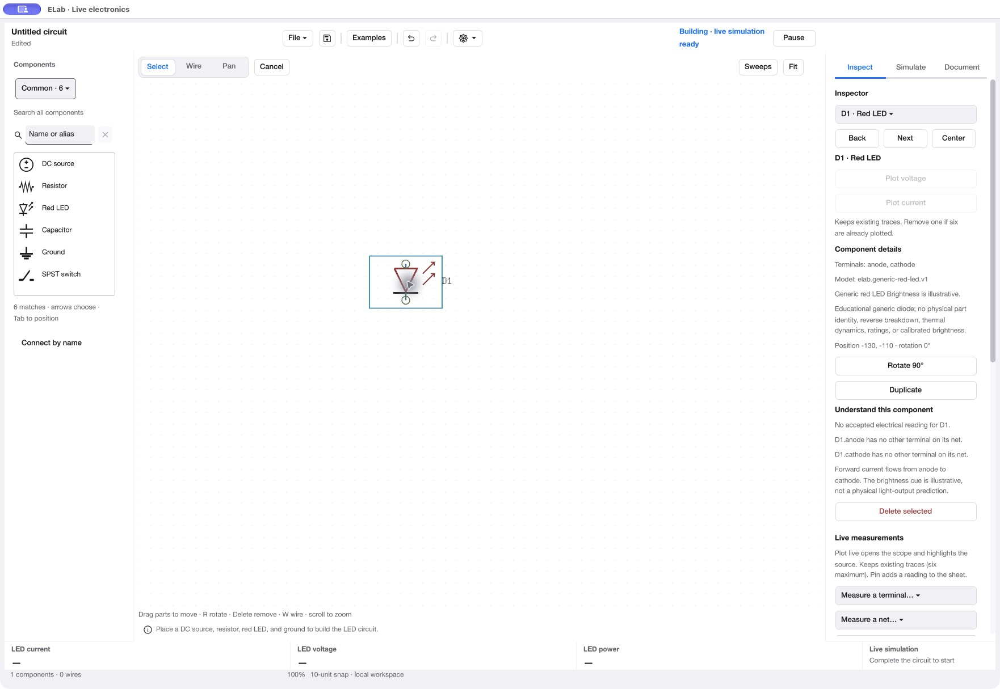
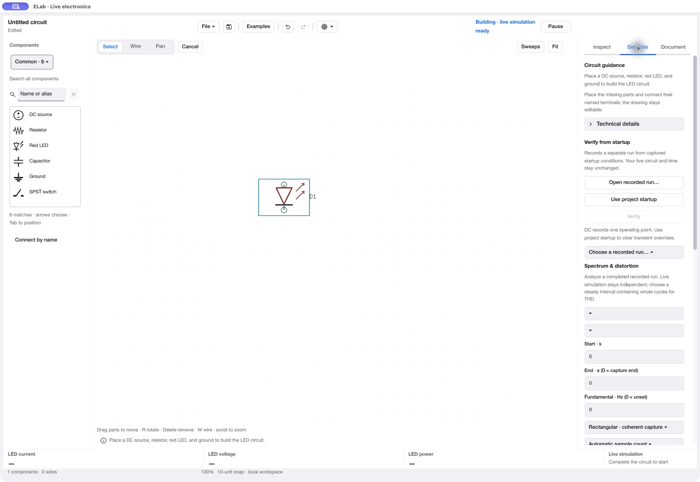

# A quieter ELab workspace

2026-10-29. Proposal only; no application behavior or commands changed.
Owner goal: easier first use without losing functionality. Latest direction:
expandable left/right panels and a Simulate panel that is not pages long.

## Current observations

Captured the current 0.201.0 /285 package through CUA in this review. Screenshots
are original saved bytes, viewed before acceptance. No prior screenshots were
used as audit evidence. The three observed steps:

1. **Open a blank circuit — overloaded starting point.** The common-parts browser
   is useful, with names and symbols. The empty right rail nevertheless presents
   object navigation, three measurement selectors, pinned readings and guidance.
   The bottom already allocates three LED readouts with no values. Guidance
   repeats between the right rail and canvas status. A beginner must distinguish
   many tools before placing a part.
2. **Choose Red LED and place it — understandable gesture, dense inspector.**
   Placement produces a selected symbol and editing actions. The rail mixes
   actions, model identifier/assumptions, explanation, unavailable readings and
   repeated Plot/Pin controls. It becomes vertically scrollable after one part.
3. **Open Simulate — poor task separation.** Recorded-run verification, recorded
   spectrum and tolerance analysis share one long scroll container. Visible
   spectrum inputs include blank selectors and zero-as-unset conventions despite
   there being no recording. Live simulation and recording need clearer separation.

This is a limited three-screen review, not a participant study. Screenshots/AX
support the hierarchy and density findings. Keyboard order, screen-reader
announcements, exact contrast, small-window/zoom behavior, all themes and other
circuits require separate testing; no accessibility compliance claim is made.

## Recommended panel design

Make both side panels independently **collapsible and resizable**. A collapsed
panel leaves a clearly labelled Parts or Properties button and keyboard/menu
entry; do not depend on a tiny unlabeled chevron. Keep a useful minimum width,
allow a wider inspector with paired short fields, and remember the user's layout.
At narrow widths, use one temporary side drawer at a time rather than squeezing
both rails and the schematic. Keep the drawing reachable while a drawer is open.

The properties panel begins collapsed on a new blank document. Selecting a part
can reveal compact properties once; keep the panel's width and position stable
until the user closes/resizes it. Clearing selection must not repeatedly open/
close the rail. Live results and agent revisions must never move panels or
reorder their controls. Drawer/collapse actions need explicit accessible names,
expanded state, predictable focus return and keyboard access.

Expandable groups alone are insufficient: a stack of expanded groups can still
be two pages long. The right rail should show **one task at a time**.

## Replace the long Simulate form

Use a short tool chooser, followed by the selected tool's settings. Proposed
navigation labels, not new simulation engines:

| Task | Default view | Details available on demand |
| --- | --- | --- |
| Live controls | Live/Paused state and relevant time controls | Existing step/startup options |
| Recorded runs | Record from startup, saved run list, Open recording | Sampling, startup overrides, compare/export controls |
| Recorded spectrum | Choose a completed run and probe, Analyze | Interval, window, fundamental, sample count, harmonics |
| Sweeps | Choose DC or AC sweep and source | Range, resolution, retained results and export |
| Tolerances | Choose measurement and Run | Variations, trials, deterministic seed |

Keep the existing Scope/Spectrum dock for live instruments. Clearly distinguish
live spectrum from analysis of a recorded run. Put each tool's primary action
near its essential inputs. Offer an Expand workspace action for dense tables,
comparisons and plots; retain the compact panel for quick adjustments. Avoid
adding a permanent tab for every analysis type.

When required data is absent, replace the inactive form with a useful explanation
and prerequisite action: e.g. "Record a run to analyze its spectrum." Existing
recording import remains reachable. Never silently change the live circuit,
pause state, capture conditions or selected source to make an action succeed.
Show the relevant task's useful basic fields; use a small Advanced disclosure for
its remaining parameters. Do not rely on unexplained zero sentinel values.

## Other changes that support the panels

- Keep existing Common parts, search and symbols as the starting left panel.
  All components remain available through search/category selection. Put exact
  X/Y placement and connect-by-name in an expandable precision section.
- Put identity, editable electrical values, rotation and a concise live reading
  first in Properties. Move full model assumptions, terminals, coordinates and
  educational explanations into clearly named disclosures. Keep model identity
  visible in summary where it changes interpretation; meaningful ratings/model
  limitations and active electrical warnings must remain discoverable.
- Replace the three measurement-selection dropdowns with one intentional
  measurement entry point, retaining named-net/terminal/probe selection under
  its options. Keep Plot and Pin near an actual selected reading.
- Show Cancel while a wire/placement is pending. Put Pan and dense analysis
  launchers in discoverable menus/secondary actions; preserve shortcuts and a
  visible way to learn them. Retain an explicit way to leave Wire mode.
- Make one status area authoritative: Circuit incomplete, Live, Paused or Error.
  Avoid simultaneous "live simulation ready" and "complete the circuit to start"
  explanations. Show one actionable issue with a route to all diagnostics.
- Stop reserving LED current/voltage/power across every blank workspace. Show
  requested/pinned readings or a compact selected-object reading instead. Keep
  LED quantities fully available for LED projects.
- Offer optional starter examples and a short current-action hint. Move general
  tutorials and long explanations behind Help/Learn; do not make novices dismiss
  a modal tour before drawing. Avoid separate Beginner/Expert modes.

## Functionality and agent contract

This reorganizes presentation. Existing electrical, capture, analysis, import,
export, printing and measurement commands retain parameters, guards, retry keys
and results. Hidden/collapsed UI must never make an existing service command
unavailable to an agent. New panel/view actions should also use shared view/layout
commands rather than widget-only state. Do not rename service commands merely
because user-facing labels become clearer. Do not change the solver or limits.

## Suggested implementation order and checks

1. Collapsible/resizable rails and stable layout/focus, including narrow windows.
2. One-tool-at-a-time Simulate navigation; move existing forms intact before
   simplifying their essential/advanced field grouping.
3. Compact contextual properties, measurement entry and relevant readouts.
4. Toolbar/status consolidation and optional contextual teaching.

For each step, map every existing control to its destination and test its command
parity, unavailable-state guidance, keyboard access and context/refusal behavior.
Cover themes, small windows, retained panel widths, first selection, clearing
selection and live/agent updates. A paused trace or open tool must remain in
place through unrelated changes. Retain scrolling as an accessible fallback;
don't clip content or reduce font size to force an arbitrary no-scroll rule.

Validate first-use improvements with actual LED drawing, RC timing and finding a
recorded spectrum/tolerance tool. Proposed outcomes: a clear first action, no
vertical browsing through unrelated analysis forms, and no control movement
while live traces update. These are goals, not measured participant results.

## Captured screens

### 1. Empty workspace

### 2. One selected LED

### 3. Simulate panel

