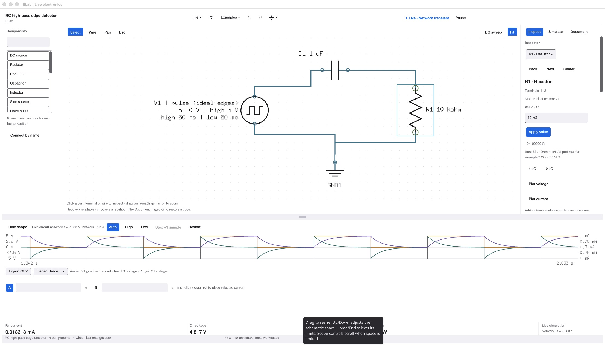

# Component coverage and library presentation

October 23, 2026. ELab 0.180.2 /200, application source `1f1cae82d8d42b915be8ca50247bcf5cde70b067`; repository documentation HEAD at review `ff8864a15004951315fb145447154aa825e58ee2`.

Audience: hobbyists and makers, with room to grow. This is an assessment and future design direction. No application, simulation or release-scope changes were made.

## Decision

The present catalog is sufficient for a focused first analog release, but it is not a complete general hobbyist library. Improve finding and recognizing the existing parts before expanding the model scope. Keep scrolling as part of a searchable, categorized library, with compact schematic-symbol-and-name rows.

This is a design judgment based on the current product, supported workflows and references below. It is not a user-study result or a statistical ranking of component demand.

## 1. Current library inspection — available, but cramped

The current /200 owner window was captured read-only while it displayed an RC high-pass example. No clicks, typing, circuit changes or navigation were performed. The screenshot was saved and reopened before accepting it as evidence. Source inspection and a fresh packaged-agent `parts.list` query supplement this one visible state.

[Accessibility snapshot](ui-audit/component-library-200/01-current-library.ax.txt) · [Packaged component catalog](ui-audit/component-library-200/parts-catalog.json).

Confirmed observations:

- The list shows roughly six complete rows and part of a seventh, despite considerable free space below the library controls in this window.
- Components are presented as text rows with an outline around each row, without their schematic symbols. This increases the visual resemblance to a stack of buttons.
- Sources, passive devices, transistors and connection helpers share one flat sequence; the visible starting group gives little indication that op-amps or MOSFETs exist farther down.
- The empty search field has no visible search label or hint in the captured state. It does have an accessible Search components name in the AX snapshot.
- The source caps the list at 220 logical units high. The palette sits inside an additional scrolling rail; a redesign should deliberately assign scrolling ownership and keep exact-placement/named-wiring controls reachable.
- Search by names/aliases and keyboard list instructions already exist. Those are assets to preserve. Full keyboard and assistive-technology behavior were not exercised in this review.

Code concern requiring a focused interaction test: `componentPalette` requests focus on the result list after a successful search change. Before making search more prominent, confirm that a person can type a complete query without focus moving prematurely. This is a code-review concern, not a reproduced failure in this capture.

Sources inspected: `workbench/graph.go`, `workbench/library.go`, `desktop/component_palette.go`, `desktop/document_workspace.go`, `desktop/keyboard_workflow.go`, and the rail layout in `desktop/view.go`. The image proves the observed layout only; it does not establish placement success, search usability, compact-window behavior or accessibility compliance.

## Component inventory

The exact packaged API returns 18 palette entries. That count includes four source forms and three connection helpers, so it should not be described as 18 distinct physical electronic devices.

| Suggested family | Present entries | Count |
| --- | --- | --- |
| Sources | DC voltage source, sine voltage source, finite pulse, ideal square | 4 |
| Passives | Resistor, potentiometer, capacitor, inductor | 4 |
| Semiconductors | Red LED, silicon diode, NPN transistor, N-channel MOSFET, P-channel MOSFET | 5 |
| Amplifiers | Powered op-amp | 1 |
| Switches | SPST switch | 1 |
| Connections | Ground, junction, net label | 3 |

This supports introductory LED circuits, dividers, RC filters/timing, RL/RLC experiments, discrete transistor switching, MOSFET switching/inversion, rectification/smoothing and op-amp experiments. It is a useful analog core.

Some apparent gaps are already covered through existing parts or tools:

- Battery and power supply already search to the DC source. A separate battery entry would not by itself add battery discharge or internal-resistance behavior.
- Different resistor/capacitor values are properties of the same kind.
- Voltage/current inspection and scope traces already exist as tools/probes; they need not each become a palette component.
- A bridge rectifier can be assembled from four existing diodes. A future reusable block is a convenience distinct from a new diode model.

## Gaps, prioritized after the frozen first release

| Priority | Candidate | Hobbyist workflows opened or simplified | Scope consideration |
| --- | --- | --- | --- |
| First analog additions | PNP transistor | Complementary BJT stages and high-side bipolar switching | A complementary nonlinear device model needs DC/transient and sign-convention validation |
| First analog additions | Zener and Schottky diodes | Simple regulation/clamps and low-forward-drop power circuits | Breakdown and forward behavior must be represented accurately enough for the stated educational model |
| First interaction additions | Momentary push button and SPDT switch | Trigger/reset controls and selecting between paths | Define real interaction/agent semantics and transient state continuity |
| Next learning expansion | 555 timer and basic logic gates | Familiar timer, oscillator and elementary digital projects | Stateful/mixed-signal behavior deserves a separate validated increment |
| Later, workflow-driven | Current source, comparator/regulator models, thermistor/LDR, relay/transformer/motor | Biasing, threshold/power/sensing and electromechanical projects | Choose from actual target projects; these vary substantially in modeling effort |

Other LED colors or capacitor appearances can be useful variants, but distinguish visual variants and parameter presets from new simulated behavior. A named physical device should have documented parameter provenance and limits. Do not imply a calibrated 2N3904 or LM358 merely by renaming a generic model.

For comparison, [iCircuit's official element reference](https://icircuitapp.com/elements) groups a much broader catalog into sources, analog, silicon, digital, ICs, microcontrollers and circuit helpers. That identifies future breadth; it does not establish that ELab needs every family before its first analog release.

## Recommended library experience

1. **Make the existing panel clearer first.** Show a visible Search components hint. Use plain compact selectable rows, with the actual schematic symbol beside the part name. Let the result region use the space available instead of a fixed short box. Keep the search reachable while browsing.
2. **Add shallow categories.** Sources, Passives, Semiconductors, Amplifiers/ICs, Switches and Connections are sufficient for the current set. Start with easy browsing; avoid a deep library tree or a compulsory dialog for every insertion. Search should work across the whole catalog and identify each result's family.
3. **Provide a Common starting view.** DC source, resistor, capacitor, LED, switch and ground form a sensible initial set. Later Recent or Favorites views can help repetitive construction. They should be deliberate additions with clear state ownership, rather than implicitly expanding the frozen first-release scope.
4. **Preserve both mouse and keyboard placement.** Click a part to enter the existing placement tool, then click the sheet; keep keyboard selection and exact placement available. Drag-to-place and a keyboard-openable quick-insert browser are possible later accelerators, subject to interaction validation and shortcut checks.
5. **Use an expanded visual browser when the catalog grows.** A searchable popover or larger library panel can show more symbols with categories and descriptions. Keep names visible; an icon-only grid would make unfamiliar transistor/IC symbols harder for beginners to distinguish. Large cards would consume the narrow sidebar quickly.

[Apple's Keynote guide](https://support.apple.com/en-sg/guide/keynote/tanbbe3614e0/mac) documents a visual shape library with categories, search and access to recently used shapes. This supports the proposed browsing pattern; it does not prove it is optimal for circuit design. [KiCad 9's symbol chooser](https://docs.kicad.org/9.0/en/eeschema/eeschema.html#placing-symbols) combines library grouping with search across names and descriptive fields. Both references support combining browsing and search.

Scrolling itself is appropriate. The problem in the inspected ELab state is the short, flat, text-only presentation and weak use of the available space. A searchable library with visual recognition and shallow grouping addresses that problem without requiring an immediate expansion of the simulator.

## User/agent parity and release boundary

Category filtering, symbols and layout can organize the current catalog while placement continues through `drawing.tool.set` and existing component commands. Search already uses `parts.search.set`. Preserve accessible names, keyboard focus, selected state and explicit placement feedback. If categories/recents/favorites become application state, expose them consistently to agents and define whether they are session or saved preferences.

A future component is complete only when its catalog metadata, symbol/terminals, placement/editing, rotation/wiring, persistence, probing, live simulation, validation limits, documentation and agent discovery agree. Each new device should have meaningful numerical references, not just a larger entry count.

Recommendation for the next product decision: improve the organization and recognition of the existing library, keep the first-release component set fixed, and maintain the missing families as a prioritized post-release backlog. This review has not implemented any of those UI or model changes.
