# Workflow findings from three hobbyist circuits

The observed workflows favor **live exploration with a clear path to precise measurement**. iCircuit keeps component values and their effects together. Falstad makes internal behavior visible with little setup. LTspice and KiCad provide useful ways to specify, inspect, and repeat an analysis. The strongest new-product concept combines these interaction patterns while keeping model assumptions visible.

The numbered steps below describe the tested journeys, not counts of individual clicks. “Healthy” means the action produced a useful result in this session. “Mixed” means it succeeded with a meaningful interpretation or discovery burden. These are analyst observations, not ratings collected from hobbyists. Circuit construction was prepared in files; no complete drawing-from-blank comparison is claimed.

## iCircuit

### 1 Open and inspect the LED

**Health: healthy.** Opening the fixture produced a running circuit with voltage colors and animated current dots. Selecting the LED exposed current, voltage, power, and its forward-voltage assumption in the same inspector. The measured current was 3.271 mA at 1 kΩ.

**Strength:** the circuit remains the center of attention. A beginner can connect “this component” to “this measurement” without learning a separate plotting workflow. The inspector also links to explanatory material.

**Friction:** `Fwd Voltage @ 1A` is a specific model parameter, not the LED's voltage at the current operating point. Showing both without explaining their relationship could confuse a novice. This is an interpretation risk, not an observed user error.

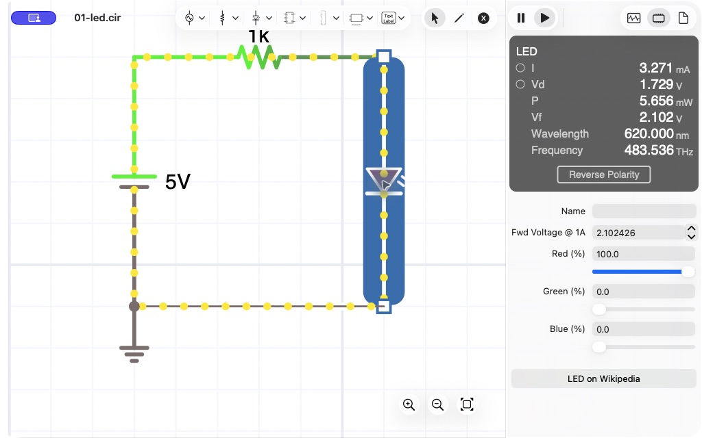

### 2 Change resistance and observe the consequence

**Health: healthy.** Entering `2k` in the resistor inspector immediately changed the current to 1.658 mA after accepting the value. No separate Run action was needed. The resistance, voltage drop, current, and power were visible beside the circuit.

**Design lesson:** preserve this short edit–observe loop. A value editor could additionally show the previous result so the effect is visible even if the user did not memorize it.

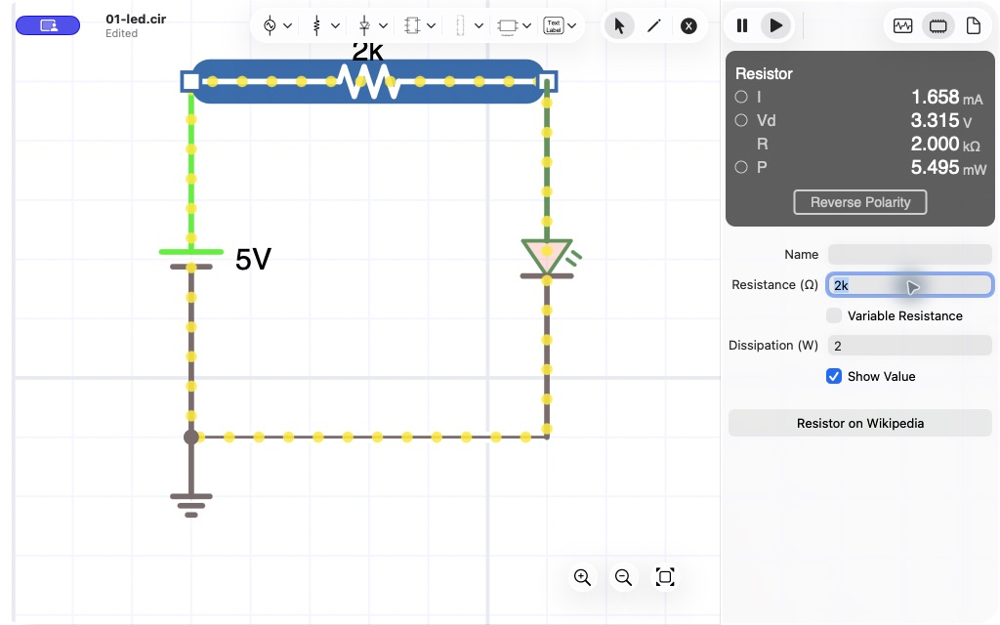

### 3 Add an RC scope and inspect simulation resolution

**Health: mixed.** Selecting the capacitor and using the circle beside its Vd meter added a scope. Setting a 300 ms duration made several cycles readable. The path is compact once discovered, but the small circle does not explicitly say “Plot voltage.”

At the observed automatic bandwidth of 256 Hz, the scope displayed a minimum near 67.45 mV and a frequency estimate of 10.24 Hz. After selecting manual 100 kHz bandwidth, the displayed minimum was 33.55 mV and the frequency estimate 10.01 Hz. The latter extrema were much closer to the ideal periodic RC calculation. **The scope's frequency estimate is not proof that the source oscillator itself ran at that frequency.** This single case does not establish general numerical accuracy.

**Design lesson:** show the active resolution and warn when the solver or measurement display may under-resolve the circuit. A smooth animation should not be the only sign that the result is trustworthy.

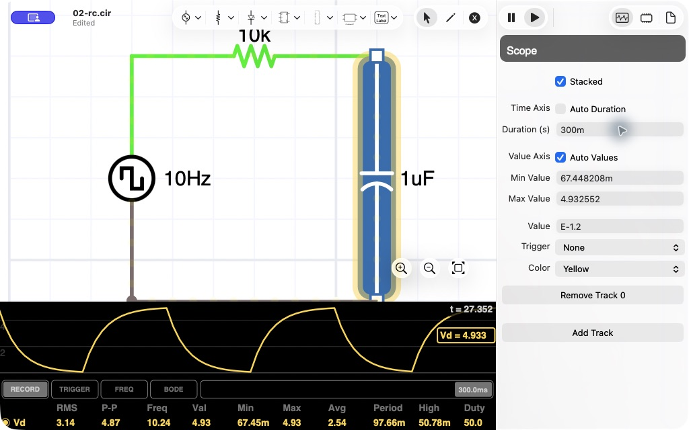

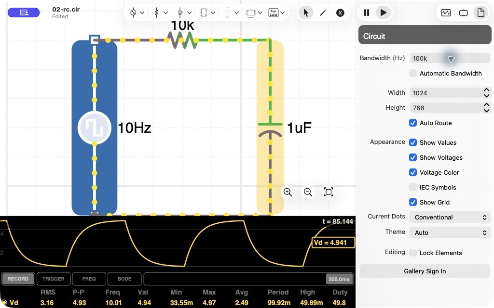

### 4 Inspect the transistor switch

**Health: healthy for qualitative exploration.** The inspector exposed transistor quantities and a `cutoff` state label. Adding Vce to the scope showed switching between approximately 50.61 mV and 5 V with the native model.

**Design lesson:** component-specific state labels help bridge physical explanations and equations. The new product should explain why a transistor is in cutoff or saturation and link that explanation to its measured voltages and currents.

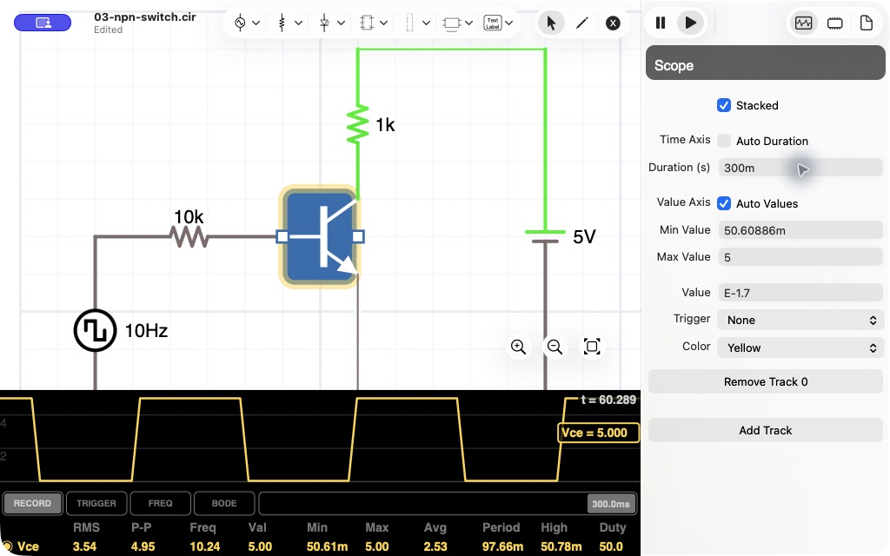

## Falstad CircuitJS

### 5 Import and inspect the LED

**Health: healthy.** The hosted application opened without an account gate, and a text import produced a live circuit. The component readout identified the imported LED model as `old-default-led` and displayed current, voltage, and power. The baseline current was 3.195 mA.

**Strength:** animation and a contextual numerical readout work together. Model identity was visible, although the legacy model name says little about its physical assumptions.

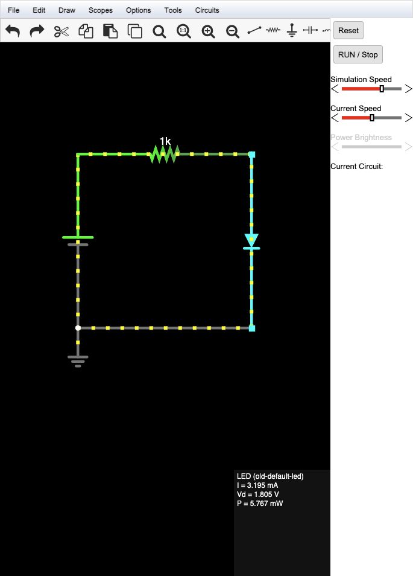

### 6 Edit the resistor

**Health: healthy.** The resistor's modal editor accepted `2k`; accepting it updated the running circuit to 1.615 mA without pressing Run. The dialog provides explicit acceptance controls, while iCircuit keeps editing in the side inspector.

**Design lesson:** offer both direct numerical editing and a persistent inspector. The important behavior is that accepting a change gives immediate, visible feedback.

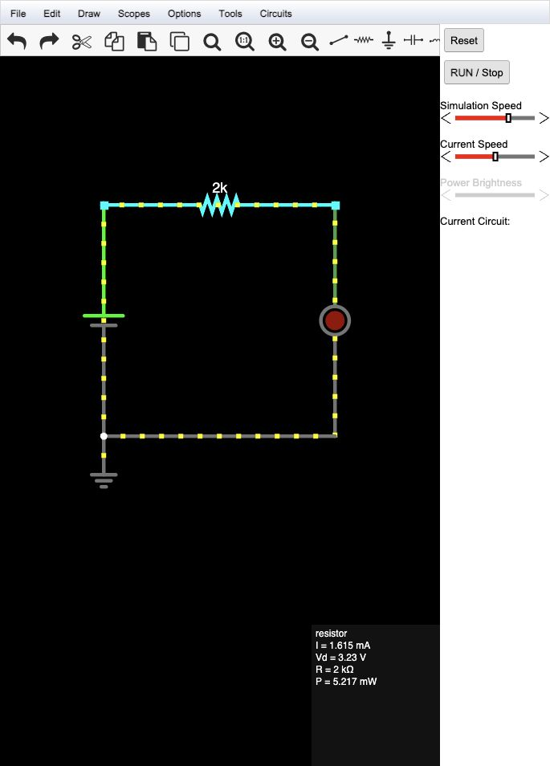

### 7 Add and configure the RC scope

**Health: mixed.** Right-clicking the capacitor and choosing View in New Scope exposed its waveform. The initial scope included voltage and current; scope properties allowed current to be hidden and scale, minimum, and frequency to be shown. The final display read 4.967 V maximum and 33.481 mV minimum, close to the analytical steady-state values.

**Strength:** useful measurements are available without building a separate testbench. **Friction:** the desired presentation required navigating the component and scope context menus. The narrow browser viewport limited plot space; that is not a controlled comparison with the desktop windows.

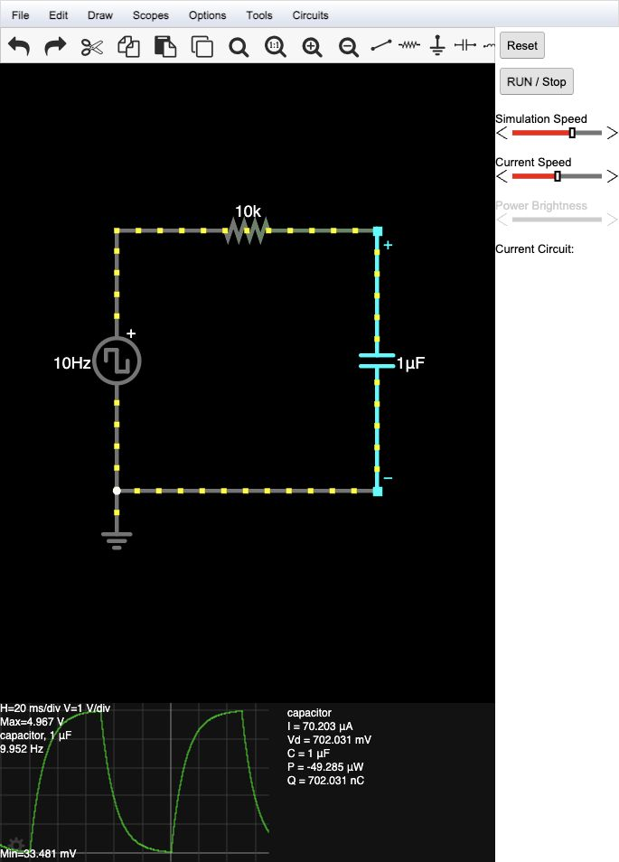

### 8 Inspect NPN behavior and export the experiment

**Health: healthy for behavior, mixed for interpreting extrema.** The transistor readout named cutoff, beta, currents, and terminal voltages. Scope choices exposed Ib, Ic, Ie, Vbe, Vbc, Vce, and a Vce-versus-Ic view. The tested Vce trace showed switching, and text export retained the circuit and scope configuration.

The captured scope minimum was 0 V, including startup history; it is **not** accepted as the settled saturation voltage. A useful new-product feature would distinguish whole-history extrema from measurements in a selected steady-state interval.

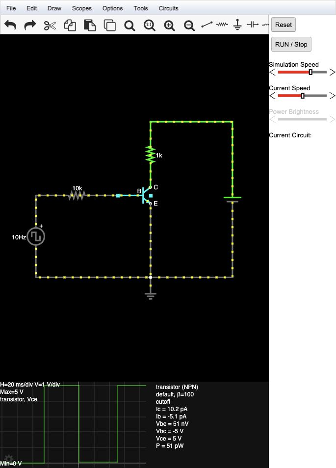

## LTspice

### 9 Run an operating point and change the LED resistor

**Health: healthy for explicit verification.** Running the prepared `.op` schematic opened a table of node voltages and device currents. The baseline was 2.91679 mA. Right-clicking the resistor opened its property dialog; changing it to 2 kΩ and explicitly rerunning gave 1.47672 mA.

**Strength:** the result is a stable snapshot associated with an analysis. **Friction for a first-time maker:** `.op`, signed source current, and generic device names require interpretation. In this workflow the edit and result are separated by Run and the result window.

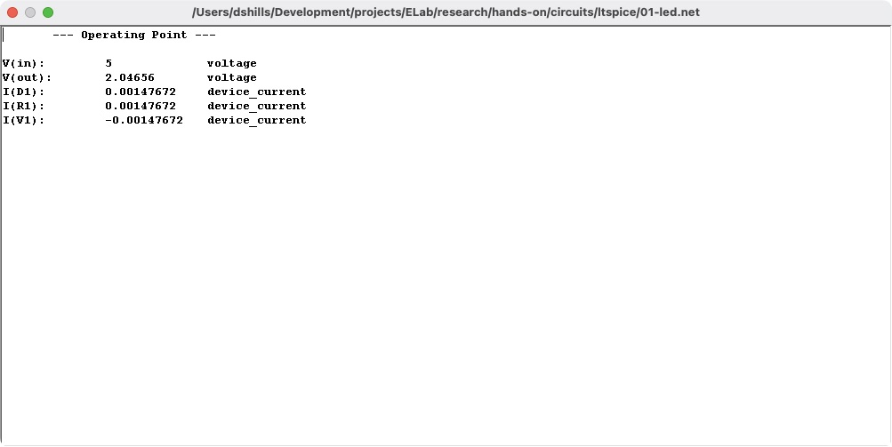

### 10 Run RC transient analysis and probe wires

**Health: healthy once the analysis is configured.** Running the prepared `.tran` circuit opened a plot. Clicking output and input wires added their traces. The `.meas` command recorded 3.16051094075 V at 10 ms in the [simulation log](circuits/ltspice/02-rc.log).

**Strength:** probing connects the schematic to its waveform directly, while measurement commands provide repeatable checks. The tiled view supports seeing both. **Friction:** multiple open test documents became small when tiled. Overlapping text in the generated schematic is a fixture-layout limitation and is not attributed to LTspice's editor.

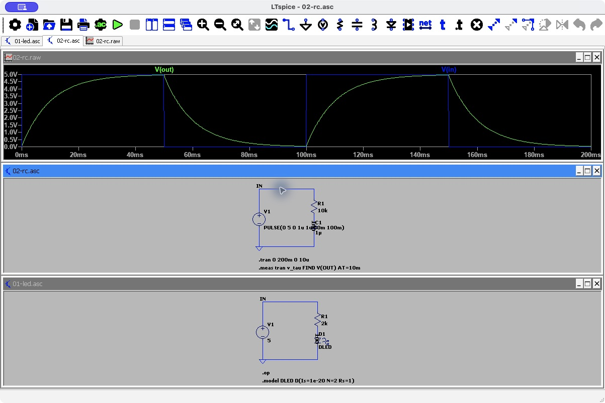

### 11 Verify transistor switching

**Health: healthy.** The collector trace showed inverted switching. Saved measurements gave 70.399299264 mV at 25 ms and 5 V at 75 ms with the specified generic NPN model. See the [NPN log](circuits/ltspice/03-npn-switch.log).

**Design lesson:** retain a named, reproducible analysis even in a product whose default mode is live. A maker should be able to save “collector voltage while on” without learning measurement syntax first.

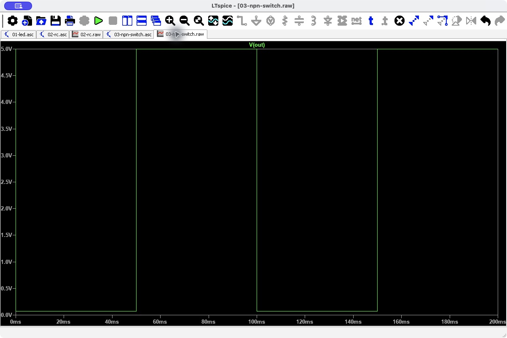

## KiCad

### 12 Open the RC simulator and select signals

**Health: mixed for entry, healthy for measurement.** Inspect → Simulator opened a separate workspace, recognized the schematic's transient directive, and ran the analysis. Plot checkboxes exposed available voltage, current, and power signals. Enabling the output cursor and entering `10m` in its time cell produced 3.16 V.

**Strength:** an explicit list makes available measurements discoverable; an editable cursor time avoids precise mouse placement. **Friction:** the separate workspace and detailed console add concepts before a beginner sees the answer. The initially small window needed resizing, but it may reflect saved local state and is not asserted to be a factory default.

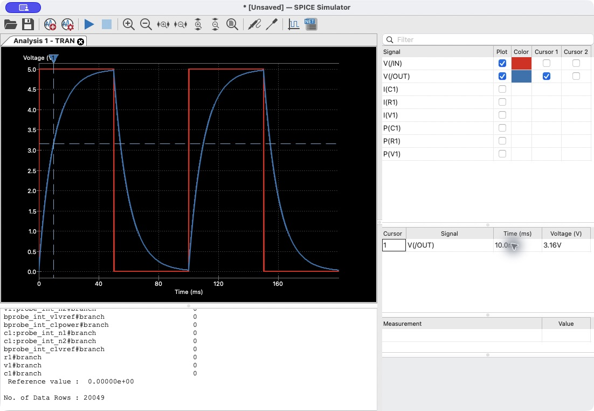

### 13 Run the LED operating point and return to the schematic

**Health: healthy after fixture correction.** The simulator's console displayed 2.91678 mA and 2.08322 V, closely matching LTspice using the same diode model. Returning to the schematic exposed voltage and current annotations on the relevant nodes and components.

**Strength:** the annotations preserve the relationship between calculated values and circuit structure. The operating-point workspace's large plot area says no plots were produced while the useful result is in the console. A product optimized for beginners could present a dedicated operating-point result card instead.

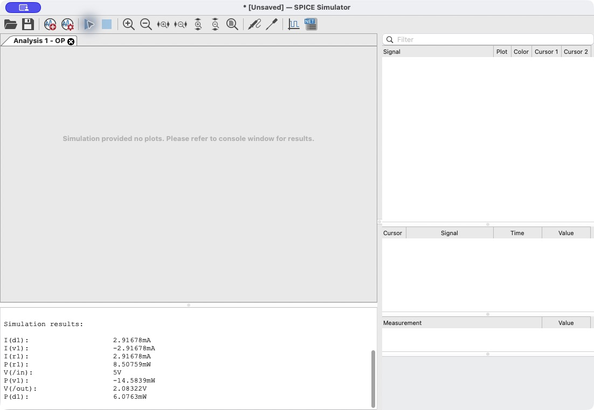

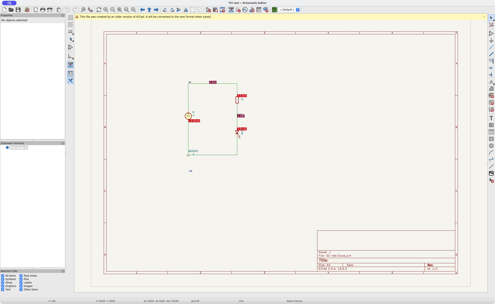

### 14 Annotate and run the NPN switch

**Health: healthy with a guided prerequisite.** The generated `RB`/`RC` references lacked numbers. Before simulation, KiCad opened an annotation dialog explaining the requirement; Annotate and Close allowed the run to continue. The output cursor at 25 ms read 70.4 mV, agreeing with LTspice to the displayed precision. The saved workbook preserves the selected traces and cursor position.

**Design lesson:** when a prerequisite is missing, offer the correction at the point of need. The numbering requirement arose from our generated fixture, so its incidence says nothing about typical KiCad projects.

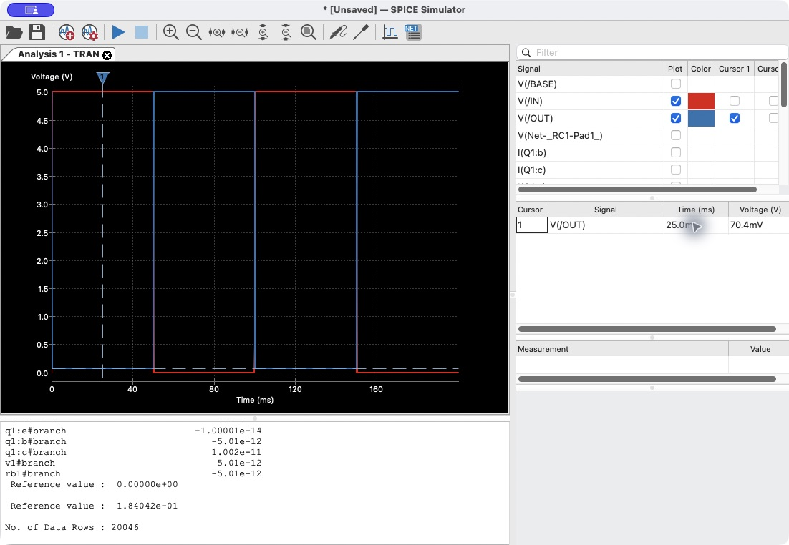

## Accessibility risks visible in this sample

These are inspection risks, not a compliance assessment. No screen-reader or complete keyboard-only journey was tested.

| Evidence | Visible risk | Design response to test |
|---|---|---|
| iCircuit steps 1–4 | Small unlabeled scope circles and several icon controls require discovery; animated color carries information | Explicit Plot voltage/current actions, keyboard focus, text state labels, optional motion |
| Falstad steps 5–8 | Canvas measurements and context menus carry much of the experience; traces and current animation rely heavily on color | Accessible component list, keyboard equivalents, persistent numeric readouts, distinguishable trace styles |
| LTspice steps 9–11 | Dense toolbar and sparse accessibility exposure in this Mac automation session | Labeled commands and a searchable command palette; test with actual assistive technology before drawing conclusions |
| KiCad steps 12–14 | Dense signal grids and small plot checkboxes; colors distinguish simultaneous traces | Larger targets, direct signal search, trace labels and styles, keyboard editing of measurement tables |

## What this establishes

The evidence establishes that the prepared circuits ran, the documented interactions produced results, and the UI patterns above are worth considering. It does not establish what most hobbyists prefer, how quickly a novice learns each app, overall solver accuracy, model-library completeness, or the quality of PCB workflows. Those questions need separate tests. The [next design experiments](design-opportunities.md) turn the observed patterns into testable proposals.
