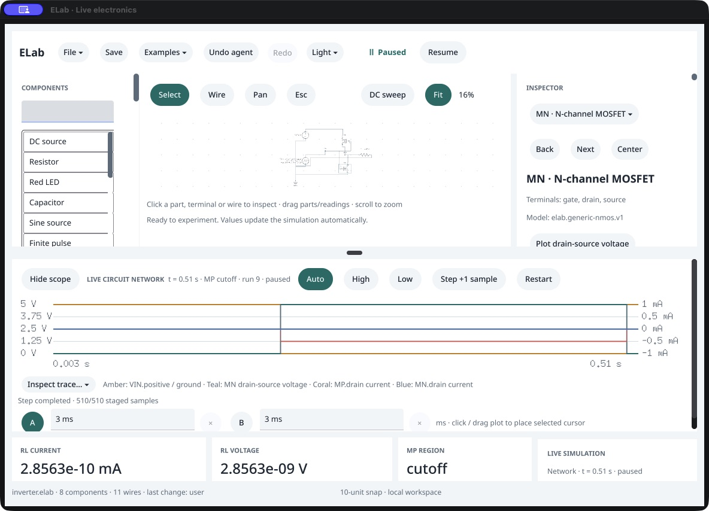
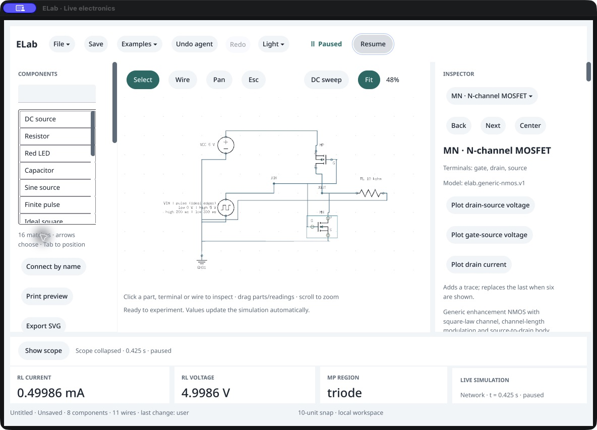
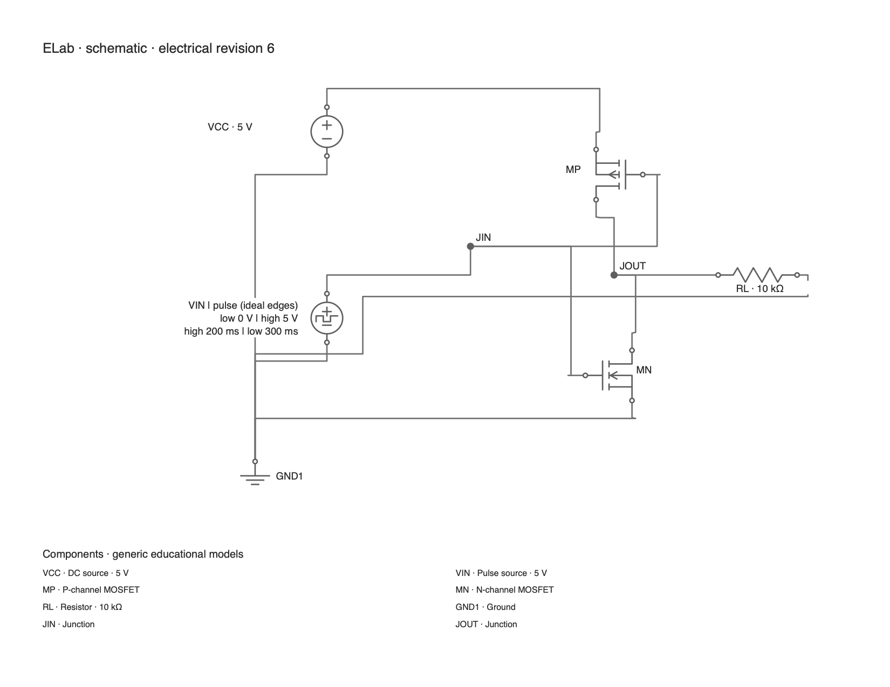

# Guided complementary inverter: native and output review

October 16, 2026. Owned macOS development candidate 0.102.0 /117. This checks the new electronics example and two defects found while using it; it is not full responsive-layout, physical-device or accessibility acceptance.

1. **Drawing — repaired.** The first exported template routed input and output along one visible horizontal segment despite separate electrical nets. A new regression reproduced W3/W6 sharing that segment. Moving the input junction and ground reference separates those routes and clears the PMOS caption. Orthogonal crossings still use the existing explicit-junction semantics. The final native/headless SVG/PNG bytes match. [Final export](04-exported-schematic.png).
2. **Device region — repaired.** With MN selected, the first candidate called MP's `cutoff` state simply “MOSFET REGION” and left its ID out of the scope caption. The failing native regression preserves this observation. The final whole-network summary says “MP REGION” and the live scope says “MP cutoff”; selecting MN does not silently change which summary device is shown. [Before](01-before-region-label.png), [after](02-named-region-and-scope.png).
3. **Four-trace workflow — observed.** The default scope shows input/output voltage and signed MP/MN drain currents across both input phases. Public/native observations, 107 captured rows and exports match. Independent scalar load-line references cover each saved row; core checks also cover 0, 1.5, 2.5, 3.5 and 5 V input. The midpoint experiment gives about 2.381 V output and ±52 mA channel currents. This uses generic zero-charge models and does not establish real logic-gate delay or transition losses.
4. **Native menu and schematic — observed with limits.** CUA opened Examples, found CMOS inverter, and activated it. Actual Pause followed; public inspection confirms the unchanged template at 0.425 s, input 0 V, MP triode/MN cutoff and output above 4.99 V. Physical Hide scope enlarged Fit from about 16% to 48%, making the full route structure inspectable. Text is still small; the scope-expanded schematic is particularly difficult to read. [Expanded schematic](03-native-circuit-expanded.png).

The screenshots were saved through CUA and opened from their files. The exported image was generated by the public command and inspected directly. No OS appearance settings or SDK files were changed. Complete mounted typing/IME, pointer/wheel, screen-reader, every font/window/zoom combination, visible latency and participant qualification remain open. The CUA tree still omits several visible inspector labels/fields; this pass does not claim to repair that existing issue.

