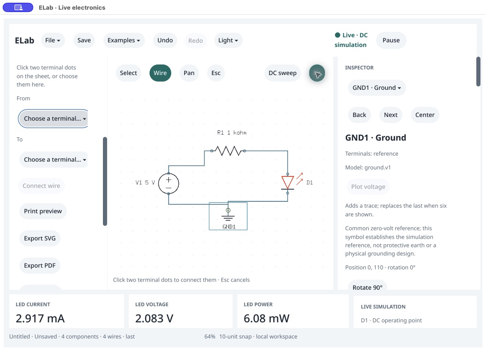

# LED construction from blank · native /159

October 18, 2026. **The stopped construction/wiring/history workflow now passes on the /159 executable.** Actual native palette selection, typed coordinates, native terminal menus and toolbar Undo/Redo produce the same circuit and results as an independently constructed packaged-agent reference. Final current is **2.916796577 mA**, displayed as **2.917 mA**. This covers the construction portion of walkthrough task A; it is not owner acceptance or the complete four-task walkthrough.

The isolated host starts with zero components and wires. The observer does not seed its graph, selection or wiring. A separate headless process builds the reference first. Native endpoint commands only observe/wait until the explicitly allowed final save and close. All four placement states, four wiring states, Undo and Redo pass the comparison. [Observer](observer-source.py), [state journal](native-session.json.gz), [stage summary](stage-summary.json), [input transcription](ui-observation.txt).

| Native action | Verified result |
|---|---|
| Palette → DC source | V1 at default `(-200,0)`, 5 V. |
| Resistor, typed X=0/Y=−110, one accessibility Place | R1 at `(0,-110)`, 1 kΩ; the formerly lost coordinate commits correctly. |
| LED, typed X=200/Y=0 | D1 at `(200,0)`. |
| Ground, typed X=0/Y=110 | GND1 at `(0,110)`. |
| Native From/To menus, four Connect wire actions | V1.positive → R1.1; R1.2 → D1.anode; D1.cathode → GND1.reference; GND1.reference → V1.negative. Each menu draft clears after connection. |
| Completed loop | Fresh 2.917 mA, 2.083 V LED drop and 6.08 mW on screen; exact full result matches the reference. |
| Toolbar Undo | Last wire removed; old readings explicitly marked stale in header and footer. Three-wire graph and stale result match reference. |
| Toolbar Redo, then Fit | Four-wire graph and fresh result restored. Fit exposes the complete schematic and captions at 64%. |

The comparator checks components, wires, nets, selection, drawing state, undo/redo names and pause state, plus the complete result and scope. Independent run/electrical identities are excluded by the existing numerical comparator; user versus agent actor attribution and native viewport/session revisions are not required to match. The agent uses the same compiled models, not an independent circuit solver. [A native terminal menu](wire-2-from-menu.png), [resistor private draft](resistor-private.png), [stale Undo](undo.png), [fresh Redo](redo.png).

After the actual UI construction, the controller saves [the native-built circuit](<Native built LED.elab>) and [the agent reference](<Agent built LED.elab>) through public commands. Every saved field except `view` matches; Fit/native layout legitimately differs from the headless viewport. A fresh packaged agent loads the native-built file from blank and matches components/wires/nets and complete fresh result/scope, with a clean document. [Fresh reopen](fresh-agent-reopen.json.gz). These are agent Save/Open checks, not new native file-panel observations.

Native SHA `063bd50f74507cab0156ea9ff98c1488c59c26e7bd71c5777c0d903f7c463537` and agent SHA `ac6185607ad04c76ba205e8e6e71d79d7b724d4c534d66a73d5a04f5be9b5c0b` match the sealed 0.142.0 /159 review, clean source `37046dc`, SDK `b22478c`. The executable runs in a disposable bundle with a custom identifier/executable name; its modified Info.plist is not an intact sealed-bundle claim. [Identity](source-release-identity.json) verifies 68 native source hashes, 343 runtime inputs and all 257 sealed package entries unchanged. Earlier copied-runtime isolation qualification retains its separate scope.

Original PID 50780 closes normally with exit 0; [process absence](process-verification.json) is verified. The stopped disposable bundle's previous executable, plist and resource manifest bytes are [restored](harness-restoration.json). No post-close `getApp`, owner window, printer or OS settings action occurs. No product/SDK/version changes or repeated Go gate were needed; the already qualified source remains unchanged.

This is one exact-coordinate/named-menu construction path, not pointer-terminal dragging, a keyboard-only workflow, a failure-rate estimate or exhaustive native conformance. Current-build value editing and explicit Delete/reconnect are the remaining task-A interaction check; other circuits/exports, full reader/IME/concurrent/blur behavior, visible-p95, environment/distribution and owner/study acceptance retain their existing limits. Owner remains “Not tried yet”; P0 stays 17 implemented /10 partial. [Checkpoint](checkpoint.json).
