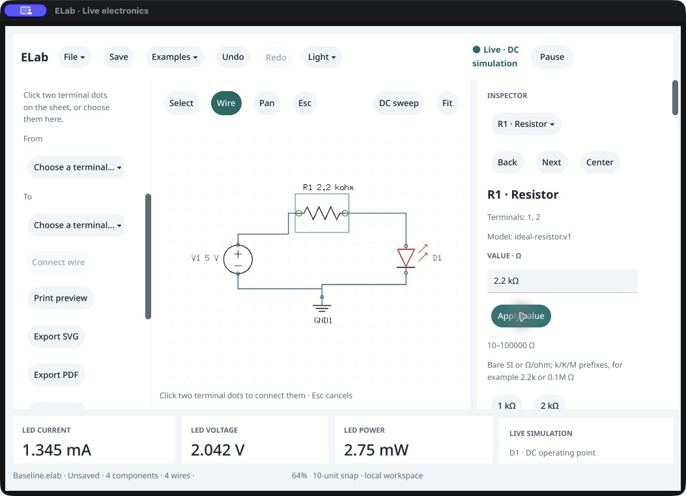

# Native LED editing · /159

October 18, 2026. **Electrical editing and agent parity pass, but native accessibility recovery has an open defect.** Resistor edits, Undo/Redo, wire Delete/reconnect, invalid-value refusal and correction produce the same graph and results as the independent packaged agent. After applying an invalid value, however, visible inspector controls disappear from the macOS accessibility tree. Pointer correction works. This does not close task A's accessibility acceptance or establish owner acceptance.

The observer publicly loads a copy of the [previous native-built circuit](../native-draw-159/README.md) and selects R1. This is an editing check with explicit initial seeding, separate from the prior blank construction check. Subsequent edits use actual native controls until the explicitly allowed final public Save and Close. A separate exact packaged agent executes the reference commands first. [Observer](observer-source.py), [state journal](native-session.json.gz), [stage summary](stage-summary.json), [input transcription](ui-observation.txt).

| Native action | Verified result |
|---|---|
| Type `2k` without Apply | Accepted graph, physics, scope, run, electrical revision, document and history remain unchanged. |
| Apply once | R1 becomes 2 kΩ; current drops from 2.916796577 to 1.476723549 mA. Full graph/result/scope/history matches the reference. |
| Toolbar Undo, then Redo | Restores 1 kΩ, then 2 kΩ; both match the reference. The original loaded file remains unchanged. |
| Select W4, Delete selected | Three wires; old reading explicitly marked stale in header and footer. |
| Native From/To menus, Connect wire | GND1.reference → V1.negative creates W5. Four wires and fresh 1.477 mA return, matching the reference. |
| Select R1, type `0`, Apply | Invalid request refused; accepted graph/results/run/document/history remain unchanged. Visible message: “That request could not be applied.” |
| Pointer correction to `2.2k`, then pointer Apply | Private correction preserves accepted state and the error until Apply. Successful Apply clears it, restores AX controls, and produces fresh **1.344737452917332 mA**, shown as **1.345 mA**. |

The comparator checks components, wires, nets, selection, drawing draft, undo/redo names and pause state, plus the complete result/scope. It excludes independent run/electrical identities for cross-process comparison and legitimate actor/viewport differences. Within-session unchanged assertions include exact result/scope/run/electrical/document/history state. The agent uses the same compiled solver, not an independent physical model. [Stale deleted wire](deleted.png), [restored loop](reconnected.png).

## Open accessibility defect

Before the invalid Apply, `selection`, `value-entry`, `apply-value` and inspector text are exposed. Afterward, screenshots still show them, but repeated full CUA AX observations omit those leaves; row descendants such as the preset buttons remain exposed. The omission persists while the corrected private draft is visible. Fresh AX lookup therefore cannot target the correction field or Apply button. Pointer input at the observed field/button succeeds, and the controls reappear in AX after the valid Apply. [Refused screenshot](refused.png), [refused AX](refused.ax.txt), [corrected private screenshot](corrected-private.png), [corrected private AX](corrected-private.ax.txt), [structured finding](accessibility-recovery.json).

The state observer's `passed: true` qualifies its explicit domain assertions and public save comparison. It does **not** test AX availability. The enclosing [checkpoint](checkpoint.json) separately records failed native accessibility recovery; overall task A is still partial. No VoiceOver session, root-cause claim or fix is inferred. The generic error message also does not itself explain the resistor's bounds; the inspector shows 10–100000 Ω.

After the actual native edits, public commands save [the native-edited circuit](<Native edited LED.elab>) and [the agent reference](<Agent edited LED.elab>); every field except `view` matches. A fresh exact packaged agent starts blank, loads the native-edited file, and matches components/wires/nets plus complete fresh result/scope with a clean document. [Reopen proof](fresh-agent-reopen.json.gz), [producer](fresh-reopen-source.py). These are public Save/Open checks, not native file-panel observations.

The native executable SHA `063bd50f74507cab0156ea9ff98c1488c59c26e7bd71c5777c0d903f7c463537` and agent SHA `ac6185607ad04c76ba205e8e6e71d79d7b724d4c534d66a73d5a04f5be9b5c0b` match qualified 0.142.0 /159, clean source `37046dc`, SDK `b22478c`. The disposable bundle uses a custom identifier/executable name; this is not an intact sealed-bundle claim. [Release verification](source-release-identity.json) checks 68 native source hashes, 343 runtime inputs and all 257 sealed manifest entries. [Helper identities](producer-identity.json) match the release source.

Original PID 54987 closes normally with exit 0 and is [absent](process-verification.json). The stopped disposable bundle's earlier executable/plist/resource manifest are [restored](harness-restoration.json). [Preservation](preservation.json) checks the original circuit and canonical app. No post-close relaunch, owner window, printer or OS settings action occurs. No product/SDK/version change or repeated Go gate was needed to record this failure; existing quality qualification retains its original scope.

Next: reproduce and repair invalid-value AX publication before continuing wider native acceptance. Owner remains “Not tried yet”; P0 stays 17 implemented /10 partial. Native file panels, pointer-terminal dragging, keyboard-only operation, reader/IME coverage, visible-p95, distribution and study acceptance retain their separate limits.
