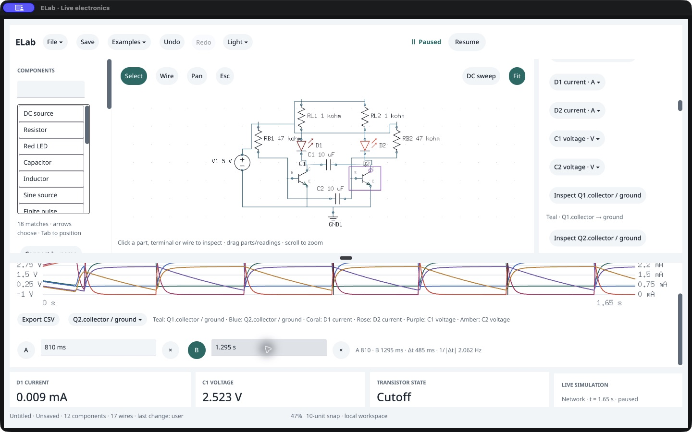
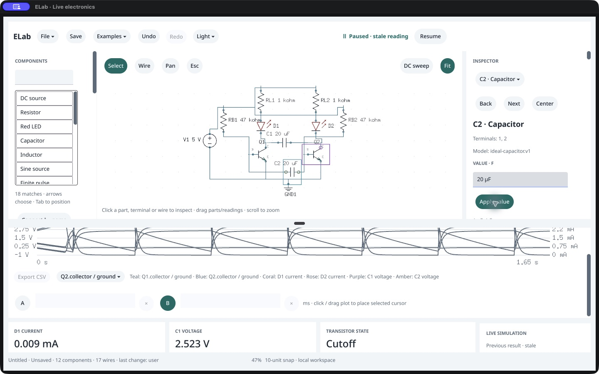
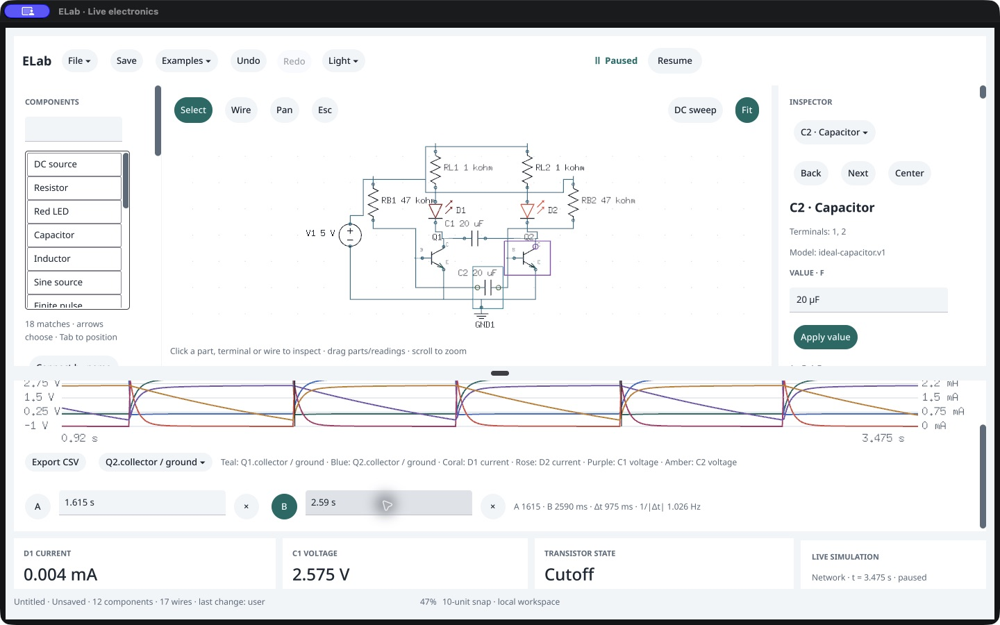

# Native timed-flasher workflow · /161

October 18, 2026: **passes** on the exact 0.144.0 /161 executable and packaged agent. Native Examples loading, live playback, probe changes, transistor trace focus, cursor entry and individual capacitor edits match a separate agent reference. Owner acceptance remains **Not tried yet**. No source, SDK, version, model or format changes; no promotion.

## Observed workflow

The owned native host starts blank, without public graph or trace seeding. CUA opens Examples → Capacitor-timed flasher, observes the new 12-component/17-wire view, pauses, restarts and resumes. An external observer waits for simulation time, then acknowledges each stage before the next native action. Pause retains 331 samples through 1.650 s. Replay advances the separate packaged reference to that observed simulation time; it does not equate wall time across processes.

The example has 5 V supply, 1 kΩ LED resistors, 47 kΩ base resistors and two 10 µF capacitors. C1 retains its explicit 0.1 V startup asymmetry; C2 starts at zero. Both LED currents fall below 10 µA and exceed 2 mA. They occupy opposite on/off states in 296 of 331 retained rows. Both collector-voltage probes match the corresponding NPN VCE. KCL and power residual checks pass. These checks supplement full native/reference graph, history, transient, mixed-network and scope comparison.

Actual native probe-6 selection replaces supply voltage with C2 voltage and backfills every retained sample. Native Inspect trace selects Q2.collector and highlights Q2. Private Cursor A/B typing preserves accepted circuit/physics/history; one-click B selection settles A and Enter settles B. At sampled D1 current crossings above 1 mA, A = 810 ms and B = 1295 ms give **Δt = 485 ms, reciprocal 2.062 Hz**.

The inspector then selects C1 and C2 individually. Each private `20uF` draft leaves accepted state intact; Apply changes only the intended value and retains the previous samples/trace as stale. The visible scope turns gray, stale labels appear and Step is disabled. Restart clears A/B and produces fresh startup; Resume/Pause reaches 3.475 s, retaining the configured 512-row rolling history. Two sampled D1 rises at 1.615 s and 2.590 s give **975 ms, reciprocal 1.026 Hz**. The period ratio is **2.0103**, within the stated ±0.06 ratio tolerance around two. Both sides continue alternating.

## Saving, closure and scope

After native actions finish, the public service saves native/reference copies. Every serialized field except native view matches, including the original startup voltage, both new capacitances, selected probes and paused setting. Two fresh packaged agents reopen them clean and paused at startup; graph/settings/probes and complete transient/mixed/scope output agree. Live waveforms, trace focus and cursor selection are session state, not saved-file claims. This check does not exercise native file panels; their earlier separate evidence remains applicable within its recorded scope.

Original PID 96942 closes normally with exit 0 and is verified absent. The stopped disposable custom bundle's three original files are restored. The sealed /161 release verifies all 68 native source hashes, 343 runtime inputs and 381 manifest entries; canonical /120 is unchanged. This uses the exact executable in an isolated bundle with a custom identity, not an intact-bundle launch claim. Existing clean source and copied-runtime quality qualification is reused; evidence-only work does not require another Go gate.

The 5 ms sample spacing brackets crossings; the displayed periods are sampled measurements. Doubling both capacitors supplies an independent model time-scaling check, not a hardware validation or a closed-form prediction of absolute period. Native/reference replay shares the solver. Signal thresholds and conservation checks provide additional invariants, without claiming exhaustive waveform accuracy. The overview is observed at 1440×900 and 47% Fit; universal label readability, VoiceOver/IME, visible p95 timing, other environments and human acceptance remain open. Remaining task C work is pulse-driven NPN and native NMOS/PMOS checks.

## Preserved producer failures

The [first attempt](first-attempt/native-session.json.gz) passes through actual Q2 focus but then the observer reads nonexistent `trace_focus.objects`; the schema uses `object_ids`. Overall failure remains recorded, and its owned host is terminated with −15 and restored. The corrected retry starts a fresh blank host and repeats the whole workflow; expanded reference preflight covers the remaining sequence. This was a producer error, not a native crash or failed focus.

Two post-close reopening verifier errors are retained: it first expected session cursor B to survive fresh process loading, then indexed an absent standalone DC `result` on a mixed transient circuit. The corrected verifier explicitly requires default A and compares optional result presence, retaining all other full comparisons. Neither error changes the saved circuits or repeats the physical UI actions.

Raw complete native/reference states are compressed in each attempt's `native-session.json.gz`. Unmodified CUA accessibility/image captures are archived and individually hashed in `ui-capture-index.json`; JPEG bytes originally named `.png` in the first attempt receive `.jpg` archive names without re-encoding. Endpoint credentials and executable backups are excluded. [Measurements](measurements.json), [stage order](stages.json), [restoration/release proof](retry/cleanup.json), [fresh reopen](retry/fresh-agent-reopen.json.gz) and [checkpoint](checkpoint.json) retain the exact evidence boundaries.
