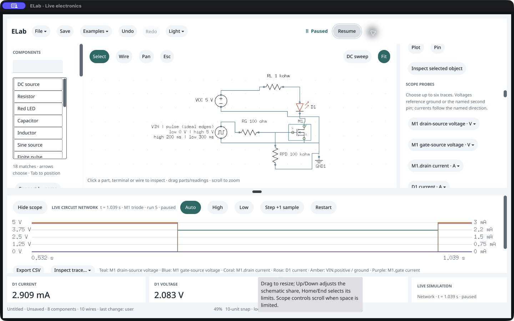

# Bounded native Pause reproduction · /161

October 18, 2026: **six single-click Resume/Pause cycles pass**, including the NPN → NMOS example/probe sequence preceding the [earlier incomplete Pause observation](../native-transistors-161/README.md). Every click is followed by observed native control replacement, accepted service state and packaged-agent parity. **The historical cause remains unknown.** The old failed checkpoint stays unchanged; these passes do not explain or erase that event.

## What was exercised

A fresh owned host starts blank on the exact 0.144.0 /161 executable. Actual native Examples loading, NPN Pause/Restart/Resume, Low/High/Auto plus Step, public Save, then native NMOS loading, Pause/Restart and gate-current probe selection recreate the preceding workflow. No public native graph/trace seeding is used.

Six cycles each invoke Resume once, observe native Pause, let the real clock advance, invoke Pause once and observe native Resume. The observer requires a paused snapshot, complete graph/history/result/transient/scope parity against a separate exact packaged agent, unchanged run ownership and stable accepted samples during another 120 ms observation. Each cycle accepts exactly two commands; none retries a click. Each native completion is visible in its first explicit post-action observation.

| Cycle | Start → paused simulation time | Command revision |
|---|---|---|
| 1 | 0 → 575 ms | 21 → 23 |
| 2 | 575 → 670 ms | 23 → 25 |
| 3 | 670 → 765 ms | 25 → 27 |
| 4 | 765 → 864 ms | 27 → 29 |
| 5 | 864 → 949 ms | 29 → 31 |
| 6 | 949 → 1039 ms | 31 → 33 |

The reference advances to the observed simulation time. This does not assume equal wall time or measure event-to-pixel latency. Independent phase/current/conservation checks use the prior bounded transistor reference; no PMOS precision claim is added.

## Source checks and cleanup

The three focused source race tests pass in 2.157 s: live samples do not invalidate rendered Pause, live repaint during a held Pause retains its context, and an intervening agent document replacement refuses the old control. Existing document/command guards remain intact. The initial sandbox attempt could not read Go's cache and never began tests; its log is retained separately. Existing AppKit deprecation and duplicate-libobjc warnings are preserved. No production source or SDK changes are made, so the prior complete quality/copy qualification remains applicable.

Native/reference saved NPN and NMOS files match in every field except native view. Four fresh packaged agents reopen matching clean, paused Auto startup with the same graph/settings/probes/models. Original PID 6294 closes normally with exit 0, is verified absent and its stopped disposable bundle is restored. All 68 native source hashes, 343 runtime inputs and 381 sealed /161 entries verify; canonical /120 is unchanged. This runs exact executable bytes in the custom test bundle, with no intact-bundle or native file-panel claim.

## Interpretation and next work

The earlier host was terminated while its Pause completion remained unobserved. It cannot now establish whether activation was delayed, missed or refused. This bounded reproduction did not reproduce a failure, and no source repair is justified by these results. Keep the earlier event as an unresolved input observation and review it alongside owner feedback; do not infer universal input reliability from six successes. The diagnostic host was designed to survive a failed completion for further inspection; that path was not needed or qualified here.

Independent file/recovery work is next: preserve an owned last manual save across controlled interruption and native recovery. Owner acceptance, broader input/reader/IME/latency/environment/distribution gates, and the separately failed strict 1 mV PMOS cutoff drain-voltage comparison remain open. No feature expansion, new version or promotion; P0 remains 17 implemented /10 partial.

[Cycles](cycles.json), [source test record](source-tests.json), [raw journal](native-session.json.gz), [fresh reopens](fresh-agent-reopen.json.gz), [cleanup](cleanup.json), [capture archive index](ui-capture-index.json) and [checkpoint](checkpoint.json) retain the evidence. Images/accessibility captures are unmodified. Endpoint credentials and executable backups are excluded.
