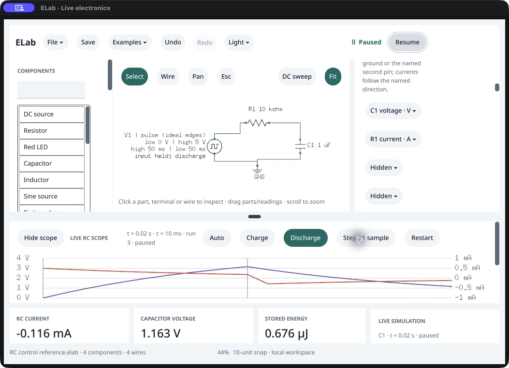

# Native RC controls and measurements · /160

October 18, 2026. **Control/cursor assertions pass, but a scope/CSV measurement defect is open.** This is engineering testing; the owner's walkthrough remains “Not tried yet.”

An actual blank native session loads Examples → RC charge / discharge, then uses the native Pause, Restart, probe selectors, Charge, Discharge, Step, Resume, cursor fields, Select and Clear controls. No graph or trace is seeded through the agent endpoint. A separate exact packaged agent supplies reference states. [Observer](observer-source.py), [journal](native-session.json.gz), [stages](stage-summary.json), [protocol](validation-protocol.json).

Forty individually observed 1 ms Step actions exercise charge, discharge and a fresh charge trace. At 10 ms, voltage is 3.1606027941427888 V. Ten discharge steps reach 1.1627207896741474 V at 20 ms. Capacitor voltage and energy remain continuous across input changes. Native live Resume/Pause reaches 146 ms; the reference uses public Step to that observed time, without a wall-clock equivalence claim. Restart creates a fresh run; the other actions preserve its identity. [Run checks](run-ownership.json), [step observations](step-actions.json).

Private cursor input preserves accepted state. Selecting B settles A at 4 ms, Enter commits B at 16 ms, and readings match independent RC voltage/current equations. Clear A retains B and removes the interval. Public Save copies match except viewport, and fresh packaged agents reopen matching clean schematics, settings and probe selections at startup. These are not native Save/Open panel tests or persistence of live waveforms/cursors. [Fresh reopening](fresh-agent-reopen.json.gz).

## Failing measurement

At the manual Charge → Discharge transition at 10 ms, the solver retains both sides of the edge. Current correctly changes from +0.1839397206 mA to −0.3160602794 mA while capacitor voltage stays constant. The `i:R1` scope repeats the positive value for both points. Its reported minimum consequently misses the immediate negative peak. A fresh public-agent reproduction exports the same incorrect duplicate in [CSV](<RC edge.csv>). [Independent checks and exact values](scope-edge-check.json), [reproduction source](scope-edge-check-source.py).

`applyRCInputLocked` updates scalar input/current and appends the sample while retaining its previous immutable probe frame. Scope and CSV read that stale frame. `rcSample` already constructs a fresh correctly oriented frame. The reference agent shares this implementation, so matching native/agent states alone did not detect the error. The observer's `passed: true` covers its enumerated assertions; the enclosing checkpoint is **false**.

The initial attempt sent Pause before observing the loaded RC view and failed its paused precondition. Its raw failure and terminated-process cleanup remain in [first-attempt](first-attempt). The retry explicitly observes the loaded scope before Pause; it does not qualify rapid activation during document replacement or establish the failed attempt's precise action ordering.

The native executable SHA `4158b9b1332e36a458c03c40c1075c72127a6aadd728dafc5b8db5aebb512eef` matches 0.143.0 /160, clean source `4403097`, SDK `b22478c`. The isolated bundle has a custom identity; no intact sealed-bundle claim is made. [Release verification](source-release-identity.json) covers 68 native sources, 343 runtime inputs and 343 manifest entries. PID 71171 exits normally, is absent, and its stopped custom bundle is restored. [Process](process-verification.json), [restoration](harness-restoration.json).

No product/SDK/version changes or promotion occur in this evidence checkpoint. Earlier source/runtime qualification retains its original scope. RC construction from individual parts, native CSV panels, broader input/accessibility, latency, distribution and owner acceptance remain separate. Next: repair cached RC input-edge frames and verify the solver, scope and CSV against independent equations.
