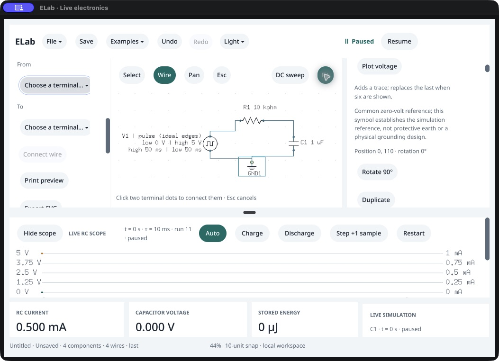

# RC construction from blank · native /161

October 18, 2026. **Native placement, value editing, named wiring, charge/discharge, cursor measurements and Resume/Pause pass against the packaged agent and RC equations.** This covers the construction and core measurement/control portions of task B. Owner acceptance remains “Not tried yet.” Paused electrical edits of an already accepted trace retain their separate acceptance work.

The host starts blank. Actual native controls place an ideal square source at (−200,0), a resistor at (0,−110), a 1 µF capacitor at (200,0) and ground at (0,110). The resistor's private `10k` draft leaves accepted state unchanged; one Apply sets 10 kΩ. Eight native terminal-menu choices and four Connect wire actions complete V1.positive → R1.1, R1.2 → C1.1, C1.2 → GND1.reference, GND1.reference → V1.negative. Fit reveals the whole circuit. The native endpoint does not seed components, selection, wires or trace. [Observer](observer-source.py), [journal](native-session.json.gz), [stages](stage-summary.json), [input transcription](ui-observation.txt).

The paused blank, four placements, resistor Apply, four wires, Restart, probes, queued inputs, sampled states and cursor commitments match the independent packaged-agent reference. Components, wires, nets, selection, drawing state, settings, pause and history names compare exactly; complete result/transient/scope compare with independent run/electrical IDs excluded. Native actor/viewport/session revisions may differ. Within-session private-draft assertions protect graph, accepted results, scope, run/electrical identity, document and history. The reference shares the compiled solver; independent equations provide separate numerical evidence.

| Native action | Verified result |
|---|---|
| Restart, select capacitor voltage and resistor current | Paused t=0, V=0, I=0.500 mA, τ=10 ms. |
| Charge, ten separately observed 1 ms Step clicks | t=10 ms, V=3.1606027941427888 V, I=+0.1839397206 mA. |
| Discharge, Step once | Both sides at 10 ms retain continuous capacitor voltage/energy; current immediately becomes −0.3160602794 mA. The scope includes the vertical edge and correct minimum. |
| Nine more Step clicks | t=20 ms, V=1.1627207896741474 V, I=−0.1162720790 mA. |
| Type A=`10 ms`, select B once, type B=`20 ms`, Enter | Private drafts preserve accepted state; A uses the latest/right-hand 10 ms sample. Native readouts show −0.3161/−0.1163 mA and Δt=10 ms. The displayed 100 Hz is the interval reciprocal, not an inferred signal frequency. |
| Native Resume, then Pause | Same run continues to 40 ms, V=0.15735714739564877 V. Complete scope/transient matches a fresh agent replay to the observed time; paused physics remains stable. No wall-clock equivalence is claimed. |

[Twenty individual Step observations](step-actions.json), [native current edge](discharge-edge-visible.png), [cursor readouts](timing-readings-visible.png), [live observation/replay](live-report.json.gz). All **43 retained final samples**, including their selected voltage/current probe values, independently satisfy the piecewise exponential RC solution, known input schedule, Ohm's law and capacitor energy. [Independent final-trace check](independent-final-trace.json). Run 11/electrical revision 10 stay fixed throughout measurement and playback; construction edits and the explicit Restart precede that boundary.

After the native work, public commands save [the native-built schematic](<Native built RC.elab>) and [the reference](<Agent built RC.elab>). Every field except `view` matches. Two fresh packaged agents reopen matching graphs, settings and selected probes, clean and paused at 0 V startup. This saves the schematic experiment, not live waveforms or cursors, and is not a native file-panel check. [Fresh reopening](fresh-agent-reopen.json.gz).

## Test protocol and limits

The first attempt advanced to the source tool before its paused-blank comparison completed. The controller asserted and intentionally terminated PID 85043; this was not a native crash. Its raw observations and cleanup remain in [first-attempt](first-attempt). The retry waits for explicit stage acknowledgments before advancing. An offscreen From-button attempt was refused; scrolling exposed it. An initial helper matched the From label by ID prefix; exact ID matching corrected it before the eight actual menu choices. [Protocol](validation-protocol.json).

The additional live observer first used the wrong reference probe-parameter shape, then accessed absent optional `redo_entry`. The actual native Resume/Pause snapshots were already captured before the second producer error. The final verifier uses those retained snapshots, a fresh full reference replay, optional-field-safe comparisons and a current paused-stability check; physical actions were not repeated. Both producer failures and the original capture are preserved. Their failures are not attributed to the application.

One minor UI issue is visible in [the resistor-only stage](resistor-placed.png): the incomplete pulse-source/resistor network has no accepted transient, but its dock says “Live NPN scope.” It changes to RC after capacitor placement. This is a caption follow-up, not a failed numerical result or a reason to change the sealed /161 package during this QA checkpoint.

Native SHA `5ccfa894a3524bc39c34150f1b3585a570b870c1db94710822807b0a2fe23b06` and agent SHA `5fae1b65a82cfafaea0ed9092e47df85413dd67dfcdf59afda3d135f48595cc3` match clean 0.144.0 /161 from `35371ee`, SDK `b22478c`. [Verification](source-release-identity.json) covers 68 native sources, 343 runtime inputs and 381 sealed manifest entries. The executable runs in an isolated custom bundle; this is not an intact sealed-bundle observation. Existing source-quality/copied-runtime qualification retains its scope; no product, SDK or version changes or repeated Go gate are needed for this evidence.

Original PID 85413 exits normally with code 0, is absent, and its stopped disposable bundle's previous files are restored. [Process](process-verification.json), [restoration](harness-restoration.json), [preservation](preservation.json). No post-close relaunch, owner window, printing or settings action occurs. Native CSV/file panels, terminal dragging, keyboard-only/reader/IME/concurrent/blur, visible latency, other environments/distribution and owner/study acceptance remain separate. P0 stays 17 implemented /10 partial. Next: paused RC electrical-edit stale/reset behavior, then the native flasher task.
