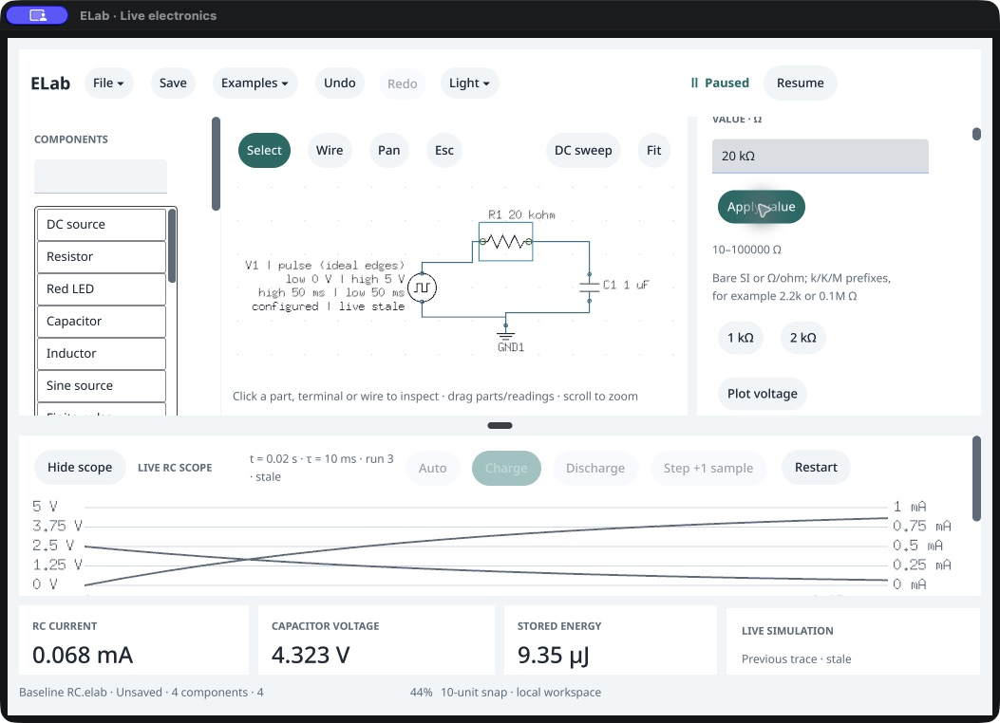
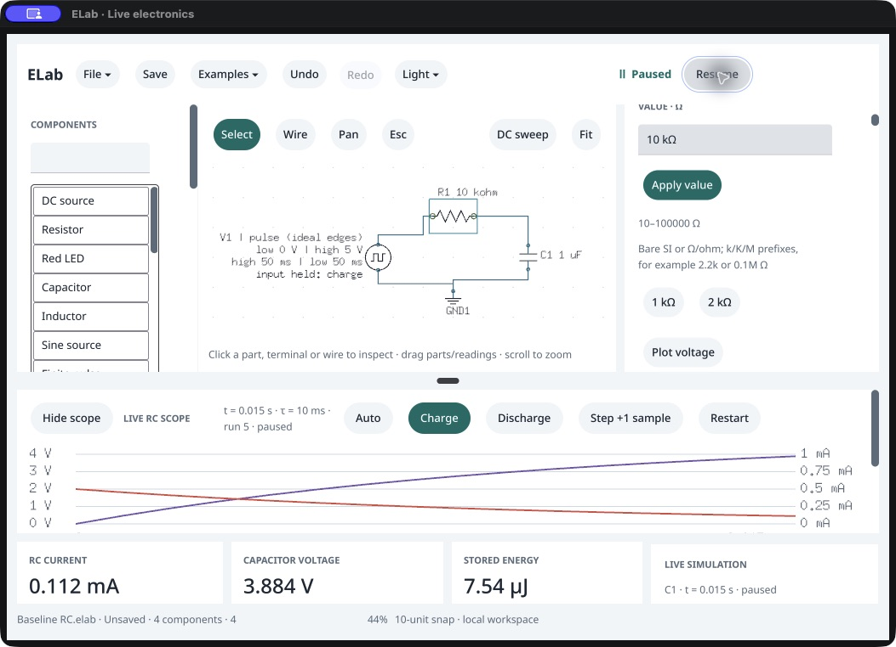

# Paused RC value edits · native /161

October 18, 2026. **Paused value edits, stale readings, Undo/Redo, explicit Restart and direct Resume pass.** Actual native commands agree with the packaged agent and independent RC equations. This completes the bounded paused resistance-edit check following [RC construction from blank](../native-rc-draw-161/README.md); owner acceptance remains “Not tried yet.”

These are editing checks with explicit public setup: a copy of the previously native-built RC circuit is loaded, R1 selected, a paused charge trace prepared and a separate baseline file saved. Subsequent value typing/Apply, history, Restart, Step and Resume/Pause use actual native controls. The native graph/trace setup is not claimed as another blank construction. [Protocol](validation-protocol.json).

## Explicit Restart and history

The first case starts at 10 kΩ/1 µF, paused at 20 ms and 4.323323584 V. Typing `20k` leaves the accepted graph, trace, scope, run/electrical identity, file and history unchanged. One Apply changes the resistor and marks the old trace stale. Its 20 ms time, 10 ms time constant, voltage/current/energy and all old samples remain unchanged. Scope lines are gray, the caption says stale, the footer says “Previous trace · stale,” and Step is disabled.

Native Restart starts a fresh zero-voltage run with τ=20 ms and initial current 0.250 mA. Ten individually observed 1 ms steps produce **1.967346701436833 V at 10 ms**, matching `5(1−exp(−t/RC))`. Undo returns the graph to the saved 10 kΩ state and clears its dirty flag; the accepted 20 kΩ trace remains explicitly stale. Redo restores 20 kΩ and dirty state while retaining that stale trace. A new Restart followed by native Resume/Pause reaches 20 ms and **3.1606027941427883 V** in the fresh 20 kΩ run.

[Observer](restart/observe.py), [state journal](restart/native-session.json.gz), [stage identities](restart-stages.json), [ten Step observations](restart/step-actions.json), [Undo screenshot](restart/undo-stale.png), [fresh 20 ms run](restart/live-paused.png).

## Resume directly after editing

A second owned host loads the saved 20 kΩ circuit and prepares a paused 20 ms trace. Native `10k`/Apply retains that old trace as stale. **Resume is then clicked without Restart.** It creates a new run from time zero and zero capacitor voltage using τ=10 ms. After Pause, the new trace reaches **15 ms /3.884349199257851 V**, rather than continuing the old experiment's stored charge.

Every scalar and selected probe row matches the RC law and a fresh reference initialized through public Restart/Step to the native observed time. A separate fresh packaged agent invokes **actual `simulation.resume` on a stale trace** and verifies its immediate response starts at t=0/V=0 with the new 10 ms time constant. This separates the deterministic full-trace comparison from the shared Resume-command check. [Native observer](resume/observe.py), [journal](resume/native-session.json.gz), [stage identities](resume-stages.json), [agent Resume check](resume/public_resume_check.py), [agent result](resume/public-direct-resume.json.gz).

Across five checked fresh trace snapshots, all **90 retained rows** and their voltage/current probe values satisfy the exponential RC solution, Ohm's law and capacitor energy. Stale snapshots are checked for exact retention under their original trace ownership; they are not reinterpreted using the edited resistor. [Independent checks](independent-traces.json). Native graph/selection/settings/history names and complete result/transient/scope agree with the reference, excluding independent run/electrical IDs. Within-native checks separately verify retained and fresh run ownership. The reference shares the solver; the equations provide separate numerical evidence. Resume/Pause comparisons use observed simulated time, not wall-clock equality.

Both cases save native/reference copies through public commands; every field except `view` matches. Two fresh agents per case reopen matching clean paused startup schematics/settings/probes. The first saves 20 kΩ/τ20 ms/initial 0.250 mA, the second 10 kΩ/τ10 ms/initial 0.500 mA. These checks persist circuit configuration, not live traces/cursors, and do not qualify native file panels. [20 kΩ file](<restart/Native edited RC.elab>), [20 kΩ reopening](restart/fresh-agent-reopen.json.gz), [10 kΩ file](<resume/Native resume RC.elab>), [10 kΩ reopening](resume/fresh-agent-reopen.json.gz). The original native-built fixture and both last baseline files remain unchanged.

## Evidence boundary

A reused CUA helper initially retained its first capture-directory closure. The actual second-case baseline/private images were written into the first directory; they were moved to the correct case, and the private image was refreshed after fixing the helper. The original first-case baseline image was overwritten and is **not** claimed retained. Its raw accepted state and [private `20k` capture](restart/private-20k.png) remain. Routing-time hashes and final refreshed hashes are recorded in [the routing note](resume/helper-output-routing.json). No native state change resulted from this evidence-routing error, and no physical edit was repeated to manufacture a pass.

Original native PIDs 89834 and 91004 both close normally with exit 0, are absent, and their stopped custom bundle files are restored. [First process](restart/process-verification.json), [second process](resume/process-verification.json). The executable SHA `5ccfa894a3524bc39c34150f1b3585a570b870c1db94710822807b0a2fe23b06` and agent SHA `5fae1b65a82cfafaea0ed9092e47df85413dd67dfcdf59afda3d135f48595cc3` match clean 0.144.0 /161 from `35371ee`, SDK `b22478c`. [Release verification](source-release-identity.json) checks 68 native sources, 343 runtime inputs and 381 sealed entries. This is an exact executable in a custom isolated bundle, not a whole sealed-bundle physical observation.

No product/SDK/version change, promotion, owner-window operation, printer action or repeated Go gate occurs; existing quality/copied-runtime qualification retains its scope. Native file panels, capacitance editing, other electrical models/topologies, reader/IME/concurrent/blur, visible latency, environment/distribution and owner/study acceptance retain separate limits. The earlier incomplete-network caption issue remains recorded. P0 stays 17 implemented /10 partial. Next: the native capacitor-timed flasher workflow.
