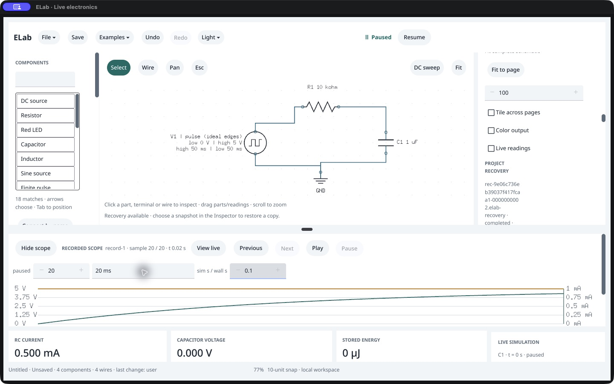

# Native recovery preserves a recorded RC experiment · /161

**Passed within the scope below.** A native RC Verify run creates 21 two-probe samples. An automatic recovery snapshot preserves the recording while the last manual save has none. After deliberately killing only that test process, a fresh native host inspects both sample pages, restores a separate copy, steps/seeks through the captured plot and returns to live view. All rows and capture metadata survive exactly; the original manual file remains unchanged. Four fresh packaged-agent processes reopen the baseline and recovered file pairs successfully.

This uses the exact **0.144.0 /161 executable** in the existing disposable custom bundle, with the matching packaged agent and pinned SDK `b22478c`. The custom bundle identity is explicit; this is not an intact-distribution-bundle test. No production, SDK, model, command or format changes. The original owner app/work is untouched; the canonical app and sealed review remain unchanged. Owner walkthrough remains **Not tried yet**.

## Observed workflow

1. Start blank with an isolated 0700 recovery directory. Choose the native RC example, Pause and Restart. The graph is 5 V pulse, 10 kΩ, 1 µF and ground; sample step is 1 ms. No graph or trace is seeded through the public endpoint. Public saves prepare the native and independent-agent baseline fixtures. These saves do not claim another native Save-panel test.
2. Type `20 ms` privately in Verify duration. Accepted graph, live physics and document stay unchanged until Return; the accepted setting still leaves the saved graph clean. Click native Verify. It retains 21 samples from 0–20 ms, probes C1.1/ground and V1.positive/ground, without advancing paused live time. Only `recordings_dirty` becomes true.
3. Wait for automatic recovery; no native checkpoint command is issued. The validated snapshot contains that exact capture metadata. The original saved file still has zero recordings. Deliberate SIGKILL of owned PID15980 returns −9; absence is verified.
4. Start a fresh native PID16443. Choose the inactive owner's same recovery ID/hash and Inspect without changing blank state. Read rows 0–19 and then row 20 through the native recording menu and Next rows. Both pages match the original capture and independent public reads exactly.
5. Restore as a new copy. The schematic is dirty, unassociated and paused at fresh live t=0; the imported recording retains all original metadata. Native View recorded plot → Next selects sample 1. Privately typing `20 ms` leaves sample 1 accepted until Return; accepted seek reaches sample 20, **4.323323584 V**, with the live circuit still at 0 V /t=0. Native View live returns to that untouched live state.
6. Public saves persist separate native/agent recovered files. Every serialized field except viewport matches; the embedded recording including model hashes matches the original capsule exactly. The manual save and capsule bytes are unchanged. Shared `app.close` ends the second native host normally at 0; both native PIDs are absent. The stopped disposable bundle's three replaced files are restored.
7. Four new packaged-agent processes reopen native/agent baseline and native/agent recovered files. They agree on graph, paused startup, scope and live physics; recovered files retain all metadata and rows. Recorded seek position is not persisted: reopened recorded sample index is 0, recorded view is off and live t=0. This is current format behavior, not loss of captured data.

## Evidence and independent checks

- [Session journal](session.json.gz), [cleanup/fresh-process result](cleanup.json), [fresh reopens](fresh-agent-reopen.json.gz), [identity](identity.json), [checkpoint](checkpoint.json), [verifier](verify.py).
- [Manual baseline](<Manual RC.elab>), [recovered file](<Recovered RC.elab>), [original synthetic capsule](<Original recorded snapshot.elab-recovery>), [crashed owner lease](crashed-owner-lease.json). A local exact-filename ignore exception retains only this synthetic capsule.
- [Raw UI observations](ui-captures.tar.gz) and [per-observation hashes](ui-capture-index.json); JPEG screenshot bytes are retained unchanged with the correct extension.
- The first independent capture excludes only five provenance metadata fields (operation ID, creation time and input/electrical/document revisions); all other metadata and every sample match. Same-capsule restore/reopen comparisons exclude **no** metadata fields.
- Independently evaluate `VC(t) = 5 × (1 − exp(−t /0.01))` and source voltage 5 V for all 21 rows, tolerance max(1 mV, 0.1% of reference). Maximum absolute error is below 2×10⁻¹⁵ V. Agent parity alone is not independent numerical validation.
- [Preflight corrections](preflight-correction.txt) retain two producer schema mistakes before native launch. [Finish correction](finish-correction.txt) retains one post-close verifier field-name mistake; all four cases were rerun after correction. No failed product action is hidden by these corrections.



## Limits

One paused RC experiment, one recording, two probes, controlled process interruption and completed automatic snapshot. This does not qualify power loss, an interrupted write, running-state recovery, every model, multiple captures, recovery latency, reader/IME behavior or arbitrary concurrency. Native Save/Open panels have their separate prior evidence. This session uses public saves and fresh public reopens, not a new native Open-panel claim. The existing source quality gate is reused because production source is unchanged. No promotion or full MVP/owner acceptance is inferred.

Recheck without launching or mutating the app:

```sh
python3 -B research/ui-audit/first-version/native-recording-recovery-161/verify.py
```
