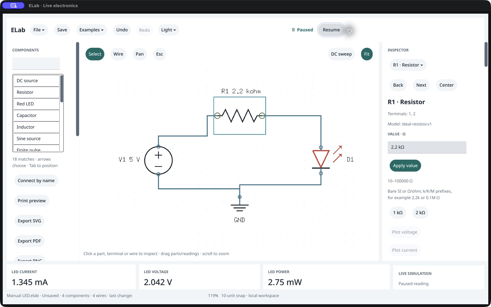
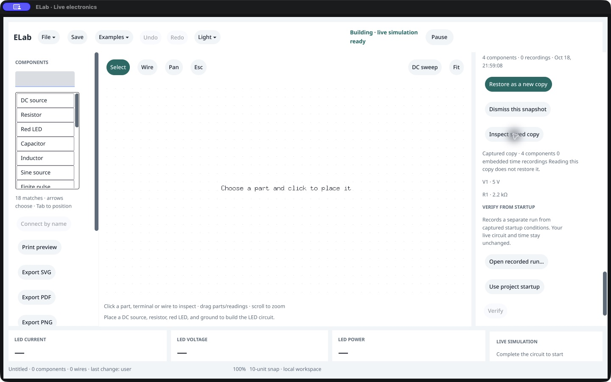
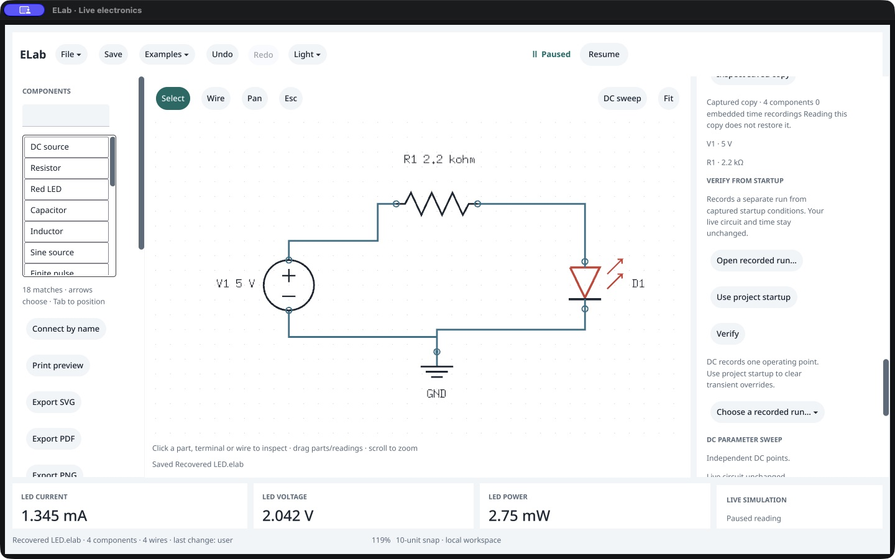

# Native automatic recovery and manual-save preservation · /161

October 18, 2026: **the native recovery workflow passes its bounded checks**. A native manual save preserves the 1 kΩ LED circuit; automatic recovery captures an unsaved 2.2 kΩ edit. After an owned SIGKILL, a fresh native app selects, inspects and restores that snapshot as a new copy, then saves it separately. The original manual file and recovery capsule remain byte-identical. A third native app opens the recovered file and closes normally, exit 0. Owner acceptance remains **Not tried yet**; no production source, SDK, version or format changes and no promotion.

## Observed workflow

The exact 0.144.0 /161 executable runs in the existing disposable custom bundle with a new private `0700` recovery directory. Appearance persistence is disabled. The owner’s default recovery directory and projects are not operated. Each native host starts blank; public commands do not seed native graphs or traces.

1. Actual Examples → LED circuit and Pause produce the 5 V /1 kΩ loop, about **2.917 mA**. The real macOS Save panel writes [Manual LED.elab](<first/Manual LED.elab>), with a completed user-owned shared save operation.
2. Native R1 selection and private `2.2k` typing preserve accepted graph/physics/document/history until Apply. Apply retains stale old readings; Resume recomputes and Pause freezes a fresh **1.344737453 mA** result. The manually saved file remains unchanged.
3. With the default two-second recovery interval enabled, the observer waits for an automatic snapshot containing the edited graph and paused setting. No manual recovery checkpoint is invoked in this native run. Public `recovery.inspect` validates the capsule, and the raw bytes are retained before interruption.
4. The observer sends SIGKILL only to owned PID 10119, waits for −9 and verifies its absence. A fresh native host using the same isolated directory identifies the crashed owner as inactive. The native snapshot menu selects the same ID/hash. **Inspect saved copy** shows four components and R1 at 2.2 kΩ while leaving the blank editor untouched.
5. Native **Restore as a new copy** produces the same graph, settings and fresh electrical result as the separate exact packaged-agent restore. It is paused, dirty and unassociated with a file; `recovered_from` identifies the manual source. The real Save panel writes [Recovered LED.elab](<restored/Recovered LED.elab>) under a new name. Every serialized field except native view matches [the agent save](<Agent recovered.elab>).
6. A third blank native host opens the recovered file through the actual Open panel. It shows 2.2 kΩ /1.345 mA, matches the agent and is clean. One Cmd+W closes original PID 11849 normally with exit 0.

## Controller failure and correction

The original observer completes restoration/save comparisons but writes `close-ready.json` without acknowledging the CUA `allow-native-close` barrier. The CUA call waits at that barrier and times out/reset **before** its final capture or Cmd+W. The observer then times out waiting for process exit and retains the native host for diagnosis. Its [original journal](original-session.json.gz) remains **`passed:false`**.

A fresh private-socket read confirms the same restored host is still responsive, clean, saved and open; no Close input had been sent. CUA reconnects, captures that state and sends Cmd+W once. PID 10603 is then verified absent. That controller did not export this child’s exit code, so it is explicitly **unavailable**, not inferred as zero. The separately supervised third native Open/Close run supplies its own normal exit proof; it does not rewrite the earlier failed report. [Correction](close-protocol-correction.txt), [process observation](corrected-close.json), [fresh native run](reopen/session.json.gz).

## Verification and limits

The post-run verifier rechecks the original accepted core stages, both serialized native/agent pairs, manual-save SHA, original capsule SHA and inactive owner. Four fresh packaged agents reopen both native/agent baseline files and both recovered files with matching clean, paused state. Independent 70-digit LED Newton references agree for 1 kΩ and 2.2 kΩ; these supplement shared-solver parity. [Fresh reopens](fresh-agent-reopen.json.gz), [independent checks](independent-led-checks.json).

All three native PIDs are verified absent and the stopped disposable bundle’s original three files are restored. All 68 native source hashes, 343 runtime inputs and 381 sealed /161 entries verify, and canonical /120 remains unchanged. Existing complete source quality and copied-runtime qualification are reused; evidence-only work does not require another full Go gate.

This covers one paused LED document with zero stored recordings and the observed Save/inspect/restore/Save/Open paths. It does not establish recovery during an in-progress write, power-loss durability, another filesystem/account, record-bearing native recovery, exhaustive failure/concurrent/ownership cases or recovery latency. A brief post-Restore caption still says “Recovery available”; the new-copy footer and recovered-source inspector are correct, and Save replaces the caption. That wording is a deferred clarity follow-up. The earlier incomplete Pause observation, strict 1 mV PMOS cutoff precision gap, broader input/reader/IME/latency/environment/distribution gates and owner acceptance stay separate.

Raw CUA images/accessibility observations are unmodified, indexed in [ui-capture-index.json](ui-capture-index.json) and archived; endpoint credentials and executable backups are excluded. [Cleanup](cleanup.json), [preservation](preservation.json) and [checkpoint](checkpoint.json) retain the exact boundaries. Next: native recovery of an experiment containing a recorded run. P0 stays 17 implemented /10 partial.
