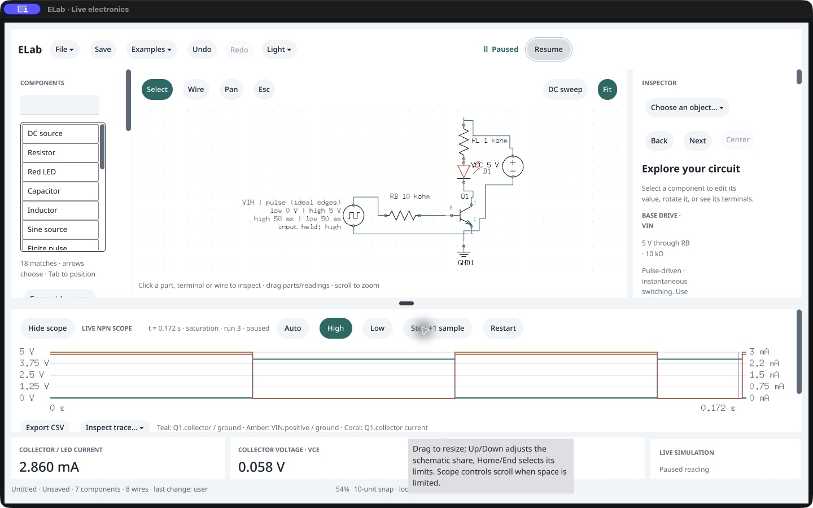
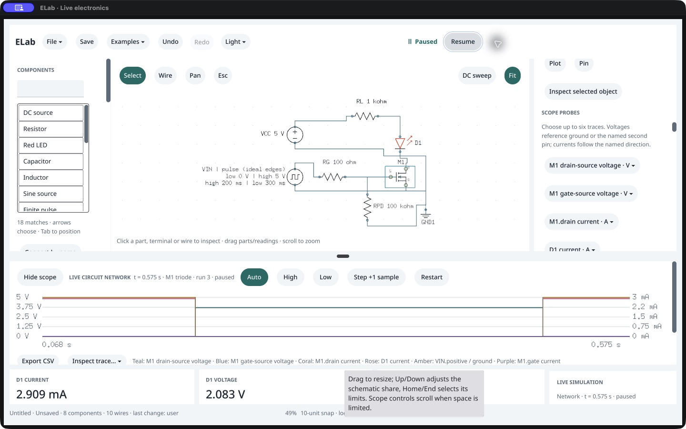
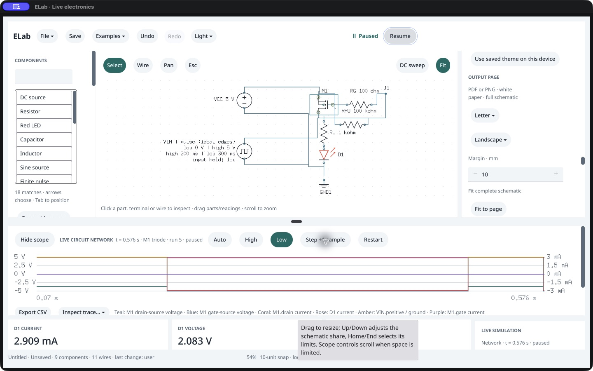

# Native pulse-NPN and MOSFET checks · /161

October 18, 2026: **bounded workflow comparisons pass; overall qualification remains open** because the first NMOS Pause observation is unresolved. The complete NPN sequence and a fresh NMOS/PMOS retry match the exact 0.144.0 /161 packaged agent. Six saved-file reopens pass. Owner acceptance remains **Not tried yet**. Source, SDK, version, models and format are unchanged; no promotion.

## Open Pause observation

The first owned host completes the NPN sequence and saves its result, then loads NMOS. After Resume and a native Pause click, both the captured native UI and the observer snapshot still report running, at about 0.665–0.675 s; command revision remains 20. The observer had published the `nmos-paused` marker without first observing Pause completion. Its assertion aborts the run and terminates PID 2029 with −15. The complete first report remains `passed:false`.

This establishes an incomplete Pause observation. It does not establish whether the click was delayed, missed or refused, since the host was terminated before further observation. A fresh blank host repeats the remaining NMOS/PMOS workflows. After each Pause/Resume click it requires the corresponding native Resume/Pause control to appear before publishing a marker. Each of the six completion checks succeeds in its first observation; each action is clicked once. Both workflows then pass full agent comparison.

**Next bounded work:** repeat single-click Pause/Resume on a live MOSFET example with native completion observations and a surviving host on failure. Distinguish delayed observation from missed activation before closing this investigation or declaring task C complete. The successful retry does not explain the earlier event.

## Completed circuit checks

Each native host starts blank. Examples are loaded through actual native menus; public commands do not seed native graphs or traces. Native Pause/Restart/Resume and Low/High/Auto overrides followed by Step reach the shared service. An external observer reads snapshots and compares them with a separate packaged-agent reference advanced to the observed simulation time, rather than equal wall time.

| Circuit | Observed result |
|---|---|
| Pulse-driven NPN | 50 ms high /50 ms low, 1 ms samples. Both sides of the 50 ms edge remain in history. At 170 ms it is cutoff; queued Low preserves accepted physics, Step applies it. High + Step reaches saturation at 172 ms, **2.860330491 mA**, VCE about **57.534 mV**. Auto + Step restores the pulse phase. |
| NMOS LED | 200 ms high /300 ms low. Gate high gives VGS **4.995005 V**, triode and ID **+2.908619226 mA**. Low gives cutoff and about **+1 nA**. |
| High-side PMOS LED | The same pulse switches the opposite way. Low gives VGS **−4.995005 V**, triode and ID **−2.908619226 mA**, while LED current is positive. High gives cutoff and about **−1 nA**. |

Both MOSFET cases add gate current as the sixth probe through an actual native menu. It is zero throughout the model. The retained 512-row traces include both sides of the 200 ms and 500 ms corners. Gate/drain/LED currents, gate-source voltage and drain-source voltage use their documented signs. Low/High/Auto queueing preserves the accepted sample until Step, and full scope/history/physics match the separate reference at each accepted stage. KCL, power and region checks pass.

## Independent checks and precision limit

The [independent reference producer](mosfet-retry/references.py) uses 70-digit simultaneous damped 3×3 Newton on declared Ebers–Moll/base/load/LED equations, without invoking ELab. Its resistor-only cases first reproduce the existing frozen Decimal references within 10⁻⁴⁵; it then includes the declared red-LED law. Every retained NPN row is checked against the corresponding independently calculated 0 V or 5 V phase, with the existing max(1 mV, 1%) voltage and max(1 nA, 1%) current envelopes. This validates the educational quasistatic model, not physical switching/storage delay.

MOSFET current uses the existing independent scalar load-line method and **2 nA** current bound from `internal/conformance/mosfet_references.go`. Six aligned probe values per row and conservation are checked. The approximate 1 nA cutoff current makes drain voltage sensitive to tiny LED-current residuals. A strict 1 mV drain-voltage point comparison **fails** for PMOS: the retained trace's maximum discrepancy is **3.217580 mV** (NMOS: **0.764745 mV**). This failed precision result remains explicit in [checks.json](checks.json) and the journals. The bounded smoke derives a monotone LED/load-line voltage interval from the same fixed ±2 nA current envelope; its success does not qualify the failed 1 mV check. No arbitrary wider voltage tolerance or solver change is introduced.

Preflight corrections are retained: explicit overwrite for disposable preflight saves, removal of that invalid option from Load, and a 1 nV bound on nominal source nodes after observing 4.999999999999715 V. The final complete preflight also checks all phase sequences and fresh saved-file reopening before native launch.

## Persistence, cleanup and evidence boundary

After native actions, public Save produces three native/reference file pairs matching in every field except native view. Six fresh exact packaged agents reopen matching clean, paused Auto startup, including graphs, settings, probes and fixed models. Native file panels and persistence of live time/waveforms/cursors are separate scopes.

The first aborted host is verified absent and its stopped disposable bundle restored. Retry PID 2784 closes normally with exit 0, is absent and its stopped bundle is restored. The sealed release's 68 native source hashes, 343 runtime inputs and 381 manifest entries verify unchanged; canonical /120 is preserved. Exact executable bytes run in a custom test bundle; an intact-bundle launch is not claimed. Existing source/copy quality qualification is reused for this evidence-only work.

Raw complete journals, immutable CUA captures, independent references, completion observations, saved circuits, six fresh reopens and cleanup are retained under `first-attempt/` and `mosfet-retry/`. Capture archives exclude endpoint credentials and executable backups. Broader input/reader/IME/latency/environment/distribution gates remain open. [Checkpoint](checkpoint.json) records overall qualification as incomplete, alongside the enumerated passes and the failed precision check. P0 remains 17 implemented /10 partial.
