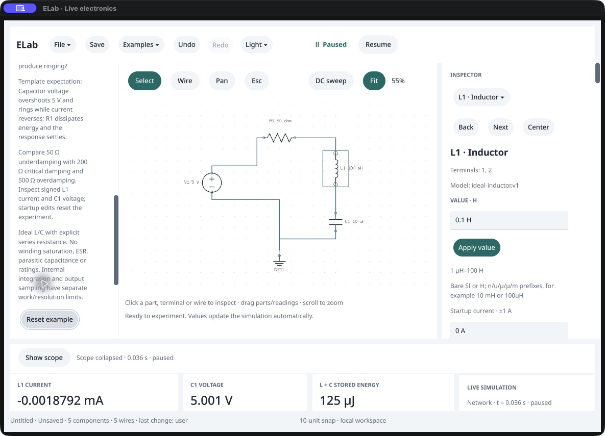
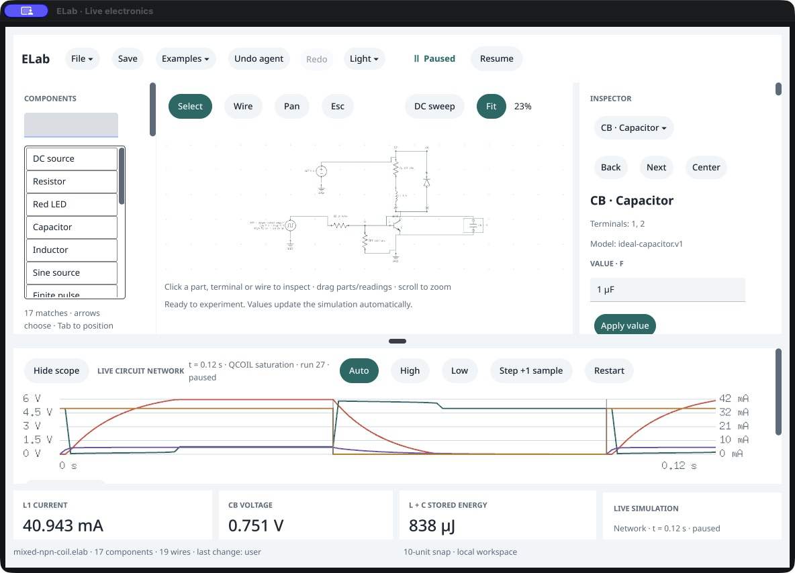
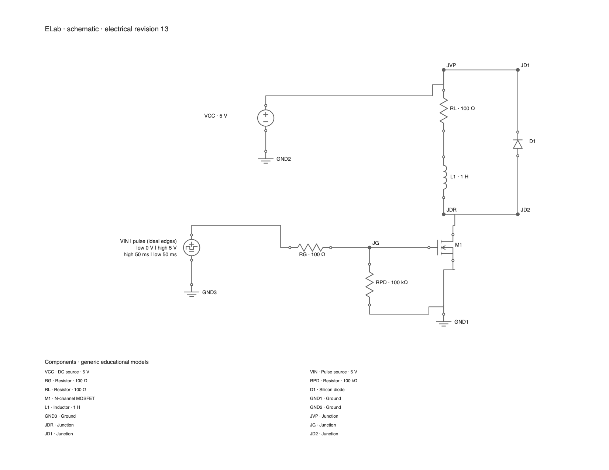

# Inductors: native workflow and output inspection

October 16, 2026. Owned macOS development candidates for unreleased 0.104.0 /119. The final inspected bundle is `build/ELab-inductor-routes.app`, executable SHA-256 `037859ea69effd9a9dca99256e5ebf08d894ae42e990a2254d3337a74f8ccdf3`. Captures 13–17 use the preceding `ELab-inductor-ui.app`; the final bundle retains those UI changes and adds caption-aware routing. Qualified `build/ELab.app` remains 0.103.0 /118. This review follows the established Product Design audit workflow: inspect the running app, preserve original screenshot bytes, open the saved files, then tie findings to that evidence.

1. **Examples menu — observed.** Physical Examples activation exposes all sixteen experiments, including RL, RLC and flyback. Entries fit the native popup. Physical RLC selection and Pause work in both inspected candidates. [Menu](01-examples-menu.jpg). This samples this menu/window; it does not establish all menu, keyboard or accessibility behavior.
2. **Schematic readability — remains open.** In the 1184×854 captures, scope-expanded RLC fits at about 31%; the route is complete but component text is tiny. Physical Hide scope raises Fit to about 55% and makes the circuit easier to inspect. The new coil and named terminals are visible. [Earlier collapsed view](06-scope-collapsed.jpg), [final expanded view](15-final-small-window.jpg), [final collapsed view](16-final-small-reset.jpg). The final window had first been observed at 1700×1266; it was resized with the native window edge before the smaller final captures. No uniform readability claim is made across window/font/zoom settings.
3. **Startup editing — observed with limits.** Tab reaches the startup-current field and automatically brings it into view even though CUA's accessibility tree omits the field. Separate Select All, type `20 mA`, and Return commit it; paused readings become stale. Physical Restart then produces fresh t=0 with L1=20 mA, L1 voltage=4 V, C1=0 V and magnetic energy=20 µJ. [Committed field](11-startup-commit.jpg), [restarted scope](12-restarted-startup.jpg), [corroborating public state](12-restarted-state.json). The final candidate shows the ±1 A label and retains keyboard reachability: [final focused startup field](17-final-startup-field.jpg). Direction and paused-Restart help are retained below the field; this screenshot does not show the whole paragraph.
4. **Clipped reset button — repaired.** In the earlier small-window capture, the long template-specific reset label is visibly cut off horizontally. The final visual label is **Reset example**, with its full template-specific accessible name retained. Its existing ID/generation guard and unsaved-work protection are unchanged and native regressions pass. Both the corrected rail button and its keyboard focus ring fit at the original smaller capture size. [Before](07-keyboard-startup.jpg), [after](16-final-small-reset.jpg). Capture 14 also shows the corrected label in the larger window, but includes an unrelated tooltip over the footer and is not used to qualify that footer.
5. **Energy/current summary — repaired.** Earlier mixed RC/NPN/coil output showed RG current, about 0.425 mA, while the important load was the coil. The final summary explicitly says **L1 CURRENT**, about 40.943 mA, **CB VOLTAGE**, 0.751 V, and **L + C STORED ENERGY**, 838 µJ. [Earlier summary](01-examples-menu.jpg), [final summary](13-final-mixed-summary.jpg). For RLC, C1 stays named in the voltage card, L1 in current, and the settled total is about 125 µJ. [Final smaller-window cards](15-final-small-window.jpg), [public numerical state](17-final-state.json). Native RL/RLC/flyback tests check the capacitor contribution and that selecting a resistor does not silently retarget these network summaries. Selected-part probes/readings remain available for other devices.
6. **Schematic outputs — inspected.** Current Radau native public commands generated the RL, RLC and flyback PNGs below. Coil geometry, labels, the explicit flyback junctions and the current-return path are readable. White label masks do not cut the reviewed wire paths. The same public workflow's headless/native SVG/PNG digests match. [RL](export-rl.png), [RLC](export-rlc.png), [flyback](export-flyback.png). This visually qualifies these PNG examples; PDF preview, every rotation/page configuration and physical printer acceptance remain separate gates.
7. **Rotated PDF wires — repaired.** A later seven-case output workflow generated PDF/PNG and captured preview for the three templates plus four coil rotations. All 14 native/headless PDFs passed parser checks and produced identical cross-adapter rendered pixel pairs. Direct inspection nevertheless found an apparently broken W3: L1's opaque label hid a vertical segment at 0°, and R1's label hid part of the return at 270°. [0° before](18-rotation-0-before.png), [270° before](19-rotation-270-before.png). A failing-before geometry test preserves both cases. Shared routing now treats component caption masks as obstacles alongside symbol bodies, including ordinary stroke clearance. Waveform annotations retain a separate, experiment-dependent placement contract. The final 14 PDFs render identically across native/headless adapters; the other five case images are byte-identical to the previously inspected versions. [0° after](20-rotation-0-after.png), [270° after](21-rotation-270-after.png). Actual final native windows also show continuous routes: [0° native](22-native-rotation-0.jpg), [270° native](23-native-rotation-270.jpg). These two scenes were prepared through shared agent commands; they do not prove physical pointer rotation input. Rotation/Fit/scope operations preserve accepted current/time/charge. This qualifies the reviewed single-page Letter-landscape cases, not all layouts/pages or a physical printer.

The final complete serial lint/import/root/native race/vet gate passes (workbench 55.705 s, native 117.168 s). The final packaged GPU/UI/lifecycle smoke passes and includes all three coil examples, startup/reset, probes and both meshes. The rebuilt bundle's full public coil workflow matches the headless Radau report apart from transport, including signed startup, analytic live/captured RL, save/fresh-process reopen, all three examples and the mixed NPN/base-capacitor/coil period. Runtime/parity evidence is separate from physical pointer, typing and screen-reader qualification.

After caption routing, the full gate passes again (workbench 56.484 s, native 114.752 s), with new packaged smoke, fourteen corrected PDFs, native screenshots and final four-adapter reference/coil/electrical/performance evidence. Vellum then advanced externally to clean `b8fd3e9`. The latest private `ELab-inductor-sdk-refresh.app` is rebuilt and passes the consumer gate (native 120.023 s), packaged smoke and four-adapter reference/coil parity on that SDK. The numbered images retain the bundle/SDK provenance stated above; lifecycle-only SDK refresh was not treated as a new physical screenshot or repeated-timing run. Canonical .103 remains untouched and inductors remain unreleased.

All numbered native screenshots are original CUA JPEG bytes, saved as `.jpg` and opened from disk. Images 18–21 are unmodified Poppler renders of the actual command PDFs. The exported example images are original public-command PNGs copied byte-for-byte for this report. Owned visual sessions exited; no user session, OS appearance setting or Vellum source was changed.

## Attempts and evidence limits

- Captures 03–05 preserve unsuccessful inspector scroll/wheel/drag attempts; they do **not** prove startup controls were reached or that native wheel scrolling is broken. Keyboard navigation subsequently reached them.
- Capture 08 preserves a refused batched Select All/type/Return attempt. Capture 09 confirms selection, 10 shows the later draft and 11 the successful separate Return. The failed first attempt is not treated as an established product defect or a successful edit.
- CUA still omits several visible selected-component fields. Native smoke can inspect some Cocoa controls in a different fixture, which does not explain or repair this tree discrepancy. Full accessibility, typing/IME/focus, pointer/wheel and participant acceptance remain open.
- One final `getApp` lookup took about 1321 seconds before returning. Subsequent observations/actions completed normally. This is recorded as tool-observation latency; no simulation or visible-UI performance conclusion is inferred from it.
- Four-adapter baseline electrical/performance and new-device workflows pass in the earlier candidate; four retained .103 captured projects reopen and re-save without semantic changes or modifying original bytes. Current final-suite evidence, coil-specific transport timing, recovery/import, release receipts and promotion are tracked separately. No broad P0 closure or released inductor support is inferred from this visual review.

