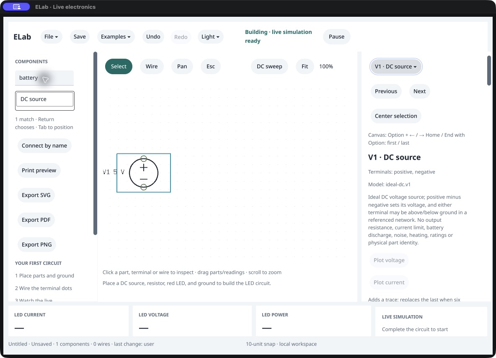
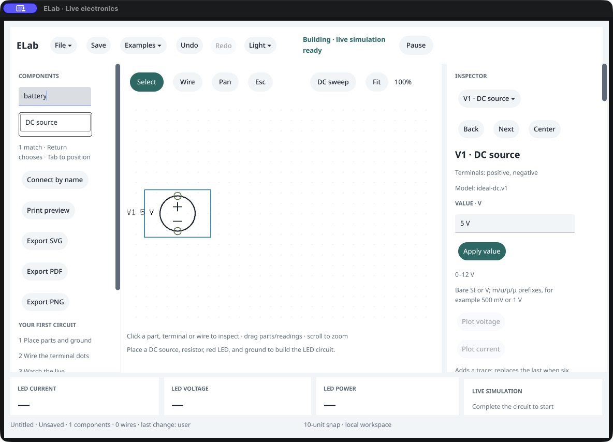
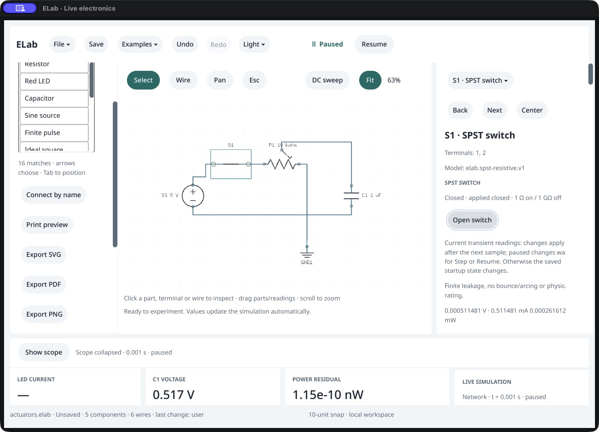

# Keyboard entry and component inspector

Scope: ELab on the recorded macOS workstation, October 16, 2026. Current-run CUA screenshots and public snapshots support this bounded workflow review. The .99 baseline and first .100 candidate use the same default window; the final candidate adds the Pause/Resume focus repair. This is not a screen-reader, participant, full physical-pointer or complete keyboard acceptance study.

1. **Enter a blank circuit — improved.** The baseline had no requested Search focus. Clicking Search through automation did not establish it; subsequent typing did not search. Escape explicitly focused Search and allowed typing. The candidate requests Search focus once at startup: typing `battery` without a preparatory click worked. The placeholder is still visually empty; the accessible Search name/help provides more information than the empty visual field. [Baseline](01-blank.png), [candidate startup](05-startup-focus-after.png).
2. **Find and place a source — works in this path.** Return commits `battery` and focuses the matching DC-source list row. Return chooses it; Tab traverses X, Y and Place. Space placed V1 at (-200,0), then returned focus to Search. Public inspection confirmed the named source and user-attributed history. [Matched alias](02-search.png).
3. **Find the main edit — repaired.** Before the change, navigation, long model limitations and plotting controls put the value editor below the fold. Tab could reveal it, so it was reachable but poorly presented. Main edits now precede whole-network summaries and longer explanations; Back/Next/Center fit on one row. Pin names, model identity, all assumptions and commands remain. [Before](03-selected-source-before.png), [keyboard reveal before](04-value-tab-reveal-before.png), [after](06-source-editor-after.png).
4. **Edit and undo — works in the observed source case.** Keyboard Tab reached the value field, select-all/type/Return staged `3.3 V`, and Space on Apply committed it. The symbol and public snapshot changed to 3.3 V with actor `user`. Cmd+Z restored 5 V. This is an incomplete one-source graph; it is not a live-result accuracy test. [Applied value](07-value-applied-after.png).
5. **Pause and continue — defect found and repaired.** The first candidate lost focus when Pause was replaced by Resume. The following Tab/type/Return sequence unexpectedly opened the recorded-run picker. Escape canceled it; public inspection confirmed the source remained 5 V and paused. A failing-before/passing-after regression covers the now-explicit successful-UI focus continuation to the replacement button, unchanged sequence on redraw and refusal purity. The final app showed Resume focused after Pause, Pause focused after Resume, and Search focused after the next Tab. A fast batched Shift+Tab/Space attempt was inconclusive; individually observed dependent actions passed. [Paused focus](08-pause-focus-after.png), [Tab after Resume](09-resume-tab-after.png).

The component editor moved to `desktop/component_inspector.go`. Existing IDs, ingress commands/parameters and the assembled view's revision binding are retained. Source review confirms direct ingress expressions/command sets are unchanged; one registry callback adds focus continuation after successful Pause/Resume, and two navigation captions change. Agents still use the existing domain commands directly. Native presentation focus is requested following successful human actions; the API does not synthesize keyboard input.

Accessibility risk: after placement, CUA's accessibility tree omitted several visible selected-component labels/fields, including the value editor and object selector. Keyboard Tab still reached the visible controls. This discrepancy was observed on the baseline and candidate and remains unresolved; it prevents a full assistive-technology claim. Raw pointer/wheel automation also remained inconclusive. Screen-reader, IME, all focus-invalidation paths, dialog restoration, full RC construction/plot/recovery and visible latency remain separate gates.

Screenshots were saved from the actual CUA capture bytes and inspected as files. No substitute OS screenshots, generated mockups or inferred states are used. The screenshots concern this local development app and contain no endpoint credentials.

6. **Use live RC controls — improved, with limits.** The public reference client constructed the five-part switch/potentiometer/capacitor fixture. This was agent construction, not a full keyboard RC build. Wiper slider and number editor were visible near the top. After an agent committed `.12345678912345`, Tab reached the displayed `12.345679` percent and Return left the stored fraction, graph, physics and history unchanged. This observes the mounted attempt; it does not assert the framework emitted an unchanged Change event. The callback regression separately covers that event. [Live wiper](10-live-wiper-after.png), [unchanged commit](11-exact-wiper-commit-after.png).
7. **Inspect and actuate a pending switch — works in this path.** Agent configuration queued desired-open while applied-closed. Keyboard Tab reached Close switch and Space coalesced desired state back to applied-closed. Public inspection confirmed pending=false, actor=user and unchanged time/charge/run/electrical identity. [Pending](12-pending-switch-after.png), [coalesced](13-switch-coalesced-after.png).

Remaining visible layout issue: long wiper/switch explanations and readings still clip at the right edge in this narrow inspector. The primary fields/actions and three navigation buttons fit in the observed window. General long-label wrapping and per-line reading layout need a separate repair; this checkpoint does not certify all inspector content or window sizes.

