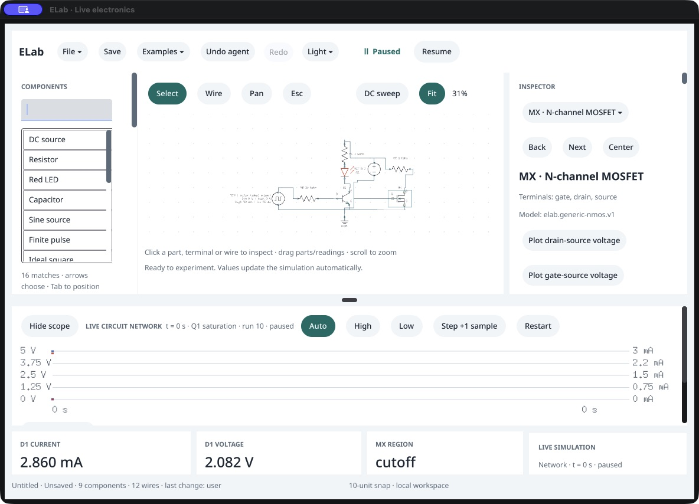
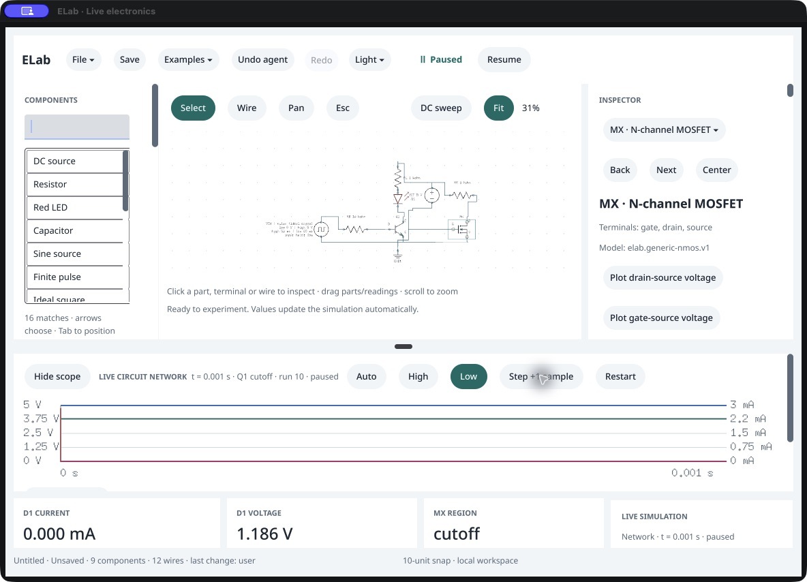

# Mixed NPN/MOSFET state identity

October 16, 2026. Current-run owned baseline 0.102.0 /117 and candidate 0.103.0 /118, same nine-part/twelve-wire pulse-NPN plus cutoff-NMOS fixture, with MX selected. Scope: correct device association for the accepted trace state.

1. **Before — incorrect association reproduced.** The scope says `MX saturation` while the public result has Q1 saturation and MX cutoff. The separately named MX summary correctly says cutoff. [Baseline](01-before.png).
2. **After — repaired.** The same accepted physics now gives `Q1 saturation` in the caption, retaining `MX REGION: cutoff` in the summary. Baseline/candidate/headless fixture reports are identical apart from transport. Trace-state values were preserved; the ID association changed. [Candidate](02-after.png).
3. **Low request and accepted Step — observed.** Physical Low first shows a pending request while retaining the accepted high-state caption. Physical Step accepts the low input at 1 ms and displays `Q1 cutoff`. Public inspection confirms accepted time/state and unchanged MX selection. [Accepted low input](03-after-low-step.png).

The blank-construction native/agent regression failed before the repair (`M1 saturation` with saturated Q1/off M1) and passes after it, including selection and the 50 ms pulse edge. Shared trace-state source logic prefers NPN, then MOSFET; independent named MOSFET summaries retain their existing source. Numerical equations/models/work limits, APIs and files are unchanged. All three screenshots were captured through CUA, saved unchanged and inspected as files.

Remaining limits: the small fitted schematic remains difficult to read, and CUA still omits some visible inspector semantics. No full keyboard/IME/pointer/wheel/focus/screen-reader, visible latency, participant or clean-distribution acceptance is implied. The fixture has no capacitors; this pass does not newly qualify charge continuity. New inductor work is only [planned](../../14-inductor-integration-plan.md).

