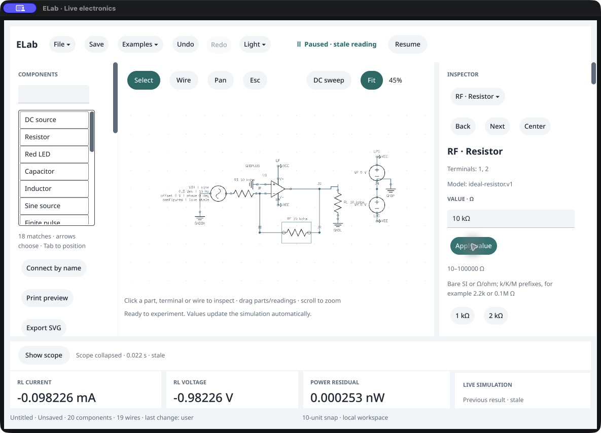
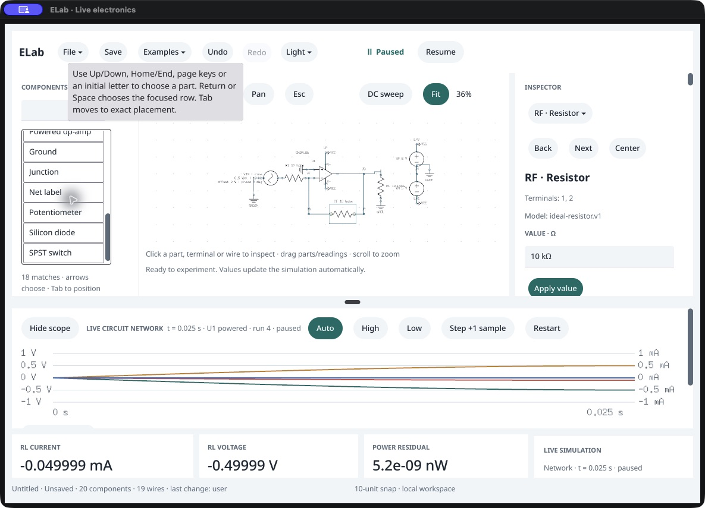
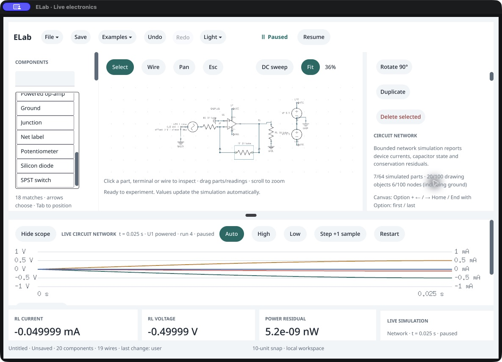
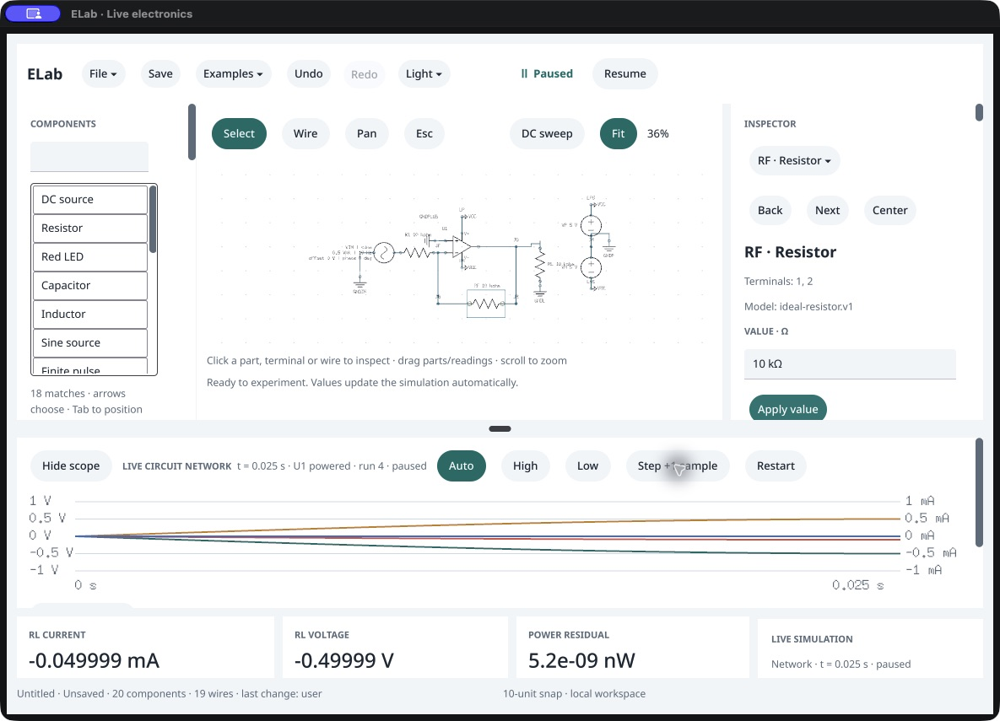
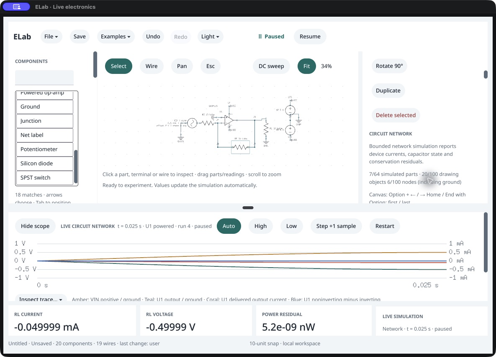

# Native mouse coordinates — SDK candidate

October 16, 2026. Follow-up to the [value Apply investigation](../value-apply/README.md). ELab's ordinary app sources now run against an isolated Vellum implementation of the event-position hook, through the framework's owned dependency patch pipeline. These physical UI runs use **no Go overlay and no diagnostic input helper in ELab**. The [exact SDK patches and reconstruction hashes](../../../docs/validation/native-mouse-sdk-sources.json) retain the source changes. Neither this report nor a passing unit suite establishes complete input/accessibility acceptance.

Two candidate contexts are retained. Images 01–05 use Vellum base `c5045bc` plus local SDK commit `a4321de` (then stage 74). Images 06–11 use base `77da1dd` plus isolated SDK commit `aa9d023` (stage 75), incorporating the newer accessibility-publication and initial-window-size changes. ELab's physical UI binary is source commit `4081de1` in both contexts. Their [initial](initial-candidate-provenance.json) and [rebased](current-candidate-provenance.json) receipts bind executable hashes and build settings. The later ELab smoke-only geometry isolation is validated separately.

The first CUA launch reported **9,706.8 seconds** before returning. Its cause is unknown; it is not an application launch benchmark. After return, the owned executable hash, process and clean ELab tree were revalidated. Vellum had advanced during that delay, so the work was rebased in the isolated checkout, preserving the shared project's new work. The manifest append conflict was resolved by retaining the upstream initial-size stage 74, renumbering this patch to 75, regenerating its input/output hashes and freshly preparing every dependency stage. Subsequent native tool calls completed normally.

1. **Native menu and value editing — passed within scope.** Examples → Inverting amplifier, Pause, Hide scope and a canvas click select RF. A targeted value-field click now establishes editing. Visually verified Select All, typing `10k` and one Apply commit **10,000 Ω**, with an explicitly stale paused result. Both candidate baselines pass. External AX still omits the visible component value/Apply leaves; coordinates were grounded in current screenshots.

   

2. **Independent scroll targets — passed within scope.** A wheel action at the component list reveals its later entries while the inspector stays put. A separate wheel action at the inspector scrolls its content while the list retains its position. This passes on both candidates. A transient palette-help tooltip is retained in the captures; no tooltip/hover acceptance is inferred.

   
   

3. **Restart and timing/gain — passed within scope.** Show scope, Restart and **25 native Step clicks** reach **25 ms** and approximately **−0.4999898606 V** output for **+0.5 V** input. Both candidates pass. Menu setup, selection, editing and stepping used native UI actions; agent calls only inspect results, perform the separately identified layout comparison, and close the generated fixtures.

   

4. **Divider drag and keyboard — unresolved.** Dragging the visible divider does not change its 0.65 fraction. Focusing its external AX target succeeds, but the advertised Up command also leaves the fraction unchanged. Both baselines exhibit this observation; no cause or attribution to the pointer patch is established. The [rebased public state](10-current-public-inspect.json) confirms 0.65 after the native attempts. Complete native event/focus tracing and an unpatched baseline comparison remain required.

   

5. **Shared command comparison — agent path passed.** The separate `workspace.layout.set` command changes the fraction to **0.63**, and both the external AX value and visible layout update. This narrows the unresolved path toward native input/focus/handler delivery; it does not prove which layer is responsible. This is an agent action, not a successful divider gesture. The [public comparison](11-agent-layout-public-inspect.json) and screenshot retain that distinction.

   

The viewport in these native captures is 1184 × 853. Saved geometry has precedence over initial size requests; these screenshots do not qualify fresh window sizing or a cross-display change. Full keyboard/IME, dragging/capture, hardware fallback, multi-window/display, screen-reader, external AX and visible-latency acceptance remain open. All generated UI sessions were closed after their results were saved. Canonical app promotion remains separate from this candidate's source and scoped functional evidence.
