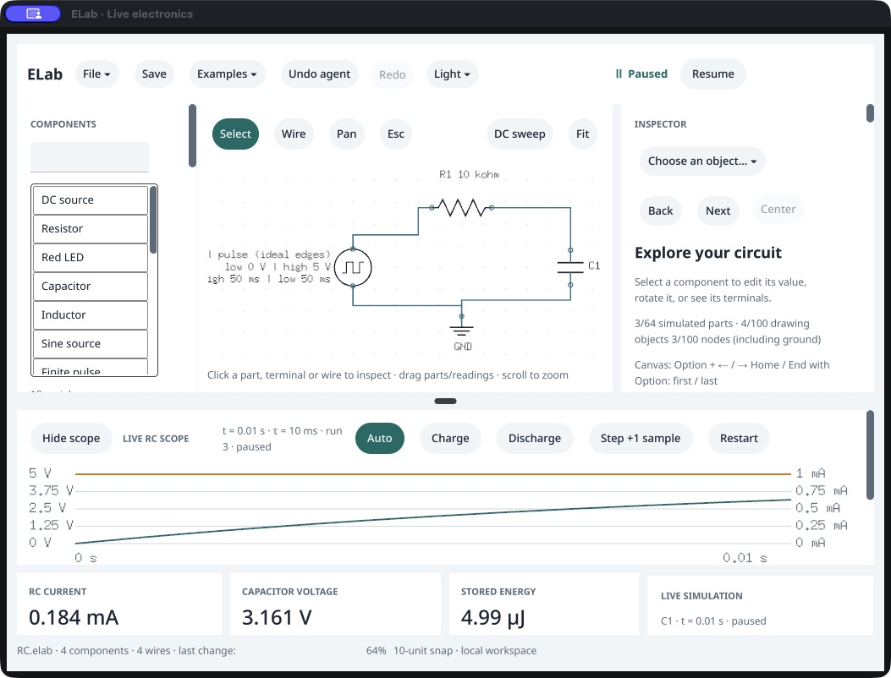
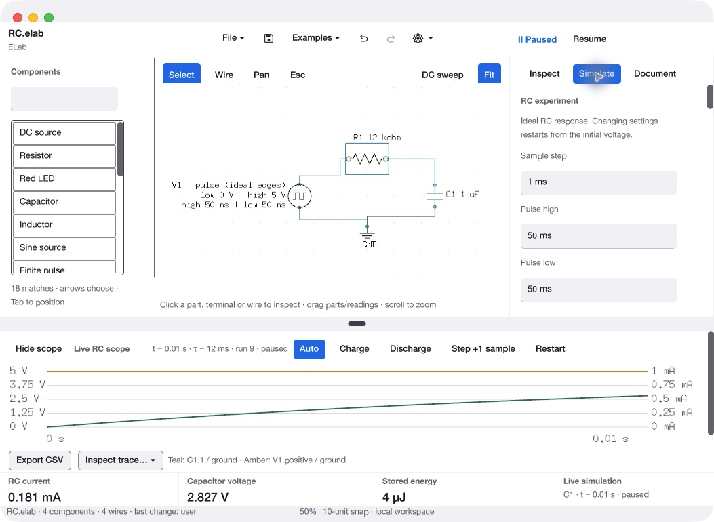
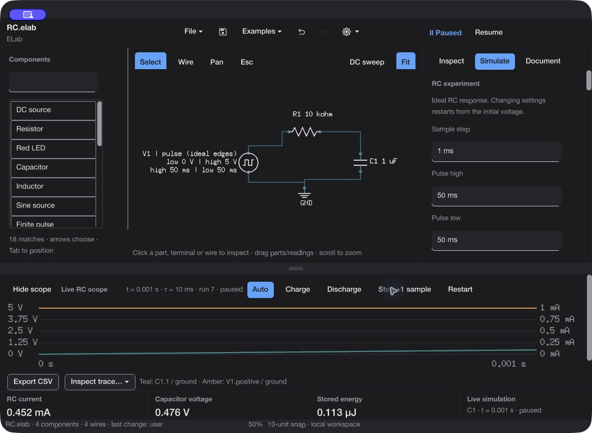
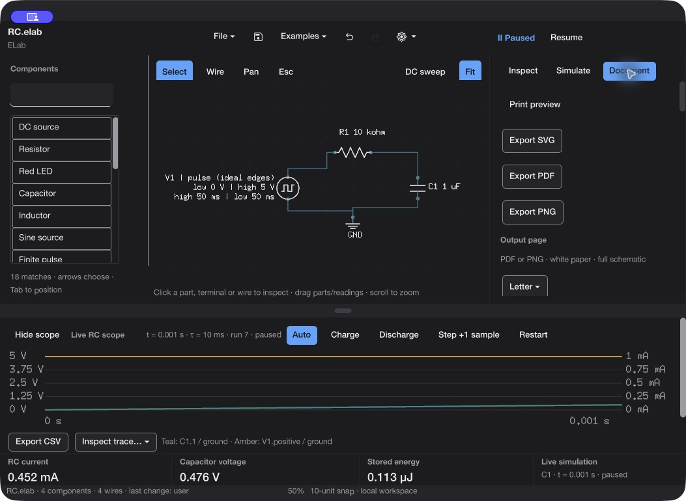

# Native document workspace — before and after

Captured through CUA from owned test copies of ELab. The final screenshots use the ZIP-extracted **0.180.0 /198** app. The app and matching agent are unchanged from clean source `063ea93567f477aa0ccf91bf22557e057136ec51`.

| Before (/196) | After (/198, light) |
| --- | --- |
|  |  |

The captures show visual hierarchy, control organization and readable bounds. Their window heights and circuit values differ; they are not a quantitative usability or electrical comparison. The final light capture follows a native inspector edit from 10 kΩ to 12 kΩ and Save. Both use a 1 µF RC circuit; the changed time constant and readings are expected.

The dark capture verifies the corrected navigation background and readable live fields/readings. The native Step action advances the paused trace. The Document inspector puts output actions first:

A [large-window capture](after/inspect-large-light.jpg) also records the selected-object inspector after value editing. It uses the macOS window Zoom action and retains fixed-width sidebars while the schematic and scope grow. The test restored the compact window before cleanup. Accessibility text beside each image records the observed controls; exact numerical and save-state checks are in [the validation receipt](../../../docs/validation/native-ui-198/report.json).

Observed limits: Vellum's managed component-list presentation remains; compact scope controls intentionally scroll; long footer filenames/actor strings can wrap. This is not full VoiceOver, IME, every-window-size or first-use acceptance. Native window/menu behavior does not imply that every custom Vellum control is an AppKit widget.
