# Guided op-amp native UI review

October 16, 2026. Actual macOS Vellum preview at 1184 × 853. These are exact native screenshots saved and inspected during this audit, including initial, intermediate and final source iterations. The dedicated preview used isolated endpoint/recovery/appearance settings. The canonical 0.105 app was not replaced. The local SDK advanced between development phases; final preview/quality evidence identifies its revision separately. These images establish observed behavior, not a controlled pixel comparison isolating SDK changes.

The selected amplifier's readings and four plot actions now precede lengthy model explanations. Feedback, input ground and supply positions were separated after checking the rendered examples. Native menus, Pause, scope collapse, canvas selection, protected example replacement and the supply plot shortcut worked. **The complete user workflow is not qualified:** mounted resistor text editing did not change the draft, several visible inspector controls/readings were absent from the accessibility tree, and a splitter tooltip remained over the bottom readings. Callback tests and agent commands do not resolve these physical-input findings.

1. **Blank launch — usable, partial.** Clear empty-state and rounded toolbar actions; disabled Undo/Redo look distinct. Component-list rows scroll within their viewport. Only part of the list is visible. Keyboard and screen-reader usability are not established by the image.

   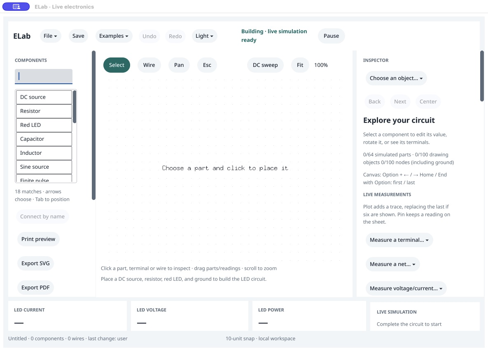

2. **Examples menu — usable.** Both new lessons appear in the actual native popup; text and menu bounds are intact. The growing flat list will eventually need organization. Menu selection was exercised through native accessibility actions; this does not prove every keyboard path.

   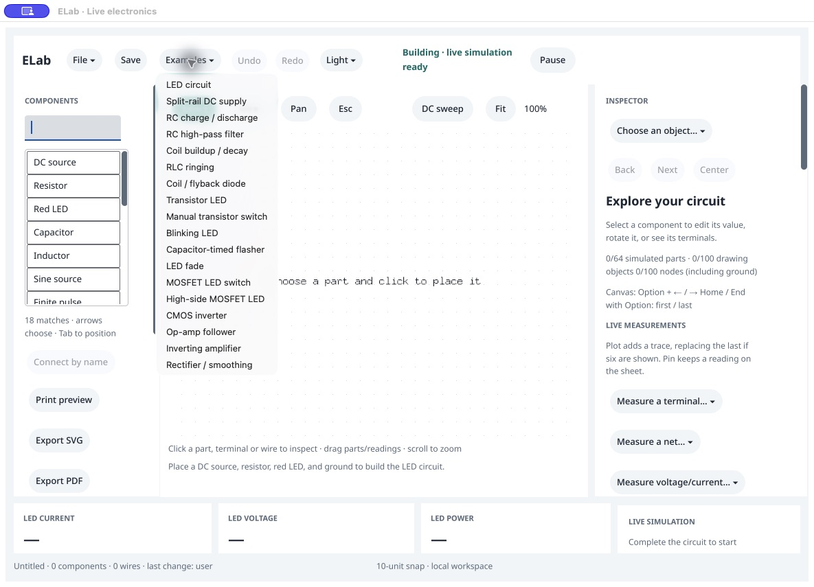

3. **Initial follower with scope — needs improvement.** Overlapping input/output is the expected buffer result, but 34% fit makes drawing text very small. Long model explanation pushes live op-amp readings and plot controls out of the opening inspector viewport.

   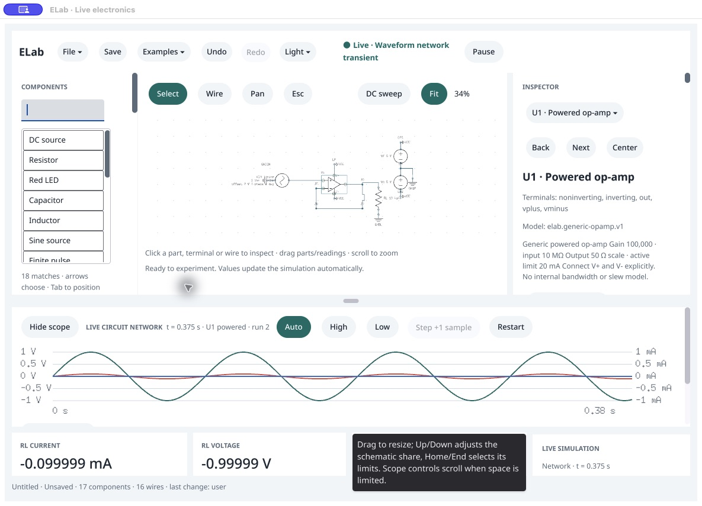

4. **Initial follower with scope collapsed — partial.** Hide scope increases fit to 49%. Main actions remain intact, but readings are still buried; source annotation and ground labeling crowd each other. Scrolling remains necessary for other controls.

   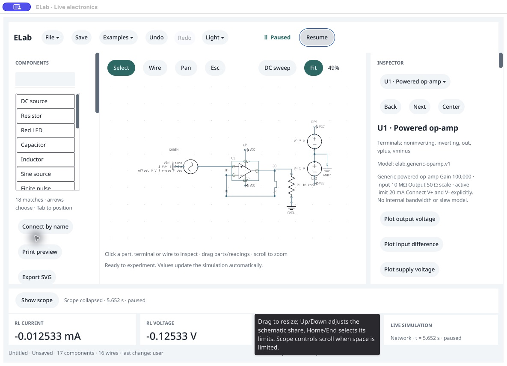

5. **Protected example switch — functionally usable, visually awkward.** The unsaved-project sheet offers Save, Discard and Cancel before replacing the generated lesson. That protection is intentional. The tall left-aligned panel, large empty area and extra Close button warrant a later dialog review. Only this audit's unchanged generated circuit was discarded.

   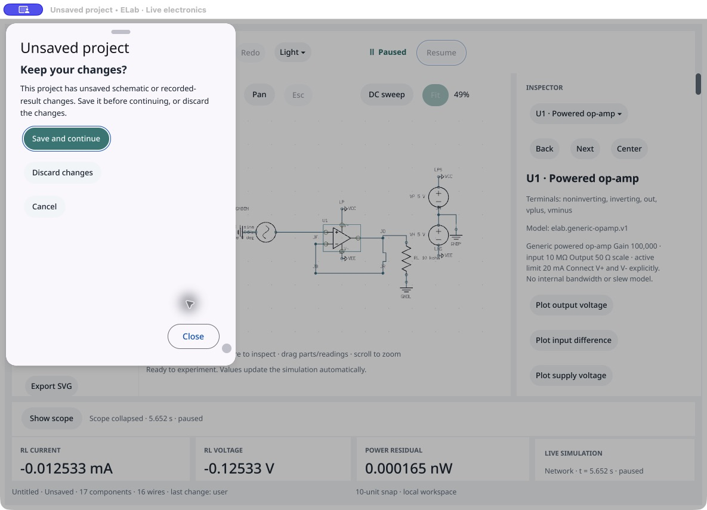

6. **Initial inverter — needs improvement.** RF's native caption overlaps the negative supply label. Long explanatory text still precedes measurements; only three of four vertical plot shortcuts fit. This screenshot supplied the layout regression target.

   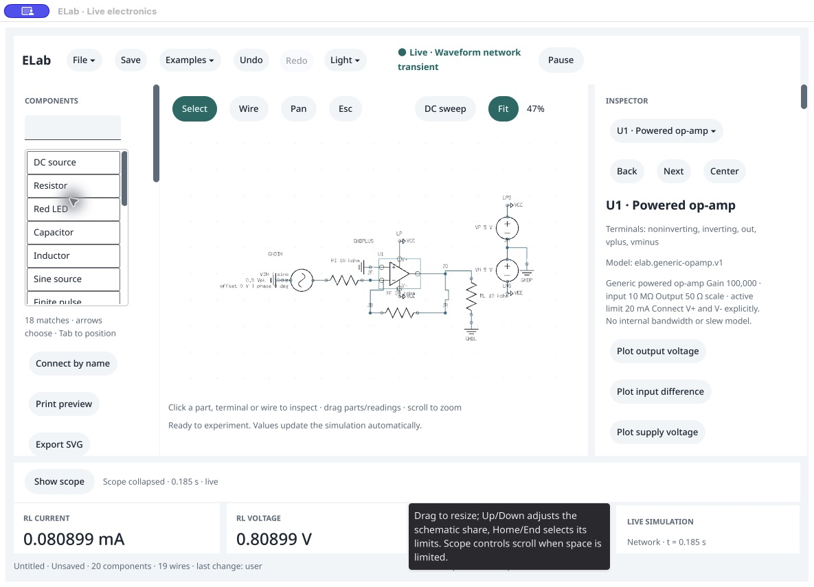

7. **Intermediate inspector revision — improved, partial.** Live output, delivered current, input difference and supply readings move above plot actions. Two compact rows retain full accessible action names. Scope-expanded fit is 42%, but feedback/supply labels are still crowded; the layout was revised again.

   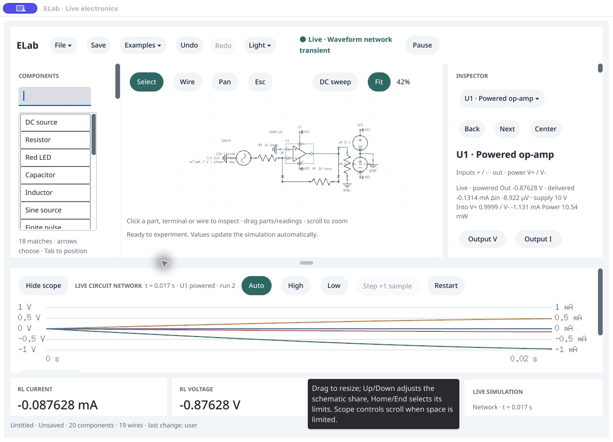

8. **Intermediate expanded canvas — partial.** Both plot rows are now visible without scrolling; the RF/VEE crowding remains. Collapsing scope produces 51% fit. This is an intermediate result, not the final layout.

   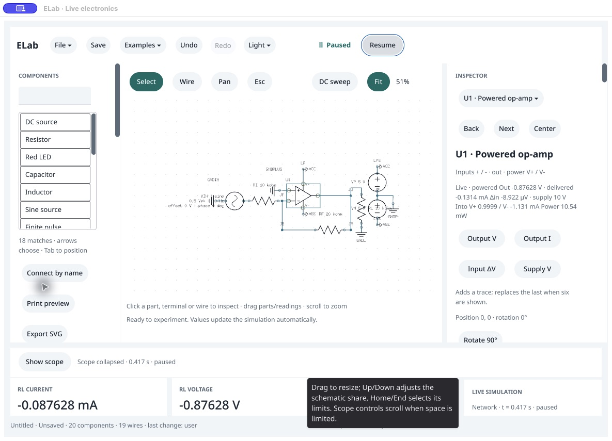

9. **Final inverter with scope — partial.** Feedback and supplies are separated; RF no longer shares the VEE caption area. Input and output show opposite signs and approximately 2:1 amplitude. Fit is 36%, so labels remain too small for comfortable reading without zooming. The splitter tooltip persists over bottom metrics even after the pointer moves elsewhere.

   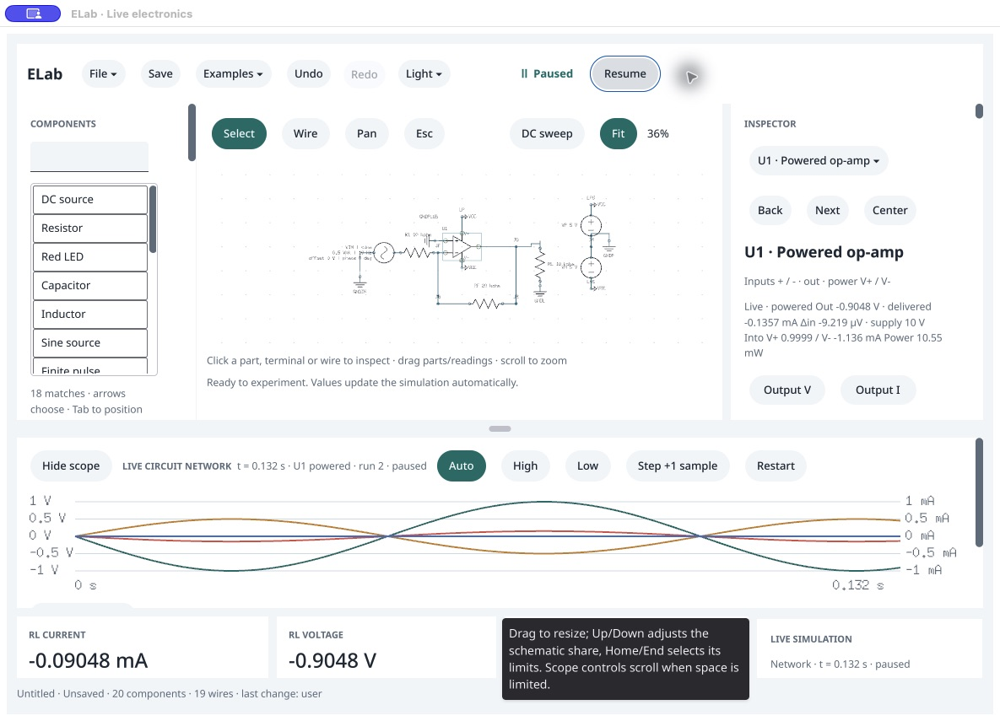

10. **Final inverter with scope collapsed and supply plot clicked — improved, partial.** Four readable shortcuts and the selected live reading fit together. The mounted supply action added `v:U1.supply` to shared state, confirmed by a read-only socket observation. The full drawing fits at 45%; text remains small and some load/supply labels are close. Tab did not demonstrate reliable focus progression in this session.

    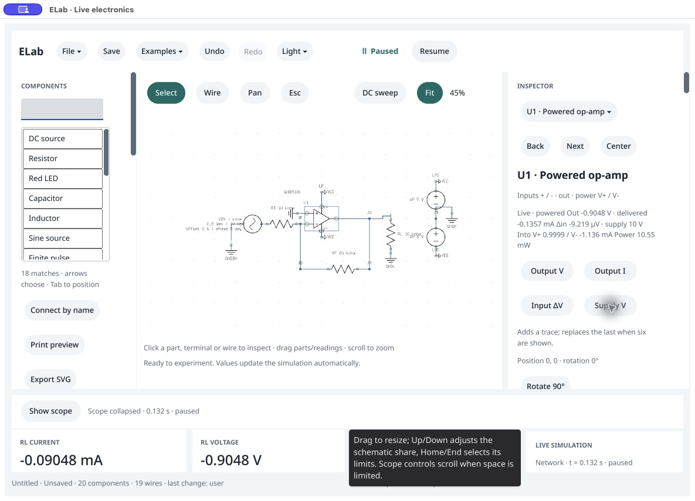

11. **Feedback value editing — unresolved.** Clicking RF on the canvas selected the correct resistor. Repeated click/select-all/type attempts against the visible field left `20 kΩ` unchanged; read-only shared state also retained that draft. The field and Apply action were absent from the exposed accessibility tree. The screenshot filename explicitly records this failed interaction. Investigate mounted input/focus/scroll routing before release; do not count source callback parity as a physical editing pass.

    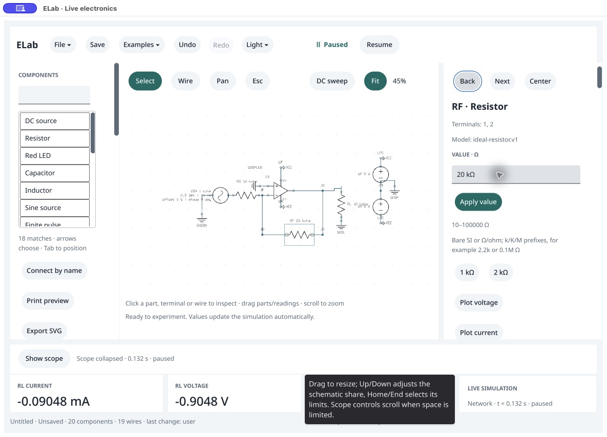

12. **Final follower and protected replacement — improved, partial.** Switching lessons again presented the guard. After discarding only the audit's generated project, the follower ran, retained the collapsed dock, and displayed live readings with all four plot controls. Supply and feedback geometry are clearer; 47% fit still needs manual zoom for detailed reading.

    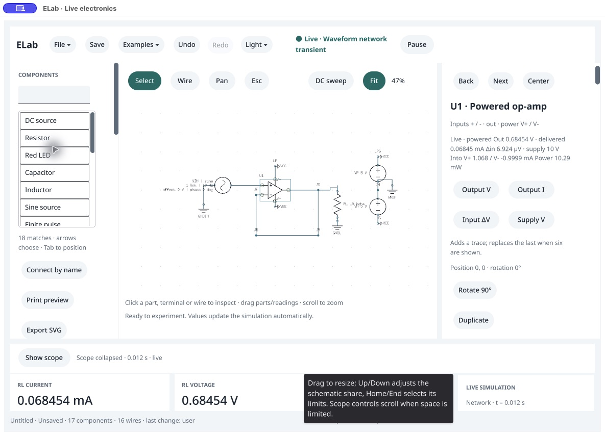

## Follow-up and evidence limits

- **P1:** reproduce the missing value-field/focus behavior in a small Vellum mounted fixture, identify whether ELab composition or the SDK causes it, and verify a physical edit/Apply/Restart cycle. Source tests already exercise the callbacks and user/agent command parity; mounted acceptance remains open.
- **P2:** dismiss the stale splitter tooltip reliably and check that tooltips cannot conceal measurements after leaving their targets. Ownership/root cause is unproven.
- **P2:** improve default schematic label readability without hiding configured source/model information or reducing the circuit scope. The final layout reduces specific collisions but trades some fit scale for separation.
- **P2:** inspect sheet sizing and duplicate Close/Cancel presentation in a separate dialog pass.

No full accessibility, VoiceOver, IME, narrow-window, dark-theme, physical printing, device-accuracy or visible-latency acceptance is claimed. No vendor model, physical bandwidth or stability claim follows from the waveforms. After this UI pass, an agent-driven experiment separately verified 101 samples per lesson, native/headless parity, capture/save/reopen and exports; those are shared-command evidence, not successful physical value editing. Disposable preview workers were closed through the guarded public shutdown command after saving only run-owned artifacts.
