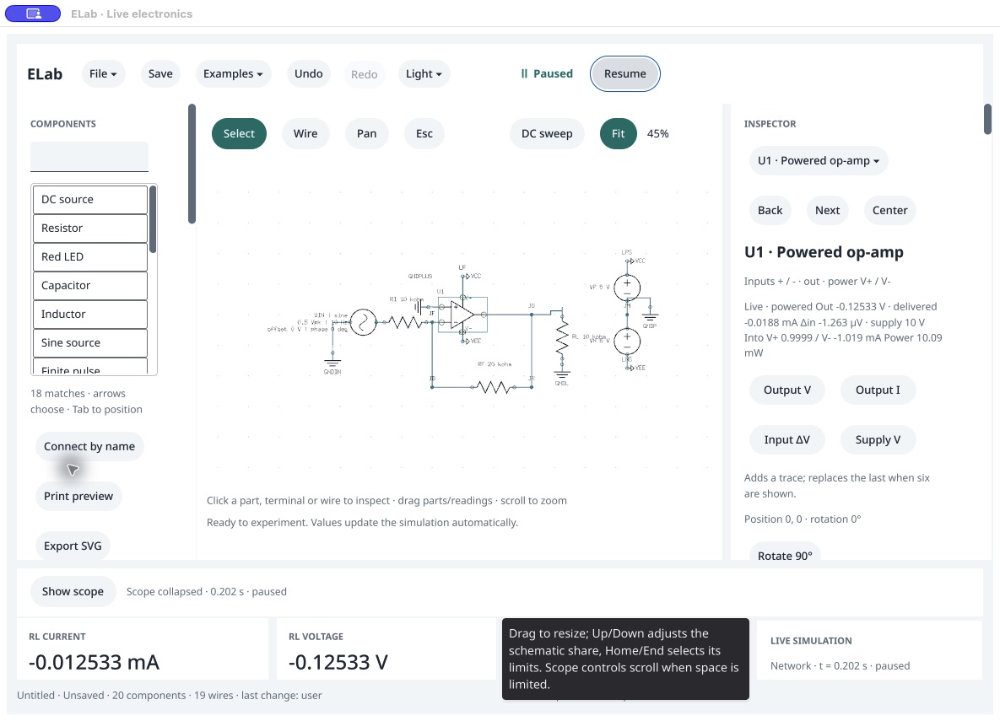
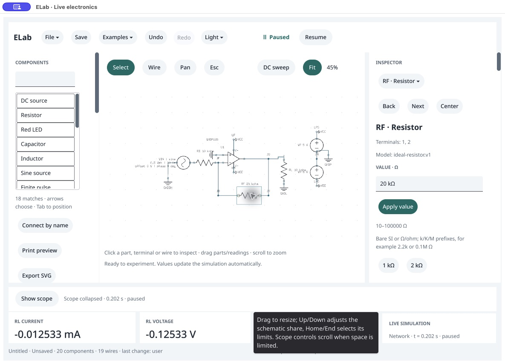
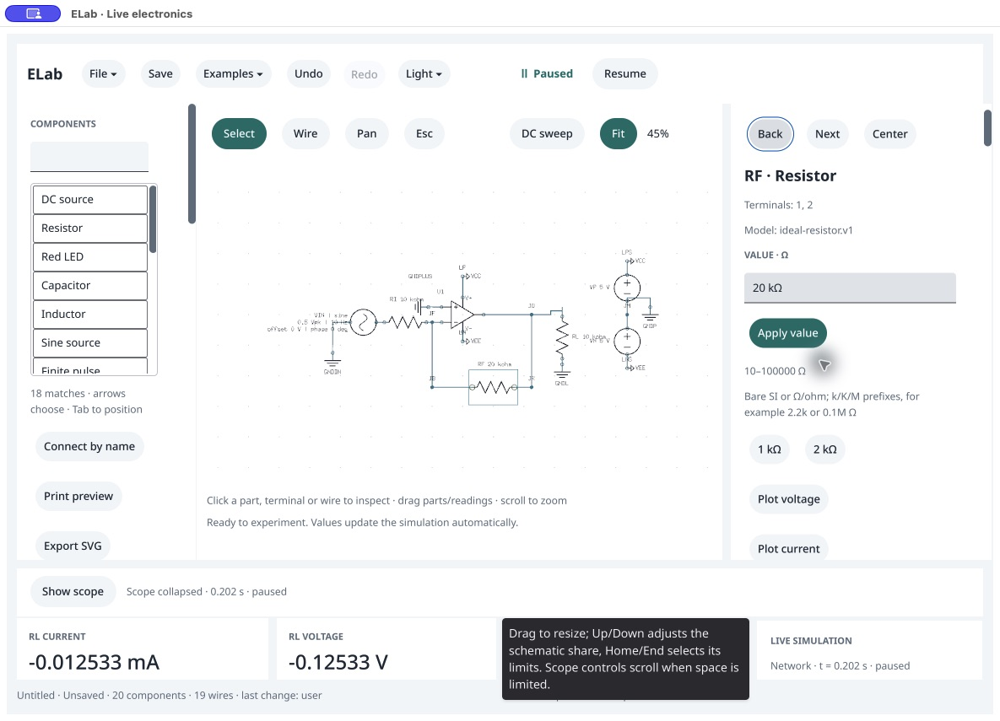

# Mounted value editor recheck

October 16, 2026. Narrow follow-up to the [guided op-amp review](../opamp-guides/README.md), using the newly built isolated native binary. The SDK's accessibility geometry code changed between 1ba954c and cdc0111; only documentation changed between cdc0111 and the recorded f1b9178 source snapshot. No SDK source was edited by ELab and no release pin/app was promoted. Actual native captures remain 1184 × 853.

1. **Load, pause and collapse scope — usable, partial.** The native example menu loaded the inverter; Pause and Hide scope worked. Live op-amp measurements and four plot shortcuts are visible. Small schematic labels and the stale splitter tooltip remain.

   

2. **Select RF and inspect editor — partial.** Clicking the drawn feedback resistor selected RF and showed the 20 kΩ editor. Its field and Apply action were still missing from the exposed accessibility tree. A direct click on the visible value field left focus on the schematic rather than establishing an accessible editor focus.

   

3. **Type 10k — unresolved.** Select-all/type attempts left the visible draft at 20 kΩ; subsequent AX output reported focus on Previous schematic object. A read-only public-state query confirmed `selected: RF`, draft `20 kΩ`, component value 20,000 Ω and unmodified template identity. This is a failed mounted interaction, not a successful edit. Root cause and ELab/SDK ownership remain unproven. The unchanged generated session was then closed through the guarded public command.

   

This recheck establishes that the particular newer SDK change did not resolve the observed editor behavior. It does not establish full accessibility, pointer/keyboard, IME or screen-reader qualification. Agent and callback editing still work; those paths cannot replace the missing physical editing evidence. Investigate a minimal mounted inspector/scroll reproduction before releasing the op-amp app.

Subsequent [direct Cocoa/event tracing](../value-apply/README.md) narrows these findings: the field/button do exist in native Cocoa children, while external AX still omits them. An event/hardware-cursor mismatch and Apply-before-field-commit ordering were reproduced separately. The ELab settlement repair passes a scoped physical edit/gain experiment on an isolated pointer prototype; dependency integration and full release/input/accessibility gates remain open.
