# Amplifier canvas and schematic output review

October 17, 2026. The guided amplifier exports now keep the source, supply and ground captions separate and the feedback wires visible. The native workflow works in this scoped run, but fitted text is still too small and external accessibility coverage remains incomplete. The candidate is **not promoted**.

This run uses the private Vellum SDK pinned at `aa9d023243a6bded514c3d9696c08a9c917119c4`. The ordinary 0.106.0 /121 candidate is `build/ELab-0.106.0-121-candidate3.app`. The inspected `ELab-output-preview.app` uses a separate launcher that execs a byte-identical candidate host with `--no-recovery --no-appearance` and a private agent endpoint. The launcher has no UI or simulation overlay. Its bundle is an inspection fixture, not the distributable candidate. Normal saved window geometry was restored: the saved PNGs measure **1185 ×855 pixels**, and do not prove fresh-default sizing. CUA reported an unusually long `getApp` observation; it is not a launch benchmark.

1. **Open an empty sheet — usable, partial.** Header actions have complete captions. Output actions and parts are discoverable in the left rail. The component list still has strong box borders and nested scrolling; its partially visible last row is a scroll boundary. This capture does not prove every control fits every window size.

   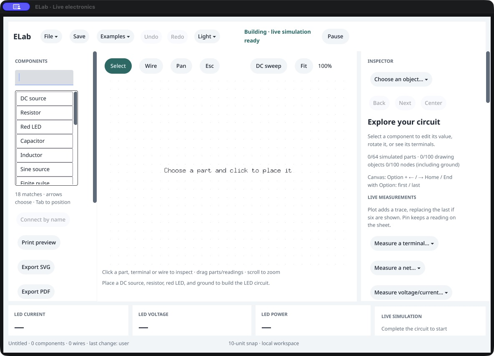

2. **Open Examples — usable.** The native menu exposes both amplifier examples, MOSFETs and earlier lessons. All entries fit in this capture. The rounded menu is distinct from the boxed component list; no menu restyling was introduced in this checkpoint.

   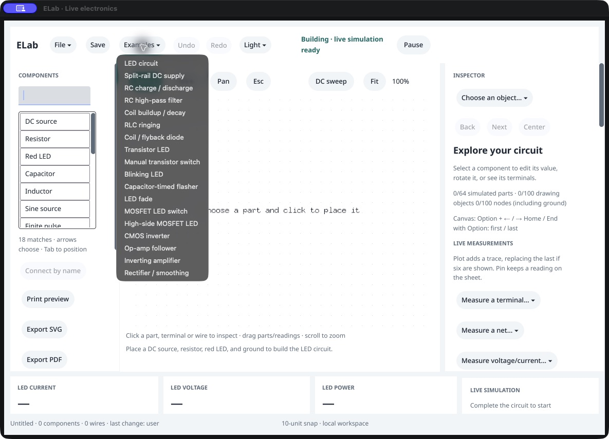

3. **Load follower and pause — partial.** A real menu click loads the follower and the four scope traces. The first Pause click left `paused:false` in a read-only public query; a second fresh-tree click paused successfully. Do not infer a cause or universal pointer acceptance from that sequence. The image below is the first, still-running state. A large component-list help tooltip persists over the upper workspace.

   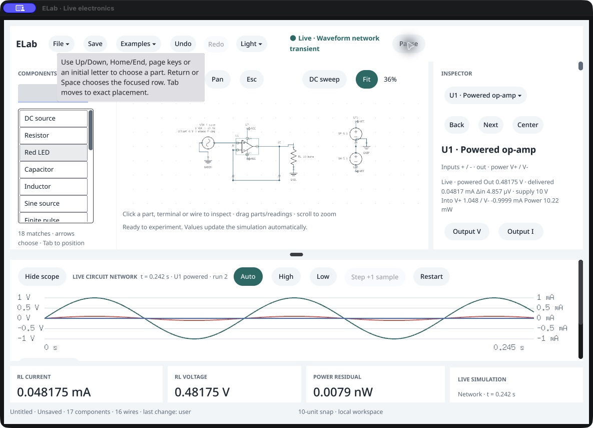

4. **Hide scope — usable, readability unresolved.** The native action expands the schematic, retains the paused run, and follows the registered viewport. Fit grows from approximately 36% to 43%, but bitmap captions remain very small. Keeping everything on screen does not meet the hobbyist readability goal by itself. The help tooltip remains visible despite interacting elsewhere.

   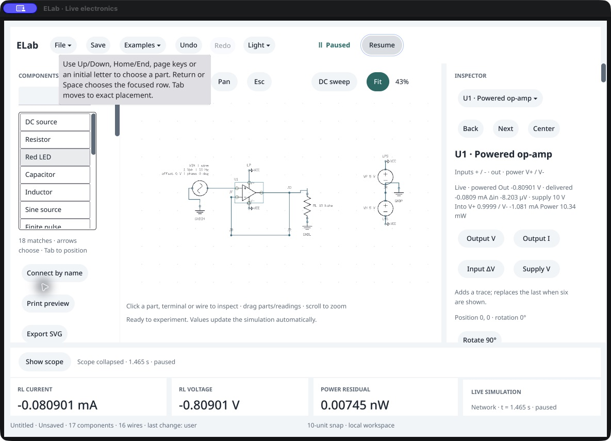

5. **Inspect inverter — usable, partial.** An external agent loads the inverter through guarded `example.load`, pauses/restarts and steps 25 ms. The inspector and cards show approximately **−0.999969 V**, with the same model and physics used by native controls. A native Fit click is accepted and preserves physics. The source and reference branch now have room, although fitted native labels remain hard to read. The exact public snapshot is retained in owned build evidence; this is not a physical value-edit test.

   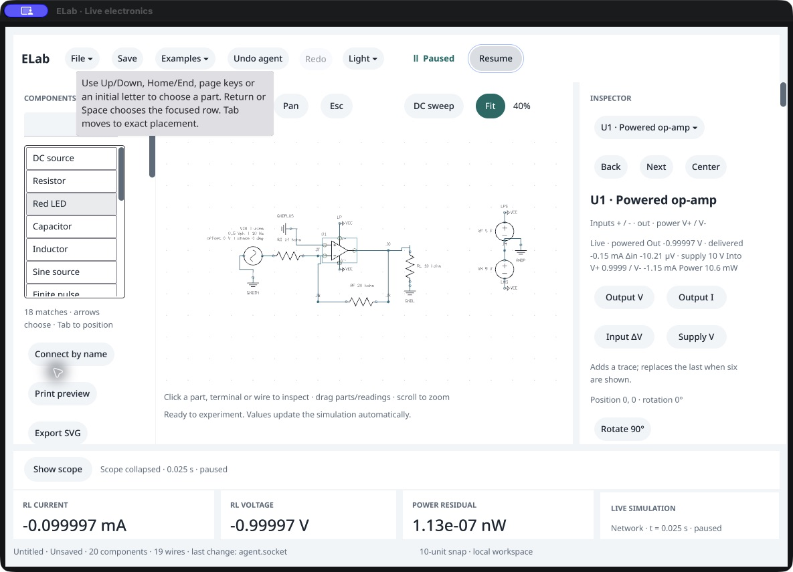

6. **Open Print preview — usable, device acceptance open.** A native click displays the complete captured Letter landscape page and the page/output controls. The tooltip clears when this workspace replaces the canvas. The exact shown PNG is exported through `preview_id`; the graph, physics, document and undo history match the pre-preview state. No printer job is submitted. The disposable UI host is then closed through the guarded public command.

   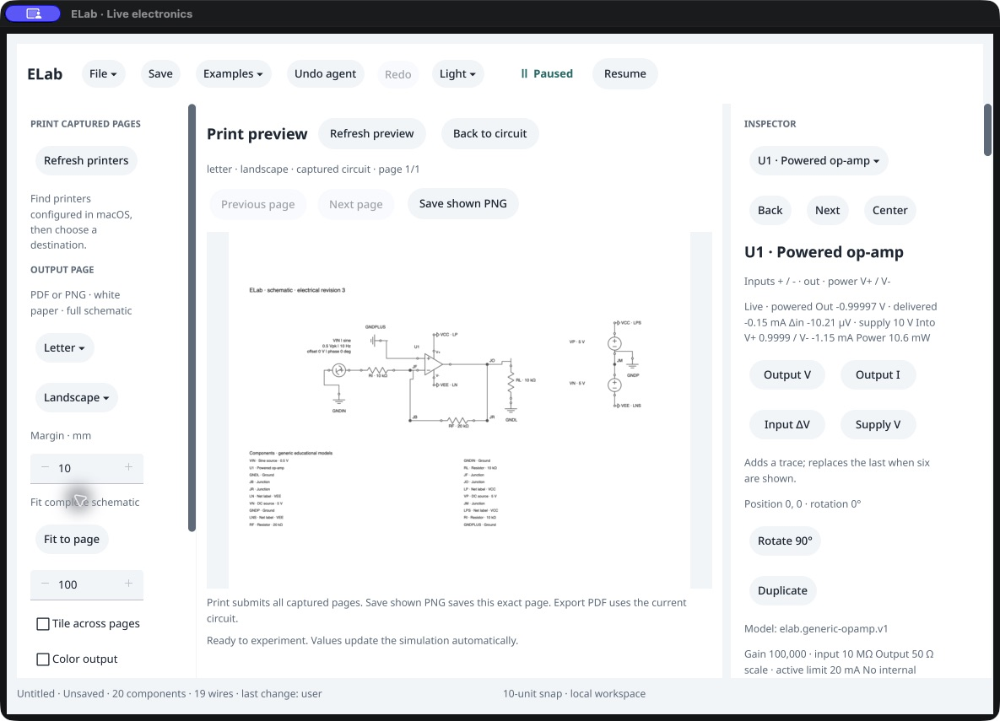

## Output defects repaired

The initial exports overlapped VN's supply value and RL's caption, placed the rotated ground caption on its connection, and put the horizontal sine caption across its return lead. A first adjustment still collided with the inverter ground label. Independent rendering also exposed a resistor caption mask hiding the feedback wire. The final source right-aligns horizontal waveform blocks above the terminal leads, shares rotation-aware ground baselines between canvas and output, and spaces the curated input/reference/supply branches. Electrical topology, values, model equations and public command identities are unchanged.

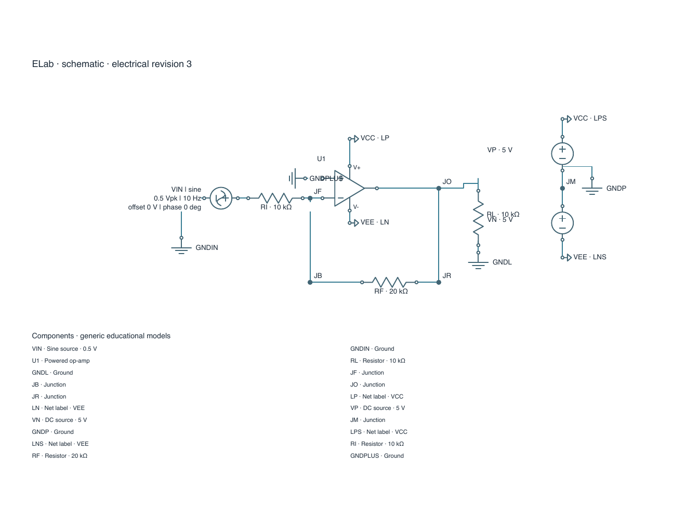

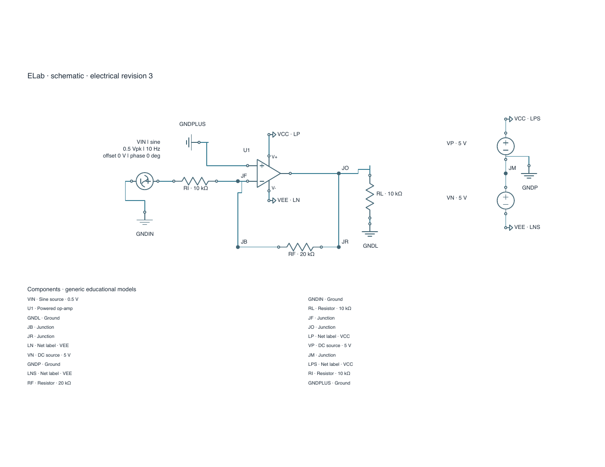

The public output workflow exercises both lessons, every sine-source/ground rotation, A4 portrait grayscale and a four-page Letter grid with 5 mm overlap. All **10 captures /13 pages** preserve source state and match their captured preview PNG bytes. Native and headless SVG/PNG files match exactly. The PDFs differ only in two Quartz timestamps and the trailer's document-ID pair; every remaining byte and non-date metadata field matches. These PDF differences are retained in the original files rather than rewritten.

All 13 PDF pages were rendered independently with Poppler. The four contact sheets below were inspected, together with full-size follower, inverter and grayscale pages. The reviewed fixtures have complete captions, continuous unmasked wires, and uncropped one-page output. Tiled page edges intentionally cut the continuous drawing; the repeated 5 mm areas and page/row/column footers support assembly. This does not prove arbitrary automatic layout or physical paper margins.

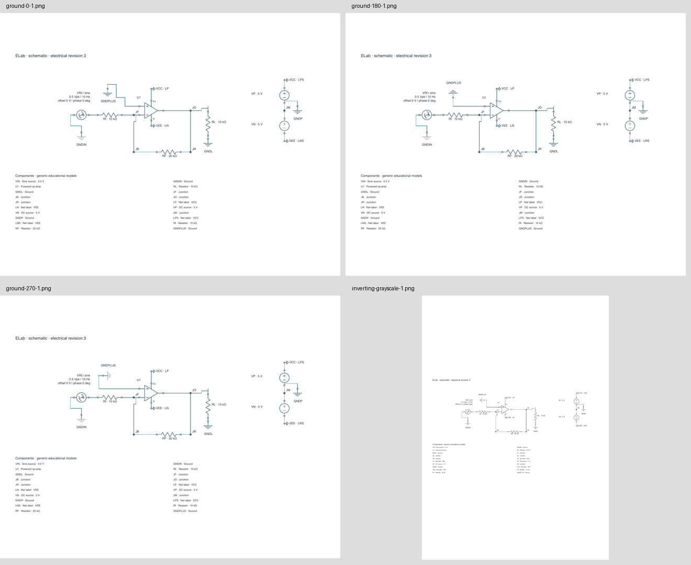

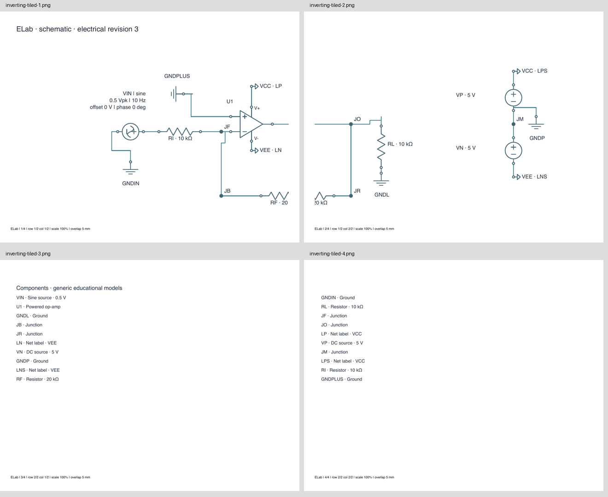

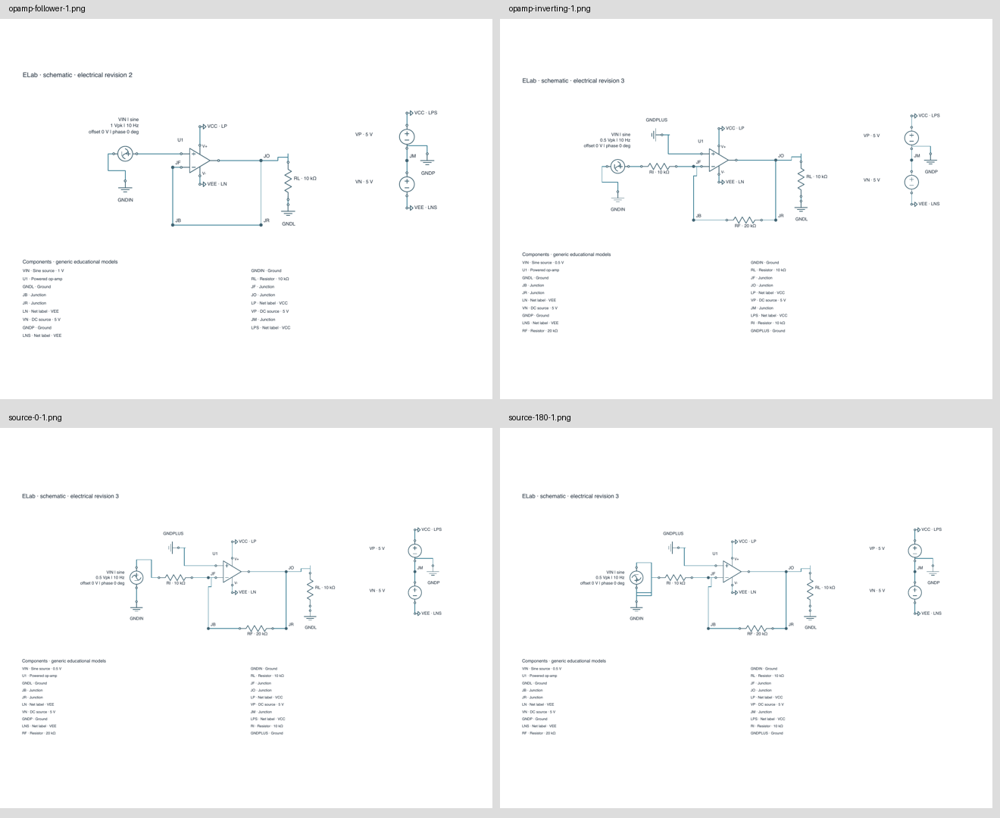

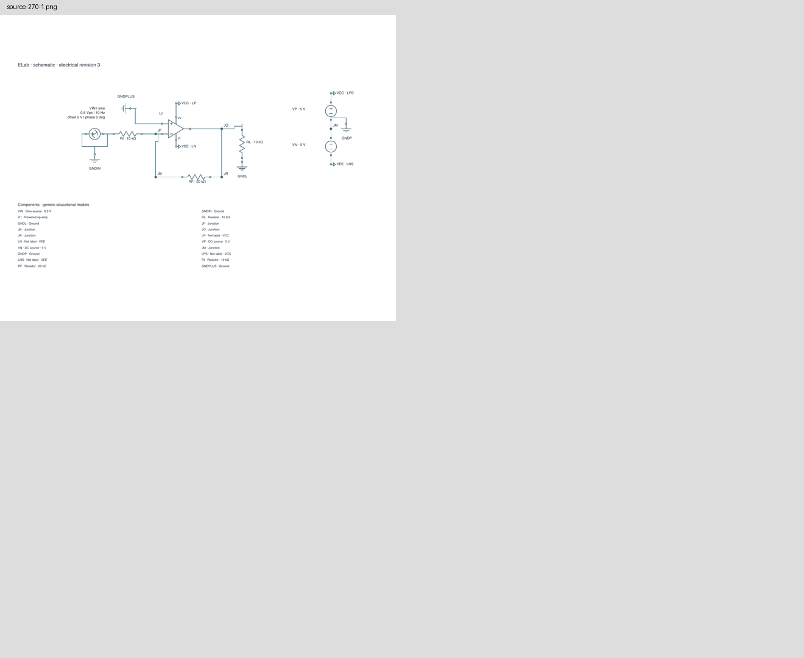

## Accessibility and remaining work

The menu, scope visibility, Fit and preview have named AX actions in the observed tree. Several visible inspector leaves remain missing from the external tree, as in earlier audits. Tiny fitted captions are a visible readability risk; the tooltip can obscure navigation. Screenshot inspection cannot qualify screen-reader order, keyboard-only completion, text-entry/IME behavior, contrast across themes or all pointer paths. Recheck those explicitly before release. Other layouts can still produce overlaps or routing fallback; the new mask-continuity tests cover the curated amplifier graphs and rotations, not a general layout guarantee.

The ordinary candidate passes packaged smoke and all four public electronics adapters. Numerical/reference and failed-file evidence matches the prior storage qualification after only the explicitly reviewed coordinates and variable `operation.inspect` polling are accounted for. The canonical 0.105 app and preserved 0.104 app retain all previous file bytes and modes. [Qualification receipt and reproduction evidence](../../../docs/validation/opamp-output-validation.json).
