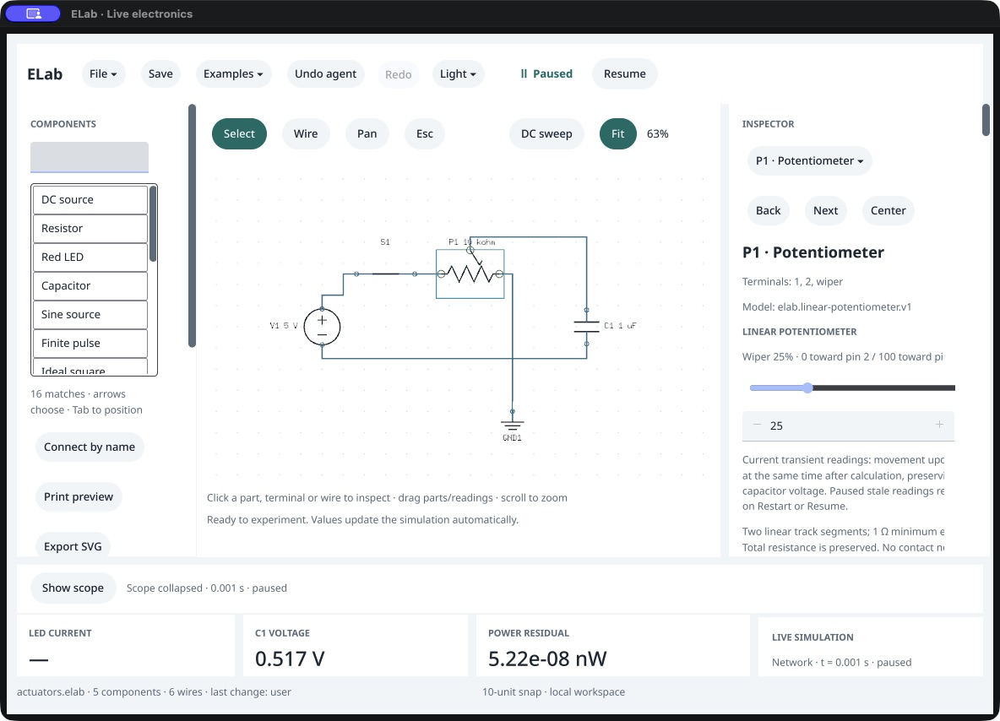
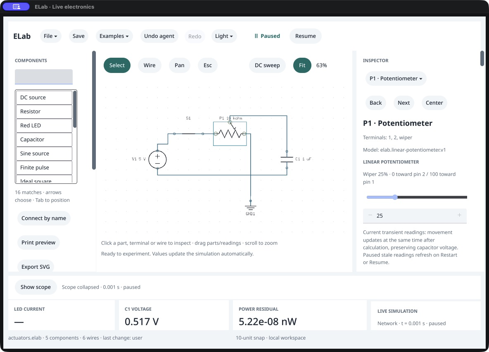
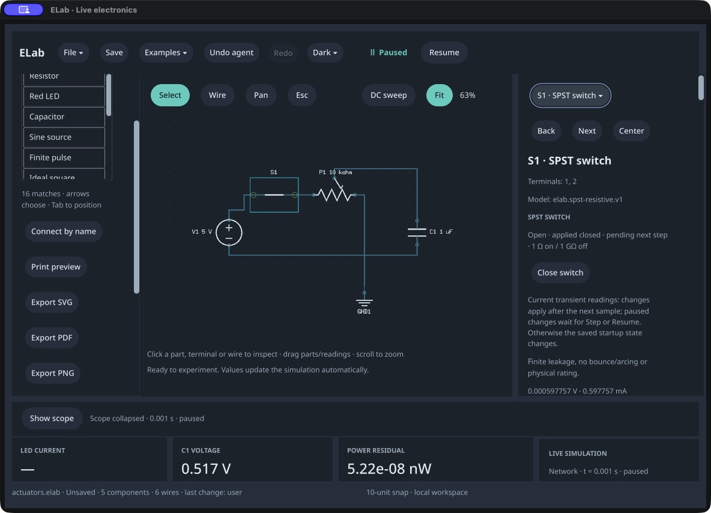

# Rail text containment

October 16, 2026. Scope: the current-run default macOS window with the shared switch/potentiometer/RC fixture, plus actual mounted text-shaping measurements. Baseline app: 0.100.0. Candidate: 0.101.0 /116. This is a bounded repair, not full responsive-layout or accessibility acceptance.

1. **Baseline — clipping reproduced.** The wiper endpoint label cuts off `pin 1`, and explanation lines lose words at their right edge. The source contains the complete wording. [Baseline](01-clipped-before.png).
2. **Selected wiper — repaired.** The endpoint label now wraps to two complete lines. The transient explanation wraps to five lines with its full ending. Fields and navigation remain visible. [Candidate](02-contained-after.png).
3. **Lower readings — repaired in this fixture.** Tab reaches the percentage field; Return without editing advances to the resistance field and scrolls the lower inspector into view. Model limitations and signed live readings wrap without the previous right-edge cuts. Native whitespace behavior still collapses embedded newlines; this repair does not introduce a new reading-row layout. [Lower readings](03-readings-after.png).
4. **Dark theme — verified visually.** The session-only theme command preserves graph, physics, history and document. The contained labels retain their foreground styling and complete wording. [Dark readings](04-dark-readings-after.png).
5. **Pending switch — verified visually.** Desired-open/applied-closed/pending-next-step text and the actuation explanation wrap completely. The Close switch action remains reachable. The selected switch was configured by the public agent commands; this is not a new full keyboard construction test. [Dark switch](05-dark-switch-after.png).

The native regression measures the actual `core.Text.PaintText` bounds after mounting through Vellum. Before containment, all three labels received 278 px allocation but only 239 px actual content width; their shaped right edges were 255.28125, 273.125 and 266.8125 px. After containment, the endpoint label fits at 227.40625/228 px and the explanation/model at 233.64062/234 and 233.78125/234 px. Complete normalized source text is retained, no truncation flag is set, and each right edge fits with at most one pixel rounding allowance. This measures these labels, not every string or display size.

The repair gives each constrained rail label a passive bounded column so wrapping sees a consistent width. Original label IDs/text/semantics and callbacks remain. Container IDs use a colon-prefixed private namespace to avoid collisions with component-derived names such as `X` and `X-bounds`. Repeated layout does not nest containers. Tests preserve literal text, focus order and command callbacks. The whole native ingress inventory remains semantically identical apart from source line shifts.

Accessibility: CUA still omits several visible live-inspector controls from its tree. In a separate incomplete-potentiometer smoke fixture, Vellum's public Cocoa inspection reports the six selected controls/labels as present and enabled; some offscreen frames are empty. Those are different fixtures, not a matched cross-tool comparison. This narrows the evidence but assigns no cause and does not prove screen-reader or complete accessibility behavior. Raw CUA observations and native probe records remain in build evidence; the compact receipt retains their hashes.

The Vellum checkout advanced from `cebae61` to `6330b2d` during the pass. Review found a parent-graph validation optimization, associated tests/reports and no text-layout or simulation changes; prepared dependency hashes remain unchanged. Final checks/build/native validation use the new clean checkout. No SDK files were edited here.

Remaining limits: arbitrary long unbroken identifiers, every window/font/zoom combination, full pointer/wheel, typing/IME/focus, screen-reader, visible latency and participant qualification remain open. Longer paragraphs require vertical scrolling. All screenshots were captured through CUA, saved unchanged and inspected from their files.

