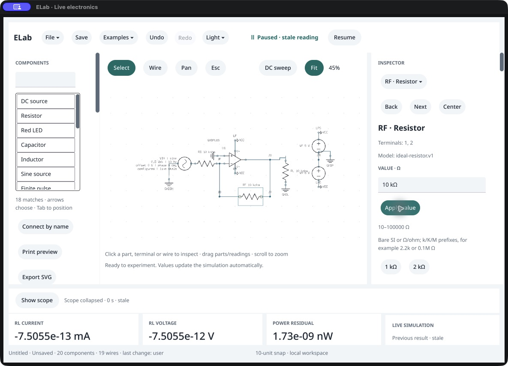
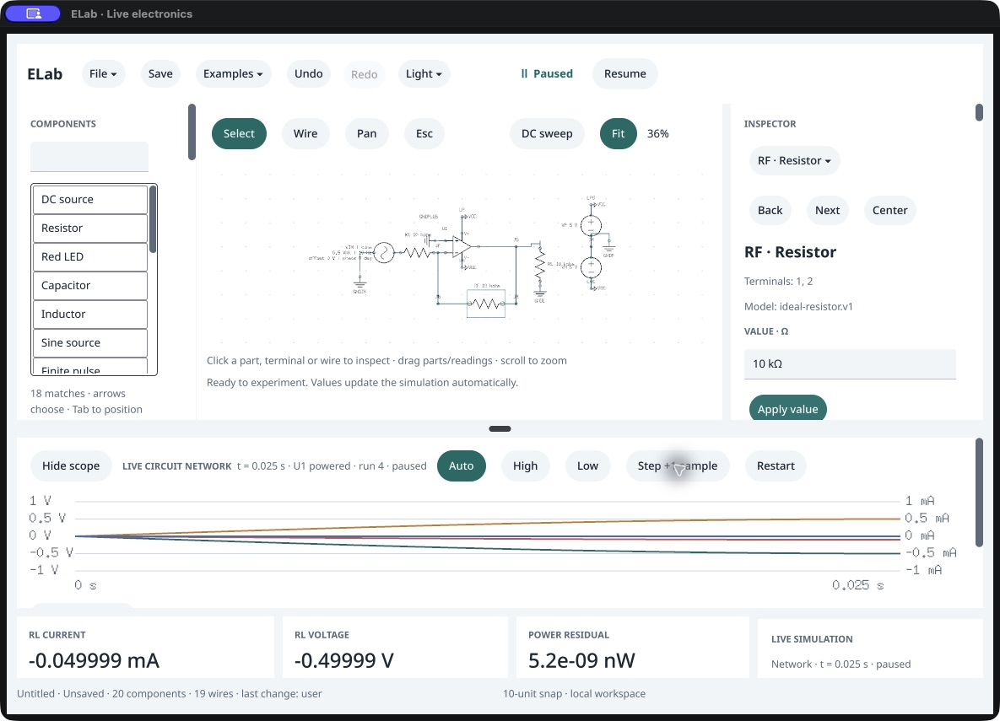

# Native value Apply investigation

October 16, 2026. Engineering follow-up to the [failed mounted recheck](../opamp-mixed/README.md). This narrows earlier observations: **the value field and Apply button exist, are visible in the actual widget tree, and are present in Cocoa's accessibility children.** The external CUA accessibility snapshot still omits those component-specific leaves. This discrepancy does not prove that ELab omitted their native accessibility nodes. Full external accessibility qualification remains open.

The isolated preview used Vellum `f1b917892d70479b7a30a5854e61e41189fdda50`, the prior ELab source plus the exact [diagnostic patch](../../../docs/validation/value-apply-diagnostic.patch), and a prototype event-position hook. [Input hashes and verified reconstruction](../../../docs/validation/value-apply-diagnostic-sources.json) bind the compiled changed sources. Trace-only logging and the prototype helper were confined to ignored diagnostic builds; ELab changed neither the shared SDK nor the canonical app. The prototype is **not a qualified dependency release**. Go's overlay mechanism did not compile the proposed SDK Objective-C file; the actual helper was compiled in the diagnostic app's own Objective-C file, as recorded in the source receipt.

1. **Route the native event — confirmed in the diagnostic build.** CUA delivers an event at the value field while the hardware pointer stays elsewhere. The original upstream mouse-button path reads the hardware cursor. The prototype reads the current matching window's mouse event, converts its content-view coordinates, and retains the old hardware fallback for other calls. Press/release now hit the same field/button widget. [Trace](event-trace.txt) and [direct Cocoa/widget inspection](native-inspector.json) distinguish event delivery, geometry and external accessibility observations. Full hover/drag/scroll/multiple-window/fallback qualification and integration through Vellum's pinned patch pipeline remain required.

2. **Type and Apply — repaired in ELab source, confirmed on the prototype.** The earlier diagnostic reached the Apply callback but submitted the rendered `20 kΩ` before the final field Change arrived. ELab now uses `SettleTextField` before Apply, passing the final text through the existing guarded `editor.value.set` and `component.set` commands. Select-all was visually checked before typing; after `10k` and one Apply, RF is **10,000 Ω**, the example is edited, and the paused result is explicitly stale.

   

3. **Restart and inspect the gain — confirmed.** Show scope, Restart and 25 physical Step clicks reach **25 ms**. Input is **+0.5 V** and output **−0.4999898606 V**. The scope, bottom reading and [read-only public inspection](02-public-inspect.json) agree. Semantic agent commands prepared the generated inverter and paused/collapsed it; CUA performed canvas focus, editor click/select-all/type/Apply, Show scope, Restart and all Step actions. This is not a from-blank construction test.

   

The [external AX snapshot](02-external-ax.txt) still lacks the value field/Apply leaves. Small fitted labels, stale tooltip behavior, keyboard/IME and complete accessibility remain open. This scoped pass does not close release acceptance. Canonical 0.105.0 /120 and preserved 0.104.0 /119 retain their qualified byte/mode trees.
